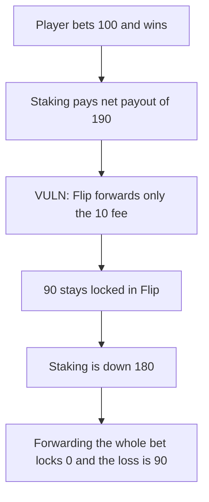

# Coinflip — a winning bet leaves 90 tokens locked in Flip

> **Vulnerability classes:** vuln/dos/frozen-funds · vuln/logic/fee-calculation

<!-- non-defihacklabs -->
<!-- source-auditvault: https://github.com/Auditware/AuditVault/blob/main/findings/55483-c-02-bet-amount-remains-locked-in-the-flip-contract-when-pla.md -->
<!-- date: 2025-02 -->

## Key info

| | |
|---|---|
| **Protocol** | Coinflip |
| **Finding** | Pashov Audit Group, AuditVault 55483 |
| **Vulnerable code** | win settlement in `Flip` |
| **Harm** | A 100 bet at a 10% fee locks 90 in Flip. Staking pays 190 and receives 10, a loss of 180. Returning the whole bet locks 0 and the loss is 90. |
| **Chain** | local synthetic |

## TL;DR

On a win, Flip forwards `stakingFee = fee - managerFee` and leaves the rest of the bet where it sits. The report's numbers are a 100 bet, a 10% fee, and a 0 manager share, so 10 moves and 90 stays. Staking still pays the 190 net payout. Its balance falls by 180. The recommended transfer is `betAmount - managerFee`, which returns 100 and leaves Flip empty. Staking then falls by 90, the fair payout.

## The vulnerable code

```solidity
uint256 managerFee = (fee * 0) / BPS;
// @> VULN: only the fee is forwarded; the rest of the bet stays here
uint256 stakingFee = fee - managerFee;
if (stakingFee > 0) {
    token.transfer(address(staking), stakingFee);
}
```

The report replaces `stakingFee` with `stakingAmount = game.betAmount - managerFee` and always transfers that amount.

## Root cause

The amount returned to staking is the fee, not the bet minus the manager's cut. The winning payout is still the full net payout, so the unreturned bet cannot back later games.

## Preconditions

The player bets 100. Fee is 10% and the manager win fee is 0. The published path is a win on one coin. This reproduction settles that win directly. The randomness callback is not the bug. Staking starts with 1000 so it can pay 190. Any player can take the path.

## Attack walkthrough

1. Bet 100. Flip holds 100.
2. Settle the win. Net payout is 190. Staking sends 190 to the player.
3. `stakingFee` is 10. Flip sends 10 and keeps 90.
4. Staking's balance is 820.
5. The fixed Flip sends `100 - 0 = 100` and ends at 0.
6. That staking pool ends at 910. The gap versus 820 is the locked 90.

## Diagrams



## Impact

Every settled win freezes `bet - fee` inside Flip. On these parameters that is 90 of the 100, and the staking pool that pays winners is 90 shorter than the payout alone requires. The fixed forward leaves nothing stuck and the pool is short only the 90 of player profit.

## Remediation

Transfer `betAmount - managerFee` to staking, not `fee - managerFee`.

## How to reproduce

```bash
cd 55483-c-02-bet-amount-remains-locked-in-the-flip-contract-when-pla_exp
forge test -vv
```

## Sources

- AuditVault finding: https://github.com/Auditware/AuditVault/blob/main/findings/55483-c-02-bet-amount-remains-locked-in-the-flip-contract-when-pla.md
- Pashov report: https://github.com/pashov/audits/blob/master/team/md/Coinflip-security-review_2025-02-05.md
- Reviewed tree: https://github.com/play-turbo/coinflip-contracts/tree/e8bc317e5cb0a7b27c91d23fc47c83b4524bfa8e
