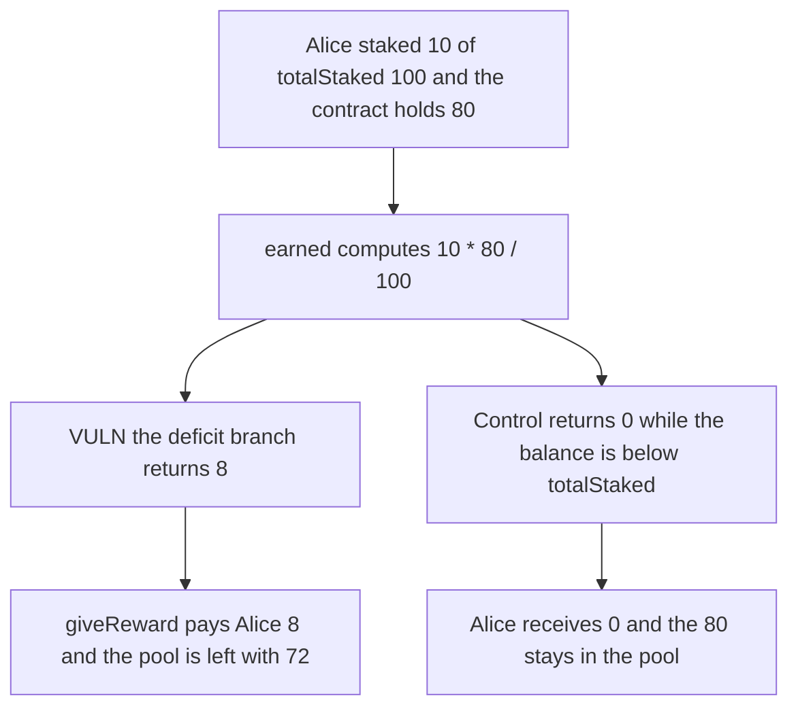

# Coinflip staking pays a reward out of a pool that is already in deficit

> **Vulnerability classes:** vuln/arithmetic/reward-calculation · vuln/defi/reward-distribution

<!-- non-defihacklabs -->
<!-- source-auditvault: https://github.com/Auditware/AuditVault/blob/main/findings/55484-h-01-stakingearned-calculates-the-rewards-wrongly-pashov-aud.md -->
<!-- date: 2025-02 -->

## Key info

| Field | Value |
|---|---|
| **Loss** | Alice is paid 8 FLIP. She staked 10 of 100 and the contract holds 80, so the pool is in deficit |
| **Vulnerable contract** | `Staking.earned` |
| **Attacker EOA** | `0x1111111111111111111111111111111111111111` |
| **Attack contract** | `Exploit` at `0x15452ec016c4dc8c549e7fe6ff4b26324ea8b7a4` |
| **Attack tx** | `Exploit.run()` |
| **Chain / block / date** | Ethereum model · block 0 · 2025-02 |
| **Compiler** | solc 0.8.27, cancun, via IR |
| **Bug class** | `earned` returns the user's share of the remaining balance while `balance < totalStaked` |



## TL;DR

`earned` does `staked * 1e18 / totalStaked * balance / 1e18`. When the token balance is below `totalStaked`, the quoted function returns that share. The recommendation returns 0 until the pool is whole again.

Alice's stake is 10, `totalStaked` is 100, and the contract holds 80. Her share of the remaining balance is 8. `giveReward` transfers those 8 FLIP. The fixed `earned` returns 0, Alice receives nothing, and the pool stays at 80.

## The vulnerable code

```solidity
uint256 userShare = stakedBalances[user] * 1e18 / totalStaked * totalTokenBalance / 1e18;
if (totalTokenBalance < totalStaked) {
    return userShare; // @> VULN: a loss still pays the user their share of the remaining balance
}
```

## Impact

A distribution during a deficit pays depositors out of principal that is already short. Here that payment is 8 FLIP, and the pool falls from 80 to 72 against 100 staked.

## How to reproduce

```bash
cd 55484-h-01-stakingearned-calculates-the-rewards-wrongly-pashov-aud_exp
forge test -vv
```

`test_exploit_deficit_pays_8` asserts Alice holds 8 and the pool holds 72. `test_control_deficit_pays_0` asserts the fixed path pays 0 and leaves 80.

## Sources

- AuditVault finding: https://github.com/Auditware/AuditVault/blob/main/findings/55484-h-01-stakingearned-calculates-the-rewards-wrongly-pashov-aud.md
- Pashov report: Coinflip security review, 2025-02-05
