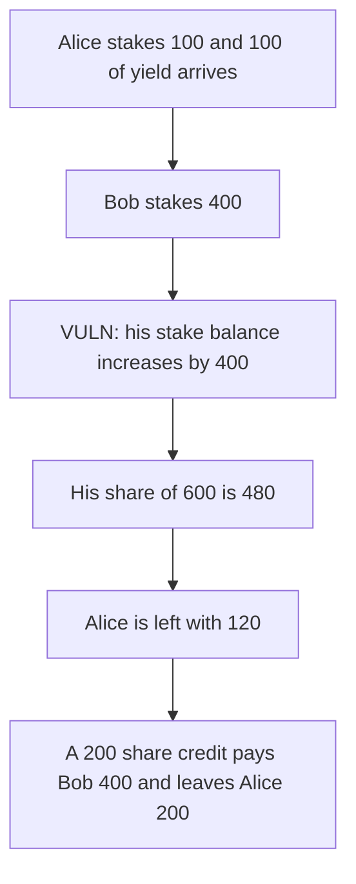

# Coinflip staking — a later deposit takes 80 of an earlier staker's yield

> **Vulnerability classes:** vuln/logic/reward-calculation · vuln/logic/state-update

<!-- non-defihacklabs -->
<!-- source-auditvault: https://github.com/Auditware/AuditVault/blob/main/findings/55486-h-03-users-can-potentially-steal-other-users-staking-rewards.md -->
<!-- date: 2025-02 -->

## Key info

| | |
|---|---|
| **Protocol** | Coinflip staking |
| **Finding** | Pashov Audit Group, AuditVault 55486 |
| **Vulnerable code** | `Staking.stake` credits the raw deposit |
| **Harm** | Bob deposits 400 after the pool has doubled and withdraws 480. Alice's 200 of value falls to 120. A share-adjusted credit pays Bob 400 and leaves Alice 200. |
| **Chain** | local synthetic |

## TL;DR

`stake` adds the deposited amount to `stakedBalances`. `unstake` then pays `userStaked * balance / totalStaked`. Alice stakes 100. Yield of 100 arrives, so her claim is 200. Bob stakes 400 and is credited 400, not the 200 shares that the 2:1 ratio would give. His share of the resulting 600 is 480. He withdraws 80 more than he deposited. Alice is left with 120. Crediting `amount * totalStaked / balance` gives Bob 200 shares, he withdraws 400, and Alice keeps 200.

## The vulnerable code

```solidity
info.totalStaked += credited;
// @> VULN: the stake balance is the raw deposit, not a share of existing rewards
stakedBalances[token_][msg.sender] += amount;
```

`unstake` uses the balance the report quotes:

```solidity
uint256 userShare = (userStaked * totalTokenBalance) / info.totalStaked;
```

## Root cause

The stake balance is the token amount, while the exit price is the pool's token balance. A deposit that arrives after the balance has grown buys yield that was already there.

## Preconditions

Alice has staked 100 and the contract then holds 200, the report's doubled balance. Cooldown is 0, which the report allows when the wait is low, so Bob can exit in the same transaction. Yield is a plain transfer into the staking contract, the same place lost bets land. Bob is not an admin.

## Attack walkthrough

1. Alice stakes 100. `totalStaked` is 100.
2. 100 of yield is transferred in. Balance is 200.
3. Bob stakes 400. His stake balance becomes 400 and `totalStaked` becomes 500. Balance is 600.
4. His share is `400 * 600 / 500 = 480`.
5. He unstakes 480. The pool still holds 120 against Alice's 100 of stake.
6. On the share-adjusted pool his credit is `400 * 100 / 200 = 200`. He unstakes 400 and the pool still holds 200.

## Diagrams



## Impact

Bob's balance rises by 80. That 80 is yield that the pre-deposit ratio assigned to Alice. She can later withdraw only 120 instead of 200. The share credit on the way in removes the 80.

## Remediation

When `totalStaked` and the token balance are nonzero, credit `amount * totalStaked / balance` instead of `amount`.

## How to reproduce

```bash
cd 55486-h-03-users-can-potentially-steal-other-users-staking-rewards_exp
forge test -vv
```

## Sources

- AuditVault finding: https://github.com/Auditware/AuditVault/blob/main/findings/55486-h-03-users-can-potentially-steal-other-users-staking-rewards.md
- Pashov report: https://github.com/pashov/audits/blob/master/team/md/Coinflip-security-review_2025-02-05.md
- Reviewed tree: https://github.com/play-turbo/coinflip-contracts/tree/e8bc317e5cb0a7b27c91d23fc47c83b4524bfa8e
