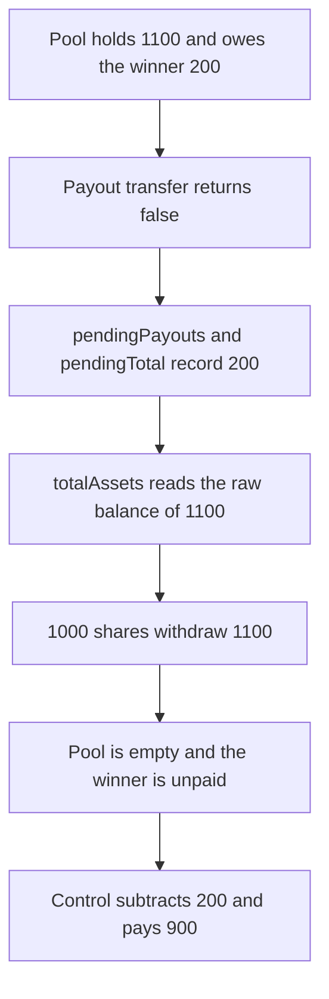

# Coinflip — a withdrawal prices shares on a balance that still owes a payout

> **Vulnerability classes:** vuln/logic/reward-calculation · vuln/logic/missing-check

<!-- non-defihacklabs -->
<!-- source-auditvault: https://github.com/Auditware/AuditVault/blob/main/findings/55502-c-01-pending-payouts-excluded-from-total-balance-cause-incor.md -->
<!-- date: 2025-02 -->

## Key info

| | |
|---|---|
| **Protocol** | Coinflip |
| **Finding** | Pashov C-01, AuditVault 55502 |
| **Vulnerable code** | `Staking.totalAssets` |
| **Harm** | The staker withdraws 1100. Fair, after the 200 pending payout, is 900. The withdrawal is 200 too high and the pool is emptied. |
| **Chain** | local synthetic |

## TL;DR

A finished game owes the winner 200. The token transfer returns false, so `pendingPayouts[token][recipient] += amount` and the 200 stays in the contract. `totalAssets` is still `token.balanceOf(address(this))`. The staker's 1000 shares are priced against 1100 instead of 900 and the withdrawal pays 1100. Nothing is left for the winner. Subtracting `pendingTotal` prices the same shares at 900 and leaves 200 in the pool.

## The vulnerable code

```solidity
if (!callSucceeded) {
    pendingPayouts[tokenAddr][recipient] += amount;
    pendingTotal += amount;
    return false;
}

function totalAssets() public virtual returns (uint256) {
    // @> VULN: pending payouts sit in the token balance and are still counted as staker equity.
    cachedAssets = token.balanceOf(address(this));
    return cachedAssets;
}
```

The report's failed-payout line is `pendingPayouts[token][recipient] += amount`. The share math then uses the raw balance in `totalOwed`, `finalizeStake`, and `finalizeUnstake`. This reduction shows that pricing on `withdraw`.

```diff
- cachedAssets = token.balanceOf(address(this));
+ cachedAssets = token.balanceOf(address(this)) - pendingTotal;
```

## Root cause

A failed payout is a liability that still sits in the token balance. Counting the whole balance as staker equity treats the winner's 200 as if the stakers had earned it. The share price is high by that amount, and the first full withdrawal takes it.

## Preconditions

The pool holds 1100: 1000 staked and 100 of bet inflow. The staker has all 1000 shares. The winner's 200 transfer returns false. No time passes. The numbers match the report's worked example, scaled to one staker so the whole excess is visible: apparent assets 1100, fair assets 900, difference 200.

## Attack walkthrough

1. `transferPayout` sends 200 to the winner. The token returns false. The 200 remains in the contract.
2. `pendingTotal` and `pendingPayouts` both record 200.
3. The staker withdraws 1000 shares.
4. `totalAssets` caches `balanceOf`, which is 1100.
5. `out = 1100 * 1000 / 1000`. The contract transfers 1100. Its balance is 0.
6. Fair assets are `1100 - 200 = 900`. The withdrawal is 200 above fair.

The control `totalAssets` subtracts `pendingTotal` before the division. The same withdrawal pays 900 and leaves 200 in the pool for the winner.

## Diagrams



## Impact

The staker receives 1100 instead of 900 and the winner's 200 is no longer in the contract. Every later share is priced on whatever is left, which here is zero. The fixed pricing pays 900 and keeps 200 escrowed for the pending payout.

## Remediation

Track `pendingTotal` per token and subtract it in every balance used for share pricing and for solvency checks: `totalAssets`, stake finalization, and unstake finalization.

## How to reproduce

```bash
cd 55502-c-01-pending-payouts-excluded-from-total-balance-cause-incor_exp
forge test -vv
```

## Sources

- AuditVault finding: https://github.com/Auditware/AuditVault/blob/main/findings/55502-c-01-pending-payouts-excluded-from-total-balance-cause-incor.md
- Pashov report: https://github.com/pashov/audits/blob/master/team/md/Coinflip-security-review_2025-02-19.md
- Reduced from the `Staking.transferPayout` and balance-of-self accounting quoted in that review.
