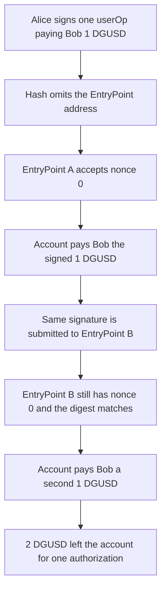

# MetaMask DeleGator — userOp hash omits the EntryPoint, so the signature replays

> **Vulnerability classes:** vuln/auth/signature-replay · vuln/auth/signature-validation

> **Reproduction:** cheatcode-free local synthetic. `DeleGatorCore.getPackedUserOperationHash` is the audited body. The signer key is held and the signature is precomputed. Full trace: [output.txt](output.txt). PoC: [test/55601-entrypoint-not-included-in-user-operation-hash-creates-the-p_exp.sol](test/55601-entrypoint-not-included-in-user-operation-hash-creates-the-p_exp.sol).

<!-- non-defihacklabs -->
<!-- source-auditvault: https://github.com/Auditware/AuditVault/blob/main/findings/55601-entrypoint-not-included-in-user-operation-hash-creates-the-p.md -->
<!-- date: 2025-03 -->

**AuditVault taxonomy:** `lang/solidity` · `sector/account` · `sector/bridge` · `sector/staking` · `sector/wallet` · `platform/cyfrin` · `has/github` · `severity/high` · genome: `permit-fork-replay` · `replay` · `variant` · `bridge-is-secure` · `signature-is-unique` · `add-nonce` · `cross-chain-message`

## Key info

| | |
|---|---|
| **Protocol** | MetaMask Delegation Framework |
| **Finding** | Cyfrin 2025-03-18, AuditVault 55601, high |
| **Vulnerable code** | `DeleGatorCore.getPackedUserOperationHash` and the same function on `EIP7702DeleGatorCore` |
| **Harm** | One signature pays Bob 1 DGUSD on EntryPoint A and another 1 DGUSD on EntryPoint B. 2 DGUSD leave the account. Alice did not sign the second EntryPoint |
| **Chain** | local synthetic |

## TL;DR

EIP-4337 says the userOp signature must depend on the chain id and the EntryPoint, because each EntryPoint keeps its own nonce. `getPackedUserOperationHash` hashes the packed userOp and stops. The EIP-712 domain adds chain id and the account, and still does not add the EntryPoint. Upgrading the delegator onto a new EntryPoint leaves the account address, and therefore the digest, unchanged. The same signature executes again and moves another 1 DGUSD.

## The vulnerable code

Audited `getPackedUserOperationHash` (`MetaMask/delegation-framework` @ `16bb886`, before the fix in `1f91637`):

```solidity
function getPackedUserOperationHash(PackedUserOperation calldata _userOp) public pure returns (bytes32) {
    // @> VULN: userOp hash omits the EntryPoint, so one signature replays on any EntryPoint
    return keccak256(
        abi.encode(
            PACKED_USER_OP_TYPEHASH,
            _userOp.sender,
            _userOp.nonce,
            keccak256(_userOp.initCode),
            keccak256(_userOp.callData),
            _userOp.accountGasLimits,
            _userOp.preVerificationGas,
            _userOp.gasFees,
            keccak256(_userOp.paymasterAndData)
        )
    );
}
```

```solidity
// FIX: append entryPoint to PACKED_USER_OP_TYPEHASH and to the abi.encode above.
// The second EntryPoint then recovers a different signer and reverts.
```

`PACKED_USER_OP_TYPEHASH` is the pre-fix string, with no `address entryPoint` field. `getPackedUserOperationTypedDataHash` wraps that struct hash in a domain of name, version, `chainId`, and the account. The EntryPoint is still absent.

## Root cause

The signature is checked against a digest that is identical for every EntryPoint. ERC-4337 nonces are stored on the EntryPoint (`EntryPoint.getNonce(sender, key)`), not on the account. A second EntryPoint still has nonce 0 for Alice, so the nonce check does not reject the replay. The report's concrete path is an upgrade: the account address stays the same (EIP-7702 delegation, or a proxy that keeps its address), the new implementation points at a new EntryPoint, and the old signature still verifies.

## Preconditions

Alice holds the signer key and has signed one packed userOp that pays Bob 1 DGUSD. The account holds at least 2 DGUSD. A second EntryPoint can submit that userOp. In the report that happens after the delegator is upgraded onto the new EntryPoint. Here the account accepts both EntryPoints, which is the post-upgrade shape: the digest still does not name which one is calling.

## Attack walkthrough

1. Alice signs a userOp whose callData pays Bob 1 DGUSD. The digest is the audited hash plus the EIP-712 domain (chain id 1, verifying contract = Alice). The signature is precomputed from the key this PoC holds. No EntryPoint is covered.
2. EntryPoint A has nonce 0 for Alice. It accepts the userOp. The account recovers Alice and transfers 1 DGUSD to Bob.
3. EntryPoint B has its own nonce 0. The userOp bytes, including the signature, are unchanged. The hash matches again.
4. The account transfers another 1 DGUSD to Bob. `replayed` is 1 DGUSD. Bob's balance is 2 DGUSD. The account is at 0.

The control puts the executing EntryPoint into the struct hash (the fix shipped in commit `1f91637`). A signature made for EntryPoint A pays the first 1 DGUSD and the same bytes revert on EntryPoint B. Bob stays at 1 DGUSD and the second 1 DGUSD never moves.

## Diagrams



## Impact

Alice authorized a single 1 DGUSD payment. The replay on the second EntryPoint moves another 1 DGUSD she did not sign for that EntryPoint. Bob receives 2 DGUSD and the account is emptied. Any later EntryPoint the account is upgraded to can replay every previously signed userOp whose nonce is still fresh on that EntryPoint.

## Remediation

Include the EntryPoint in `PACKED_USER_OP_TYPEHASH` and in `getPackedUserOperationHash` on both `DeleGatorCore` and `EIP7702DeleGatorCore`. MetaMask did this in [1f91637](https://github.com/MetaMask/delegation-framework/commit/1f91637e7f61d03e012b7c9d7fc5ee4dc86ce3f3). With that field present, the second execution reverts.

## How to reproduce

```bash
cd 55601-entrypoint-not-included-in-user-operation-hash-creates-the-p_exp
forge test -vv
```

## Sources

- AuditVault finding: https://github.com/Auditware/AuditVault/blob/main/findings/55601-entrypoint-not-included-in-user-operation-hash-creates-the-p.md
- Cyfrin report (18 March 2025): https://github.com/Cyfrin/cyfrin-audit-reports/blob/master/reports/2025-03-18-cyfrin-Metamask-DelegationFramework1-v2.0.pdf
- Finding report link: https://github.com/solodit/solodit_content/blob/main/reports/Cyfrin/2025-03-18-cyfrin-Metamask-DelegationFramework1-v2.0.md
- Vulnerable code: https://github.com/MetaMask/delegation-framework/blob/16bb88611a58e77e0e7106b0dcf2ac0e8b81b65f/src/DeleGatorCore.sol
- Same omission on EIP-7702: https://github.com/MetaMask/delegation-framework/blob/16bb88611a58e77e0e7106b0dcf2ac0e8b81b65f/src/EIP7702/EIP7702DeleGatorCore.sol
- Fix: https://github.com/MetaMask/delegation-framework/commit/1f91637e7f61d03e012b7c9d7fc5ee4dc86ce3f3
- EIP-4337 userOp hash: https://eips.ethereum.org/EIPS/eip-4337#useroperation
