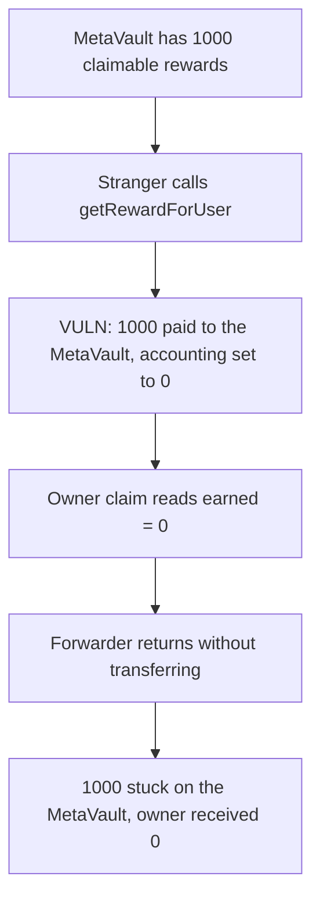

# InfraVault — permissionless reward claim strands tokens on the MetaVault

> **Vulnerability classes:** vuln/access-control/missing-auth · vuln/logic/missing-check

<!-- non-defihacklabs -->
<!-- source-auditvault: https://github.com/Auditware/AuditVault/blob/main/findings/55624-infravaults-permissionless-reward-claiming-can-allow-anyone.md -->
<!-- date: 2025-04 -->

## Key info

| | |
|---|---|
| **Protocol** | Dolomite POLVaults (InfraredBGTMetaVault) |
| **Finding** | Cyfrin / 0kage, AuditVault 55624 |
| **Vulnerable code** | `MultiRewards.getRewardForUser` and `InfraredBGTMetaVault._performDepositRewardByRewardType` |
| **Harm** | 1000 reward tokens stuck on the MetaVault. The owner's claim forwards 0. |
| **Chain** | local synthetic |

## TL;DR

Infrared's `getRewardForUser(user)` is public. It transfers that user's accrued rewards to `user` and zeros the accounting entry. A stranger calls it with the MetaVault as `user`. The 1000 tokens arrive on the MetaVault, but `_performDepositRewardByRewardType` only forwards the amount the claim was told, which is now 0. The tokens sit on the vault. The owner's balance stays 0. Adding `token.balanceOf(address(this))` to the forwarded amount lets the owner claim the same 1000.

## The vulnerable code

```solidity
function getRewardForUser(address _user) public {
    uint256 reward = rewards[_user];
    if (reward > 0) {
        // @> VULN: any caller pays `_user` and then clears the claimable balance.
        token.transfer(_user, reward);
        rewards[_user] = 0;
    }
}

function _performDepositRewardByRewardType(uint256 _amount) internal returns (uint256) {
    if (_amount == 0) {
        return 0;
    }
    token.transfer(owner, _amount);
}
```

The audited Infrared function is the `MultiRewards` loop quoted in the report: it low-level-calls `transfer` to `_user` with a 200,000 gas stipend and, on success, sets `rewards[_user][token] = 0`. There is no `msg.sender == _user` check. This reduction is one reward token and a normal `transfer`; the permissionless pay-and-zero is the same.

The MetaVault only runs `_performDepositRewardByRewardType` on its own claim, and it passes the earned amount captured before that call. After a stranger has already claimed, earned is 0, so the function returns without moving the balance that just arrived.

## Root cause

Two pieces have to line up. Infrared lets anyone trigger a user's payout. The MetaVault assumes rewards only arrive inside its own claim, and it forwards the accounted amount rather than the tokens it is holding. A payout that lands between those two steps is invisible to the forwarder.

## Preconditions

The MetaVault has a non-zero Infrared reward balance. No role and no approval are required to call `getRewardForUser`. One transaction is enough.

## Attack walkthrough

1. Infrared holds 1000 reward tokens credited to the MetaVault. `earned(meta)` is 1000.
2. A stranger calls `getRewardForUser(meta)`.
3. Infrared transfers 1000 to the MetaVault and sets `rewards[meta]` to 0.
4. The owner calls `claim`. It reads earned 0, calls `getRewardForUser` again (nothing left), and `_performDepositRewardByRewardType(0)` returns 0.
5. The MetaVault still holds 1000. The owner holds 0. `forwarded` is 0.

The control uses the report's fix: `_amount += token.balanceOf(address(this))` before the forward. The same stranger call still pushes 1000 onto the vault, and the owner's `claim` then sends those 1000 to the owner. The vault balance ends at 0.

## Diagrams



## Impact

The vault owner cannot use the 1000 reward tokens. They are not burned and not sent to the attacker; they are locked in the MetaVault because no claim path looks at the raw balance. The report notes the production vault is upgradeable, so the lock is recoverable by an upgrade, but until then the owner cannot deploy those rewards in Dolomite. This run shows the 1000 unclaimable.

## Remediation

In `_performDepositRewardByRewardType`, add the vault's current token balance to the amount being deposited or forwarded, as in the Dolomite fix. That makes tokens pushed by a third-party `getRewardForUser` claimable by the owner.

## How to reproduce

```bash
cd 55624-infravaults-permissionless-reward-claiming-can-allow-anyone_exp
forge test -vv
```

## Sources

- AuditVault finding: https://github.com/Auditware/AuditVault/blob/main/findings/55624-infravaults-permissionless-reward-claiming-can-allow-anyone.md
- Cyfrin report: https://github.com/solodit/solodit_content/blob/main/reports/Cyfrin/2025-04-24-cyfrin-dolomite-POLVaults-v2.0.md
- Dolomite fix: https://github.com/dolomite-exchange/dolomite-margin-modules/commit/d0a638aefdda72925329b2da60f405cd4450f78a
- Infrared vault the report cites: https://berascan.com/address/0x67b4e6721ad3a99b7ff3679caee971b07fd85cd1
