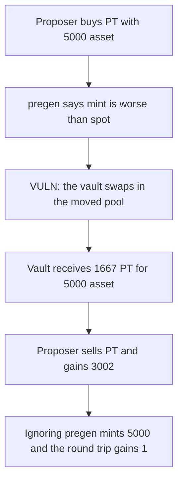

# AdapterVault — proposer pregen_info forces a pool buy and extracts 3002 asset

> **Vulnerability classes:** vuln/defi/sandwich-attack · vuln/logic/missing-validation

<!-- non-defihacklabs -->
<!-- source-auditvault: https://github.com/Auditware/AuditVault/blob/main/findings/55659-h-01-malicious-proposer-can-use-pregen-info-to-drain-vault-a.md -->
<!-- date: 2024-05 -->

## Key info

| | |
|---|---|
| **Protocol** | AdapterFi AdapterVault |
| **Finding** | 0x52, AuditVault 55659 |
| **Vulnerable code** | `balanceAdapters` trusts `pregen_info` |
| **Harm** | The proposer spends 5000 asset, forces the vault to buy PT in that pool, and sells back for 8002. Gain is 3002. The vault that ignores the caller mints instead, and the same trades return 5001. |
| **Chain** | local synthetic |

## TL;DR

`pregen_info` decodes into `mint_returns` and `spot_returns`, and `mint_returns > spot_returns` decides whether the vault mints PT or buys it in the pool. The proposer is not a trusted role. Setting mint to 0 and spot to 1 forces the swap after the proposer has bought PT and made it expensive. The vault spends 5000 asset to receive 1667 PT. The proposer sells the PT they bought and receives 8002 asset, a gain of 3002. A vault that computes the quote itself sees mint 5000 against a spot of 1667, mints, and the proposer's round trip makes 1 from integer rounding.

## The vulnerable code

```solidity
if (trustCaller && pregenInfo.length > 0) {
    (mintReturns, spotReturns) = abi.decode(pregenInfo, (uint256, uint256));
}
// @> VULN: caller mint_returns and spot_returns choose mint versus the pool swap
if (mintReturns > spotReturns) {
    ptOut = assetAmount;
} else {
    ptOut = pool.swapAssetForPt(assetAmount);
}
```

The report says this data must be trusted and that the balance call should be withdraw-only so a proposer cannot aim the vault at a manipulated swap.

## Root cause

The branch that chooses mint or swap reads numbers the caller supplied. Those numbers are not the pool's quote. A proposer can make the swap branch run at whatever price the pool currently has.

## Preconditions

The pool starts at 10000 PT and 10000 asset. The vault holds 5000 asset and will deploy that amount. The proposer holds 5000 asset. No admin key is used. The three steps land in one transaction here. The report spreads them across a sandwich. The prices are the same.

## Attack walkthrough

1. Swap 5000 asset for PT. The pool becomes 6666 PT and 15000 asset. The proposer receives 3334 PT.
2. Call `balanceAdapters(5000, abi.encode(0, 1))`. Mint does not win.
3. The vault swaps and receives 1667 PT for its 5000 asset.
4. Sell the 3334 PT. The pool pays 8002 asset. Profit is 3002.
5. On the vault that ignores the bytes, the computed spot after the same buy is 1667, which is below the mint of 5000, so it mints 5000 PT.
6. Selling the 3334 PT back into the untouched pool returns 5001 asset.

## Diagrams



## Impact

The proposer gains 3002 asset. That asset left the pool because the vault bought PT there at the proposer's price. The vault holds 1667 PT instead of the 5000 a mint would have produced. The vault that computes its own quote does not trade, and the proposer does not extract the 3002.

## Remediation

Do not let the caller choose mint versus swap. Compute both quotes in the vault, or call the adapter with withdraw-only set so this path cannot swap.

## How to reproduce

```bash
cd 55659-h-01-malicious-proposer-can-use-pregen-info-to-drain-vault-a_exp
forge test -vv
```

## Sources

- AuditVault finding: https://github.com/Auditware/AuditVault/blob/main/findings/55659-h-01-malicious-proposer-can-use-pregen-info-to-drain-vault-a.md
- 0x52 report: https://github.com/solodit/solodit_content/blob/main/reports/0x52/2024-05-03-AdapterFi.md
- AdapterVault: https://github.com/adapter-fi/AdapterVault/blob/3c2895a69ad5eb2c4be16d454f63a6f2f074f351/contracts/AdapterVault.vy
