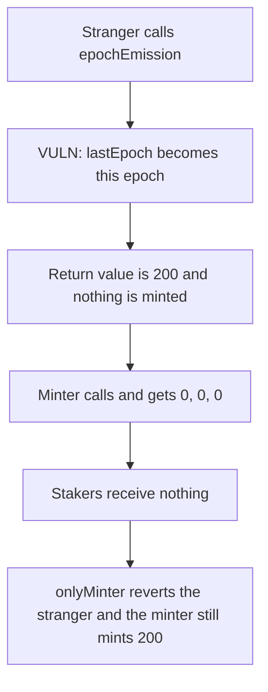

# Hyperstable — anyone can consume an emission epoch and the minter then mints 0

> **Vulnerability classes:** vuln/access-control/missing-auth · vuln/logic/state-update

<!-- non-defihacklabs -->
<!-- source-auditvault: https://github.com/Auditware/AuditVault/blob/main/findings/55693-h-02-emissionschedulerepochemission-lacks-access-control-and.md -->
<!-- date: 2025-05 -->

## Key info

| | |
|---|---|
| **Protocol** | Hyperstable EmissionScheduler |
| **Finding** | 0x52, AuditVault 55693 |
| **Vulnerable code** | `EmissionScheduler.epochEmission` |
| **Harm** | A stranger's call writes `lastEpoch`. The minter's call then returns `(0, 0, 0)` and 200 tokens are not minted. `onlyMinter` reverts the stranger and the minter still mints 200. |
| **Chain** | local synthetic |

## TL;DR

`epochEmission` sets `lastEpoch = currentEpoch` and returns the epoch's emission. There is no caller check. The first call in an epoch returns `(peg - ve) * 2 / 10000`. With a peg supply of 1_000_000 and no ve supply that is 200. The stranger does not mint. The minter's later call sees `currentEpoch == lastEpoch` and returns `(0, 0, 0)`, so the epoch mints nothing. The scheduler that requires `msg.sender == minter` reverts the stranger, and the minter's call mints 200.

## The vulnerable code

```solidity
if (currentEpoch == lastEpoch) {
    return (0, 0, 0);
}
// @> VULN: any caller writes lastEpoch, so the minter's later call returns zero
lastEpoch = currentEpoch;
uint256 toEmit = (_pegSupply - _veSupply) * 2 / EMISSION_PRECISION;
```

The report's fix is `_onlyMinter` on this function. That check is present on the control scheduler.

## Root cause

`lastEpoch` is both the "already emitted" flag and a value any external caller can write. The mint path trusts the returned tuple, so a consumed epoch mints zero.

## Preconditions

`lastEpoch` has not yet been set to the current epoch. Peg supply is 1_000_000 tokens and ve supply is 0. `EMISSION_PRECISION` is 10000. The stranger is not the minter. No time travel is required. Both calls see the same `block.timestamp`.

## Attack walkthrough

1. The stranger calls `epochEmission(1_000_000 ether, 0)`. It returns 200 and writes `lastEpoch`.
2. No emission tokens are minted. The staker balance stays 0.
3. The minter calls the same function. It hits `currentEpoch == lastEpoch` and returns `(0, 0, 0)`.
4. The mint is 0.
5. On the gated scheduler the stranger's call reverts with `only minter`.
6. The minter's call there returns 200 and mints 200 to stakers.

## Diagrams



## Impact

Stakers receive 0 emission tokens for the epoch instead of 200. The 200 is not paid to the stranger either. It is simply not minted. The gated scheduler still pays the 200, so the loss is the missing caller check and not the emission formula.

## Remediation

Require `msg.sender == minter` before writing `lastEpoch`.

## How to reproduce

```bash
cd 55693-h-02-emissionschedulerepochemission-lacks-access-control-and_exp
forge test -vv
```

## Sources

- AuditVault finding: https://github.com/Auditware/AuditVault/blob/main/findings/55693-h-02-emissionschedulerepochemission-lacks-access-control-and.md
- 0x52 report: https://github.com/solodit/solodit_content/blob/main/reports/0x52/2025-05-02-Hyperstable.md
- EmissionScheduler: https://github.com/hyperstable/contracts/blob/35db5f2d3c8c1adac30758357fbbcfe55f0144a3/src/governance/EmissionScheduler.sol
