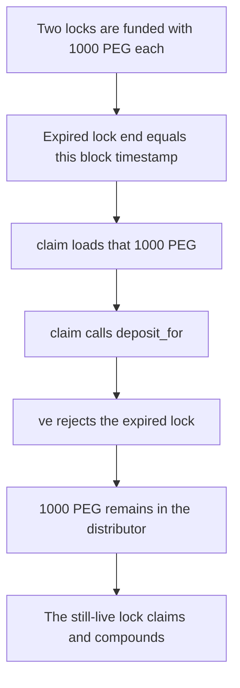

# Hyperstable — `RewardsDistributor.claim` reverts once a ve lock expires and the reward stays in the distributor

> **Vulnerability classes:** vuln/dos/frozen-funds · vuln/logic/incorrect-state-transition · vuln/logic/missing-check
>
> **Reproduction:** Local Foundry reproduction of the verbatim `claim` / `deposit_for` pair. No fork. Trace: [output.txt](output.txt).

<!-- non-defihacklabs -->
<!-- source-auditvault: https://github.com/Auditware/AuditVault/blob/main/findings/55694-h-03-rewarddistributorclaim-will-revert-for-tokens-with-expi.md -->
<!-- date: 2025-05 -->

## Root cause

`RewardsDistributor.claim` always forwards a non-zero reward into the voting escrow with `deposit_for`. `vePeg.deposit_for` reverts when `locked.end` is not strictly after `block.timestamp` (`"Cannot add to expired lock. Withdraw"`). `increase_unlock_time` uses the same require, so the lock cannot be extended after expiry. The claim reverts and the PEG stays in the distributor.

```solidity
if (amount != 0) {
    // @> VULN:
    IVotingEscrow(voting_escrow).deposit_for(_tokenId, amount);
    token_last_balance -= amount;
}
```

## Attack path



## PoC

One transaction. The expired lock's `claim` is a low-level call and reverts. The live lock's `claim` succeeds and compounds 1000 PEG into the escrow. The distributor's PEG balance is the expired 1000.

The fixed distributor pays an expired lock by transferring PEG to the owner. That control leaves the distributor at 0.

```bash
cd 55694-h-03-rewarddistributorclaim-will-revert-for-tokens-with-expi_exp
forge test -vv
```

## Remediation

If `locked.end <= block.timestamp`, transfer the reward to the lock owner instead of calling `deposit_for`. Hyperstable did this in commit `3012a71`.

## References

- AuditVault finding 55694
- Report: https://github.com/solodit/solodit_content/blob/main/reports/0x52/2025-05-02-Hyperstable.md
