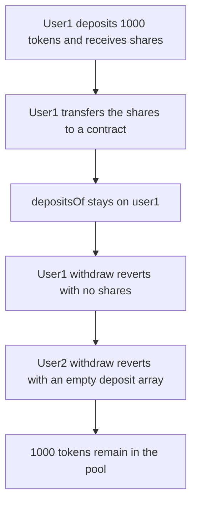

# Rainmaker — transferring TimeLockPool shares sticks both the deposit and the shares

> **Vulnerability classes:** vuln/dos/frozen-funds · vuln/logic/state-update · vuln/logic/missing-check
>
> **Reproduction:** Local Foundry reproduction. Share `transfer` does not rewrite `depositsOf`. No fork. Trace: [output.txt](output.txt).

<!-- non-defihacklabs -->
<!-- source-auditvault: https://github.com/Auditware/AuditVault/blob/main/findings/56297-deposits-and-shares-may-get-stuck-zokyo-none-rainmaker-markd.md -->
<!-- date: 2021-12 -->

## Root cause

`deposit` pushes a `Deposit` onto `depositsOf[receiver]` and mints the same amount of shares. `transfer` moves only the share balance. After maturity:

- user1 still has the `Deposit` but no shares, so `withdraw` reverts on the share burn and the tokens stay in the pool
- user2 has the shares and an empty `depositsOf` array, so `withdraw` reverts `"Deposit does not exist"`

User2 is a contract with no share-transfer function, so the shares cannot be sent back.

```solidity
// @> VULN:
shareBalance[msg.sender] -= amount;
shareBalance[to] += amount;
```

Duration is 0, so the lock is already mature in this block. The failure is the missing deposit migration, not a time skip.

## Attack path



## PoC

Both withdraw attempts return false. Pool balance is 1000 tokens. User2 holds 1000 shares.

The fixed pool moves `depositsOf` with the shares. User2 then withdraws the 1000 tokens and the pool is empty.

```bash
cd 56297-deposits-and-shares-may-get-stuck-zokyo-none-rainmaker-markd_exp
forge test -vv
```

## Remediation

On transfer, move the sender's `Deposit` entries to the recipient, or make the pool non-transferable. The client later said only non-transferable pools would be used.

## References

- AuditVault finding 56297
- Report: https://github.com/solodit/solodit_content/blob/main/reports/Zokyo/2021-12-29-Rainmaker.md
