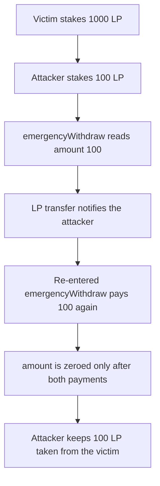

# Stargate — `LPStaking.emergencyWithdraw` pays `user.amount` before clearing it

> **Vulnerability classes:** vuln/reentrancy/single-function · vuln/logic/incorrect-order-of-operations · vuln/logic/missing-check
>
> **Reproduction:** Local Foundry reproduction of the pre-fix order. The LP token notifies the recipient. No fork. Trace: [output.txt](output.txt).

<!-- non-defihacklabs -->
<!-- source-auditvault: https://github.com/Auditware/AuditVault/blob/main/findings/56308-reentrancy-attack-in-emergencywithdraw-function-zokyo-none-s.md -->
<!-- date: 2021-12 -->

## Root cause

The December 2021 `emergencyWithdraw` transferred `user.amount` and only then wrote `user.amount = 0` and `user.rewardDebt = 0`. The LP token notifies the recipient, so the attacker re-enters while `user.amount` is still the full stake and is paid again. The function also has no emergency-status check, so it is callable in the normal state.

```solidity
uint256 userAmount = user.amount;
// @> VULN:
pool.lpToken.transfer(address(msg.sender), userAmount);
user.amount = 0;
user.rewardDebt = 0;
```

A victim has 1000 LP staked. The attacker stakes 100 LP, calls `emergencyWithdraw`, and the callback calls it again. The attacker receives 200 LP. The extra 100 LP comes out of the victim's stake. The staking contract is left holding 900 LP against the victim's recorded 1000.

## Attack path



## PoC

The fixed staking writes `user.amount = 0` before the transfer. The same callback then transfers 0. The attacker is left with their own 100 LP and the victim's 1000 LP stays in the contract.

```bash
cd 56308-reentrancy-attack-in-emergencywithdraw-function-zokyo-none-s_exp
forge test -vv
```

## Remediation

Copy `user.amount` to a local, set `user.amount` and `rewardDebt` to 0, then transfer the local amount. Gate the function on an emergency flag if it should not be a normal exit.

## References

- AuditVault finding 56308
- Report: https://github.com/solodit/solodit_content/blob/main/reports/Zokyo/2021-12-31-Stargate.md
