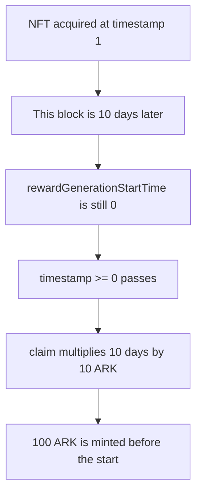

# CWBC — `Arkouda.claimReward` mints before `rewardGenerationStartTime` is set

> **Vulnerability classes:** vuln/logic/wrong-condition · vuln/logic/reward-calculation · vuln/logic/missing-check
>
> **Reproduction:** Local Foundry reproduction. `rewardGenerationStartTime` stays 0. No fork. Trace: [output.txt](output.txt).

<!-- non-defihacklabs -->
<!-- source-auditvault: https://github.com/Auditware/AuditVault/blob/main/findings/56419-user-can-claim-rewards-before-the-start-zokyo-none-cwbc-mark.md -->
<!-- date: 2022-02 -->

## Root cause

`rewardGenerationStartTime` defaults to 0 and is written by a separate `startRewardGeneration` call. `claimReward` never rejects 0, so `block.timestamp >= rewardGenerationStartTime` is true before rewards are started. A holder whose NFT was acquired at timestamp 1, observed in the block at timestamp `1 + 10 days`, mints `10 * BASE_REWARD` = 100 ARK.

```solidity
require(block.timestamp >= rewardGenerationStartTime, "before start");
// @> VULN:
lastReward = daysHeld * BASE_REWARD;
```

The block timestamp is set once for the whole transaction. `run()` does not warp.

## Attack path



## PoC

The exploit asserts the start time is still 0, `lastDays` is 10, and the mint is 100 ARK. Those 100 ARK are transferred to the holder.

The fixed claim reverts with `"not started"` and mints 0.

```bash
cd 56419-user-can-claim-rewards-before-the-start-zokyo-none-cwbc-mark_exp
forge test -vv
```

## Remediation

Require `rewardGenerationStartTime != 0` before the timestamp comparison, and set the start once.

## References

- AuditVault finding 56419
- Report: https://github.com/solodit/solodit_content/blob/main/reports/Zokyo/2022-02-27-CWBC.md
