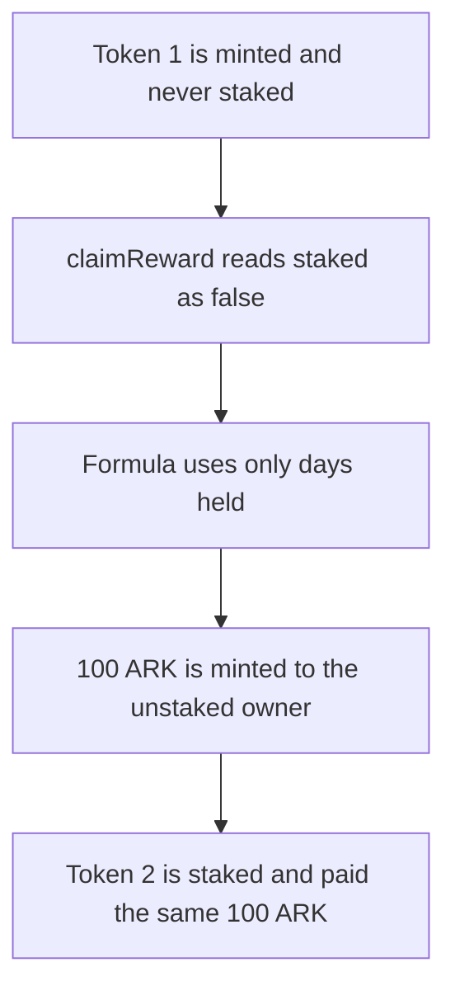

# CWBC — Arkouda rewards use days held and ignore `stakeCBWC`

> **Vulnerability classes:** vuln/logic/reward-calculation · vuln/logic/missing-check · vuln/logic/wrong-condition
>
> **Reproduction:** Local Foundry reproduction. An unstaked NFT is paid the same 100 ARK as a staked one. No fork. Trace: [output.txt](output.txt).

<!-- non-defihacklabs -->
<!-- source-auditvault: https://github.com/Auditware/AuditVault/blob/main/findings/56420-staking-is-not-used-to-calculate-arkouda-tokens-to-be-reward.md -->
<!-- date: 2022-02 -->

## Root cause

`stakeCBWC` sets `staked[id]`. `claimReward` reads that flag into `ignoredStakeFlag` and then does not use it. The mint is `daysHeld * BASE_REWARD` for any owner. Rewards have already started (`rewardGenerationStartTime = 1`), so this is not the pre-start claim.

An NFT acquired at timestamp 1, claimed in the block at `1 + 10 days`, mints 100 ARK whether or not it was staked. The unstaked mint is 100 ARK that a staking-gated claim would not pay.

```solidity
ignoredStakeFlag = staked[tokenId] ? 1 : 0;
// @> VULN:
lastReward = daysHeld * BASE_REWARD;
```

`run()` does not warp. The block timestamp is fixed for the transaction.

## Attack path



## PoC

Unstaked mint and staked mint are both 100 ARK. `stakeCalls` is 1, and it happens after token 1 was paid. The unstaked 100 ARK is transferred to the holder.

The fixed claim reverts with `"not staked"` for an unstaked id and still pays a staked id.

```bash
cd 56420-staking-is-not-used-to-calculate-arkouda-tokens-to-be-reward_exp
forge test -vv
```

## Remediation

Require `staked[tokenId]` before computing the reward, and size the reward from the stake rather than from days held alone.

## References

- AuditVault finding 56420
- Report: https://github.com/solodit/solodit_content/blob/main/reports/Zokyo/2022-02-27-CWBC.md
