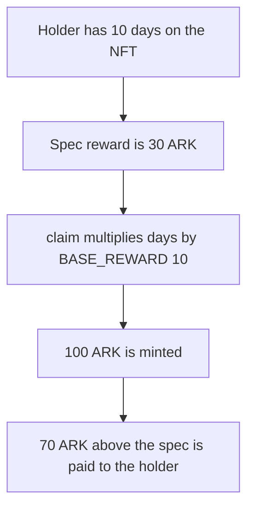

# CWBC — `Arkouda.BASE_REWARD` is 10 ARK instead of 3 ARK per day

> **Vulnerability classes:** vuln/logic/reward-calculation · vuln/logic/missing-validation
>
> **Reproduction:** Local Foundry reproduction of the constant. Ten days mints 100 ARK instead of 30. No fork. Trace: [output.txt](output.txt).

<!-- non-defihacklabs -->
<!-- source-auditvault: https://github.com/Auditware/AuditVault/blob/main/findings/56421-value-of-base-reward-state-variable-is-incorrect-zokyo-none.md -->
<!-- date: 2022-02 -->

## Root cause

`BASE_REWARD` is 10 ARK. The stated minimum tier is 3 ARK per day. `claimReward` pays `daysHeld * BASE_REWARD`. Rewards have already started, so this is not the pre-start claim.

An NFT acquired at timestamp 1, claimed in the block at `1 + 10 days`, mints 100 ARK. The spec amount is 30 ARK. The extra 70 ARK is transferred to the holder.

```solidity
specReward = daysHeld * SPEC_PER_DAY;
// @> VULN:
lastReward = daysHeld * BASE_REWARD;
```

`run()` does not warp. The block timestamp is fixed for the transaction.

## Attack path



## PoC

`BASE_REWARD` is 10 ether, `minted` is 100 ether, `spec` is 30 ether, `excess` is 70 ether. The holder receives the 70 ARK excess.

The fixed contract sets `BASE_REWARD` to 3 ether and the same 10 days mint 30 ARK.

```bash
cd 56421-value-of-base-reward-state-variable-is-incorrect-zokyo-none_exp
forge test -vv
```

## Remediation

Set `BASE_REWARD` to 3 ARK per day, matching the minimum tier.

## References

- AuditVault finding 56421
- Report: https://github.com/solodit/solodit_content/blob/main/reports/Zokyo/2022-02-27-CWBC.md
