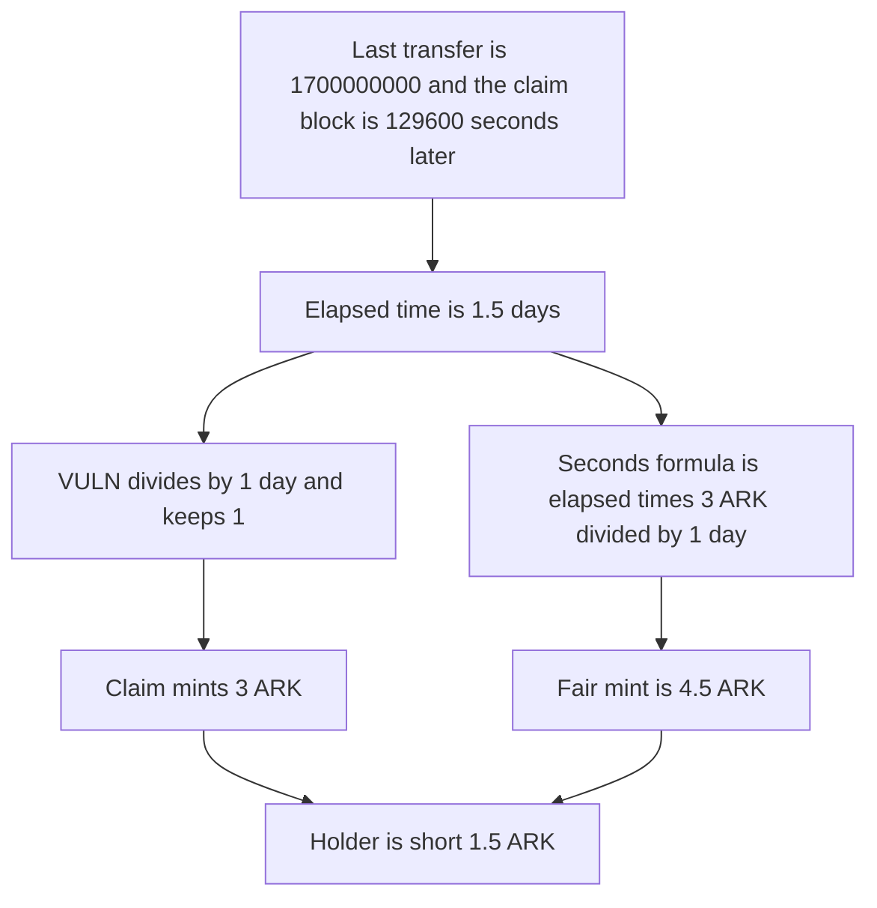

# Arkouda pays NFT rewards in whole days, not seconds

> **Vulnerability classes:** vuln/logic/reward-calculation · vuln/arithmetic/precision-loss

<!-- non-defihacklabs -->
<!-- source-auditvault: https://github.com/Auditware/AuditVault/blob/main/findings/56425-rewards-calculation-is-done-by-counting-number-of-days-since.md -->
<!-- date: 2022-02 -->

## Key info

| Field | Value |
|---|---|
| **Loss** | A holder of 1.5 days is minted 3 ARK. The seconds formula owes 4.5 ARK. The holder is short 1.5 ARK |
| **Vulnerable contract** | `Arkouda.getPendingReward` |
| **Attacker EOA** | `0x1111111111111111111111111111111111111111` (the NFT holder who claims) |
| **Attack contract** | `Exploit` |
| **Attack tx** | `Exploit.run()` |
| **Chain / block / date** | Ethereum model · block timestamp 1700129600 · 2022-02 |
| **Compiler** | solc 0.8.27, cancun, via IR |
| **Bug class** | Reward accrual truncates elapsed time to whole days |

## TL;DR

Zokyo's February 2022 CWBC review says `Arkouda.getPendingReward` counts days since the last transfer instead of seconds. The daily tier is 3 ARK, the documented minimum. A holder whose NFT last moved at timestamp 1700000000 claims at 1700129600. That is 129600 seconds, 1.5 days. Integer division keeps 1 day, so the claim mints 3 ARK. Paying the same tier for every second mints 4.5 ARK. The 1.5 ARK difference is the half day the division drops. The owner is not called. The control uses the seconds formula and mints 4.5 ARK.

## Background

CryptoBear Watch Club pays Arkouda to NFT holders by tier. Zokyo's companion note says the minimum tier is 3 ARK per day. The recommendation on this finding is to make `getPendingReward` seconds-based. The stored input is the last transfer time. This run does not move that timestamp and does not call `setTokenIdReward`, `startRewardGeneration`, or `flipArkoudaClaimStatus`.

## The vulnerable code

```solidity
lastTransferTime = LAST_TRANSFER;
elapsedSeconds = block.timestamp - lastTransferTime;
// @> VULN: whole days since the last transfer, not seconds
daysHeld = elapsedSeconds / 1 days;
paid = daysHeld * REWARD_PER_DAY;
fair = elapsedSeconds * REWARD_PER_DAY / 1 days;
```

`REWARD_PER_DAY` is 3 ARK. `1 days` is 86400 seconds.

## Root cause

The pending amount is `elapsed / 1 days * rewardPerDay`. The division rounds down. Any hold that is not an exact number of days is paid only for the completed days. The seconds formula is `elapsed * rewardPerDay / 1 days`, which keeps the fraction.

## Preconditions

- The NFT's last transfer is stored as 1700000000. The claim block is 1700129600.
- Elapsed time is 129600 seconds, which is 1 day and 12 hours.
- The tier is 3 ARK per day. No admin changes that rate in this transaction.

## Attack walkthrough

1. The claim reads the stored last transfer. It is 1700000000.
2. The clock is 129600 seconds later.
3. `129600 / 86400` is 1. The extra 43200 seconds are discarded.
4. `1 * 3 ARK` is minted. The holder balance is 3 ARK.
5. `129600 * 3 ARK / 86400` is 4.5 ARK. The shortfall is 1.5 ARK.
6. The control mints 4.5 ARK to the same holder for the same elapsed time.

## Diagrams



## Impact

The holder is minted 3 ARK. The continuous tier for 1.5 days is 4.5 ARK. The holder loses 1.5 ARK of rewards that the seconds formula would have minted. The loss is the truncated half day. It does not depend on the owner rewriting the tier or the start time. The control pays 4.5 ARK and leaves no shortfall.

## Remediation

Compute `elapsedSeconds * rewardPerDay / 1 days`, and do the multiplication before the division. Do not count only completed days.

## How to reproduce

```bash
cd 56425-rewards-calculation-is-done-by-counting-number-of-days-since_exp
forge test -vv
```

`test_exploit_days_underpay` warps to 1700129600 and asserts a 3 ARK mint, a 4.5 ARK fair amount, and a 1.5 ARK shortfall. `test_control_seconds_pay_fair` asserts the seconds formula mints 4.5 ARK. Captured output is `output.txt`.

## Sources

- AuditVault finding: https://github.com/Auditware/AuditVault/blob/main/findings/56425-rewards-calculation-is-done-by-counting-number-of-days-since.md
- Zokyo CWBC report: https://github.com/solodit/solodit_content/blob/main/reports/Zokyo/2022-02-27-CWBC.md
