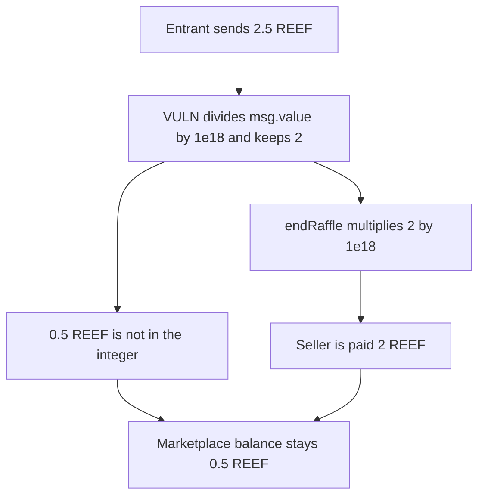

# Sqwid raffle drops the fractional REEF and leaves it in the contract

> **Vulnerability classes:** vuln/arithmetic/precision-loss · vuln/dos/frozen-funds

<!-- non-defihacklabs -->
<!-- source-auditvault: https://github.com/Auditware/AuditVault/blob/main/findings/56646-not-the-whole-amount-of-reef-is-transferred-due-to-accuracy.md -->
<!-- date: 2022-06 -->

## Key info

| Field | Value |
|---|---|
| **Loss** | 2.5 REEF is entered. The seller is paid 2 REEF. 0.5 REEF stays in the marketplace |
| **Vulnerable contract** | `SqwidMarketplace.enterRaffle` / `endRaffle` |
| **Attacker EOA** | `0x1111111111111111111111111111111111111111` (the entrant) |
| **Attack contract** | `Exploit` |
| **Attack tx** | `Exploit.run()` with `msg.value` of 2.5 REEF |
| **Chain / block / date** | Ethereum model · block 0 · 2022-06 |
| **Compiler** | solc 0.8.27, cancun, via IR |
| **Bug class** | `msg.value / 1e18` truncates the raffle entry |

## TL;DR

Zokyo's June 2022 Sqwid review says `enterRaffle` divides `msg.value` by 1e18, and `endRaffle` multiplies the integer by 1e18. Their example is 2500000000000000000 wei, which is 2.5 REEF. The division keeps 2. The payout is 2000000000000000000 wei, which is 2 REEF. The contract still holds 0.5 REEF. The control forwards `msg.value` with no division, pays the seller 2.5 REEF, and leaves a zero balance.

## Background

SqwidMarketplace records raffle entries in whole REEF so a later pseudo-random draw can weight them. Solidity division drops the remainder. The team kept the division and documented it. A direct caller who sends a fractional REEF amount still loses the fraction: it is not part of the payout.

## The vulnerable code

```solidity
entered = msg.value;
// @> VULN: msg.value / 1e18 drops the fractional REEF
wholeReef = msg.value / 1e18;
payout = wholeReef * 1e18;
stuck = entered - payout;
```

## Root cause

The entry is stored as `msg.value / 1e18`. The settlement pays `stored * 1e18`. The product is the largest whole-REEF amount that does not exceed what was sent. The remainder never leaves the contract in this settlement.

## Preconditions

- The entrant sends exactly 2.5 REEF, the amount in the report.
- `endRaffle` pays `wholeReef * 1e18` to the seller.
- No fee is taken on top. The only missing amount is the truncated fraction.

## Attack walkthrough

1. The marketplace receives 2.5 REEF.
2. `2500000000000000000 / 1e18` is 2.
3. The payout is `2 * 1e18`, which is 2 REEF.
4. 2.5 minus 2 is 0.5 REEF. That value is not included in the transfer.
5. The seller's balance is 2 REEF. The marketplace balance is 0.5 REEF.
6. The control sends 2.5 REEF to the seller and the contract balance is 0.

## Diagrams



## Impact

The entrant paid 2.5 REEF. The seller receives 2 REEF. 0.5 REEF is left in the marketplace and is not part of this payout. The locked amount is the fractional REEF the division removed. The control pays the seller the full 2.5 REEF.

## Remediation

Record and refund `msg.value` itself. Do not divide by 1e18 on the way in and multiply by 1e18 on the way out.

## How to reproduce

```bash
cd 56646-not-the-whole-amount-of-reef-is-transferred-due-to-accuracy_exp
forge test -vv
```

`test_exploit_fractional_reef_stuck` sends 2.5 REEF and asserts a recorded 2, a 2 REEF payout, a 0.5 REEF contract balance, and a seller balance of 2 REEF. `test_control_pays_full_value` asserts a 2.5 REEF payout and a zero stuck amount. Captured output is `output.txt`.

## Sources

- AuditVault finding: https://github.com/Auditware/AuditVault/blob/main/findings/56646-not-the-whole-amount-of-reef-is-transferred-due-to-accuracy.md
- Zokyo Sqwid report: https://github.com/solodit/solodit_content/blob/main/reports/Zokyo/2022-06-16-Sqwid.md
