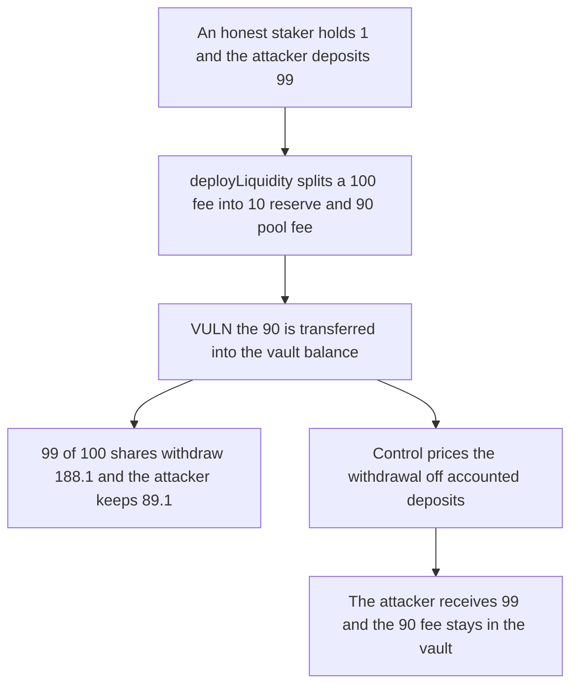

# A same-transaction staker withdraws the Rush launch fee

> **Vulnerability classes:** vuln/defi/donation-attack · vuln/logic/share-price

<!-- non-defihacklabs -->
<!-- source-auditvault: https://github.com/Auditware/AuditVault/blob/main/findings/56660-rush1-7-rusherc20-launch-fee-bypass-due-to-flash-loan-stake.md -->
<!-- date: 2025-02 -->

## Key info

| Field | Value |
|---|---|
| **Loss** | A staker with 99 of 100 shares keeps 89.1 of the 90 pool fee |
| **Vulnerable contract** | `LiquidityDeployer.deployLiquidity` |
| **Attacker EOA** | `0x1111111111111111111111111111111111111111` |
| **Attack contract** | `Exploit` at `0x15452ec016c4dc8c549e7fe6ff4b26324ea8b7a4` |
| **Attack tx** | `Exploit.run()` |
| **Chain / block / date** | Ethereum model · block 0 · 2025-02 |
| **Compiler** | solc 0.8.27, cancun, via IR |
| **Bug class** | The pool fee is transferred into a vault that prices shares off its token balance |



## TL;DR

`deployLiquidity` computes a fee and transfers `totalFee - reserveFee` straight to the liquidity pool. The finding states the default split is 90 percent to the pool and 10 percent to the reserve. The pool is an ERC4626 that treats its token balance as assets, and deposits and withdrawals are open in the same transaction.

The model uses a 100 fee, so 10 goes to the pair and 90 goes to the pool. An honest staker holds 1 and the attacker holds 99. After the transfer the pool balance is 190. The 99 shares withdraw 188.1, and 89.1 of the fee is sent to the attacker. The control prices shares off deposits that the vault itself recorded. That withdrawal returns 99, and the pool still holds the honest 1 plus the 90 fee.

## The vulnerable code

```solidity
reserveFeeStored = reserveFee;
weth.transfer(address(pair), reserveFee);
poolFeeStored = poolFee;
weth.transfer(address(pool), poolFee); // @> VULN: the vault prices shares off this balance
```

## Impact

The launch fee that was meant to stay in the pool as yield is withdrawn by the dominant staker in the same transaction. Here that amount is 89.1 of the 90 pool fee.

## How to reproduce

```bash
cd 56660-rush1-7-rusherc20-launch-fee-bypass-due-to-flash-loan-stake_exp
forge test -vv
```

`test_exploit_staker_takes_89_1_of_the_fee` asserts the attacker receives 89.1 and the withdrawal is 188.1. `test_control_accounted_assets_keep_the_fee` asserts the withdrawal is 99 and the pool keeps 91.

## Sources

- AuditVault finding: https://github.com/Auditware/AuditVault/blob/main/findings/56660-rush1-7-rusherc20-launch-fee-bypass-due-to-flash-loan-stake.md
- Hexens report: Rush Trading, 2025-02-03
