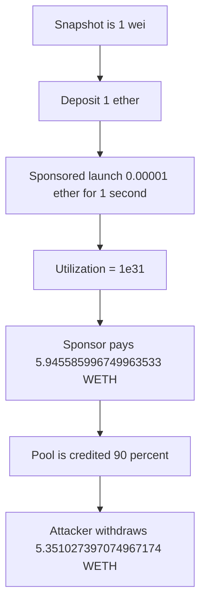

# Rush Trading - a 1 wei snapshot inflates the sponsored launch fee

> **Vulnerability classes:** vuln/defi/fee-calculation · vuln/logic/utilization · vuln/arithmetic/ratio

> **Reproduction:** a self-contained Foundry PoC that compiles and runs offline
> with only `forge-std` - no fork and no RPC. Trace: [output.txt](output.txt).
> PoC: [test/56661-rush1-8-utilisation-ratio-can-exceed-100-to-inflate-fees-and_exp.sol](test/56661-rush1-8-utilisation-ratio-can-exceed-100-to-inflate-fees-and_exp.sol).

<!-- non-defihacklabs -->
<!-- source-auditvault: https://github.com/Auditware/AuditVault/blob/main/findings/56661-rush1-8-utilisation-ratio-can-exceed-100-to-inflate-fees-and.md -->
<!-- date: 2025-02 -->

---

## Key info

| | |
|---|---|
| **Loss** | Sponsor pays **5.945585996749963533 WETH** for a 0.00001 WETH, 1 second launch. The attacker LP withdraws **5.351027397074967174 WETH** of that fee. A fresh snapshot charges **317097 wei** |
| **Protocol** | Rush Trading FeeCalculator |
| **Vulnerable code** | `FeeCalculator.calculateFee` - utilization is not capped and divides by the snapshot |
| **Bug class** | Stale total-liquidity snapshot lets utilization exceed 100% |
| **Finding** | Hexens - Rush Trading, 3 Feb 2025 · RUSH1-8 · id 56661 |
| **Report** | [2025-02-03-Rush-Trading.md](https://github.com/solodit/solodit_content/blob/main/reports/Hexens/2025-02-03-Rush-Trading.md) |
| **Source** | [AuditVault finding](https://github.com/Auditware/AuditVault/blob/main/findings/56661-rush1-8-utilisation-ratio-can-exceed-100-to-inflate-fees-and.md) |
| **Status** | Audit finding. Reproduced as a local synthetic. |
| **Chain / block / date** | Ethereum model · block 0 · 2025-02 |
| **Compiler** | solc 0.8.27, cancun, via IR |

---

## TL;DR

`calculateFee` sets

```text
utilization = (outstandingLiquidity + newLiquidity) * 1e18 / totalLiquidity
```

`totalLiquidity` is `lastSnapshotTotalAssets`, not the pool's live balance, and the ratio is not capped at `1e18`.

Default curve (from the repo's `Defaults`): base `31709791983`, optimal `0.6e18`, slope1 `317097919`, slope2 `23782343987`.

Seed the pool with **1 wei**, snapshot, then deposit **1 ether** without snapshotting. A sponsored launch of the minimum **0.00001 ether** for **1 second** has utilization `1e31`. The sponsor pays **5945585996749963533 wei**. The pool receives 90% of it. The attacker, who owns the 1 ether deposit, withdraws **5351027397074967174 wei** of that fee (6 wei stays on the seed share).

The same charge after `takeSnapshot()` pays **317097 wei** and the LP gain is **285387 wei**.

## The vulnerable code

```solidity
lastUtilization = _mulDiv(params.outstandingLiquidity + params.newLiquidity, 1e18, params.totalLiquidity); // @> VULN: snapshot total is the divisor, and the ratio is not capped at 1e18
uint256 utilizationRatio = lastUtilization;
if (utilizationRatio > OPTIMAL_UTILIZATION_RATIO) {
    feeRate += RATE_SLOPE_1
        + _mulDiv(RATE_SLOPE_2, utilizationRatio - OPTIMAL_UTILIZATION_RATIO, MAX_EXCESS_UTILIZATION_RATIO);
}
totalFee = _mulDiv(feeRate * params.duration, params.newLiquidity, 1e18);
```

The published fix caps the ratio at `1e18`. The sponsored path should also pass `max(actualTotal, snapshotTotal)`.

## Root cause

The fee curve is an Aave-style kink priced per second. Above 60% utilization, slope 2 is extrapolated with denominator `1 - optimal`, which is `0.4e18`. Nothing stops the numerator from being larger than the snapshot, so a 1 wei snapshot turns a dust launch into a multi-ether fee. The launch does not revert: the pool really holds the 1 ether deposit.

## Preconditions

- `lastSnapshotTotalAssets` is 1 wei.
- A later deposit has not refreshed the snapshot.
- The sponsor will pay `calculateFee` for `MIN_DEPLOYMENT_AMOUNT` (0.00001 ether) and `MIN_DURATION` (1 second).
- The attacker holds the shares from the deposit that made the liquidity available.

## Attack walkthrough

1. Seed **1 wei** and snapshot. `lastSnapshotTotalAssets = 1`.
2. Deposit **1 ether**. The snapshot stays 1. Outstanding deployed liquidity is 0.
3. Sponsor escrow holds **10 ether**.
4. Charge a sponsored launch of **0.00001 ether** for **1 second**.
5. Utilization is `1e31`. Total fee is **5.945585996749963533 ether**.
6. Reserve keeps 10%. The pool is credited **5.351027397074967180 ether**.
7. The attacker redeems the 1 ether of shares and receives **5.351027397074967174 ether** of profit.

Control: snapshot after the deposit. Utilization stays under 100%. The sponsor pays **317097 wei**. LP profit is **285387 wei**.

## Diagrams



## Impact

The sponsor, who priced a minimum launch, pays **5.945585996749963533 WETH** instead of **317097 wei**. The depositors of the liquidity pool, here the attacker, receive the pool's 90% as yield: **5.351027397074967174 WETH**.

## Remediation

Cap utilization at `1e18` inside `calculateFee`. For the sponsored charge, pass `max(actualTotalAssets, lastSnapshotTotalAssets)` as `totalLiquidity`.

## Sources

- [AuditVault finding 56661](https://github.com/Auditware/AuditVault/blob/main/findings/56661-rush1-8-utilisation-ratio-can-exceed-100-to-inflate-fees-and.md)
- [Hexens Rush Trading, 3 Feb 2025](https://github.com/solodit/solodit_content/blob/main/reports/Hexens/2025-02-03-Rush-Trading.md)

### Taxonomy

- `severity/high` · `sector/defi`
- `vuln/defi/fee-calculation` · `vuln/logic/utilization` · `vuln/arithmetic/ratio`
