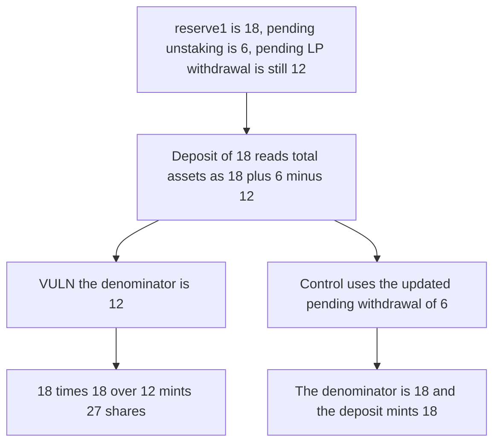

# Valantis STEX deposit mints extra shares off a stale pending withdrawal

> **Vulnerability classes:** vuln/logic/share-calculation · vuln/arithmetic/stale-accounting

<!-- non-defihacklabs -->
<!-- source-auditvault: https://github.com/Auditware/AuditVault/blob/main/findings/56682-vlts3-5-the-calculation-of-shares-in-stexamm-is-incorrect-be.md -->
<!-- date: 2025-03 -->

## Key info

| Field | Value |
|---|---|
| **Loss** | A deposit of 18 mints 27 shares. With the pending LP withdrawal updated, the same deposit mints 18 |
| **Vulnerable contract** | `AMM.deposit` |
| **Attacker EOA** | `0x1111111111111111111111111111111111111111` |
| **Attack contract** | `Exploit` at `0x15452ec016c4dc8c549e7fe6ff4b26324ea8b7a4` |
| **Attack tx** | `Exploit.run()` |
| **Chain / block / date** | Ethereum model · block 0 · 2025-03 |
| **Compiler** | solc 0.8.27, cancun, via IR |
| **Bug class** | `amountToken1PendingLPWithdrawal` stays 12 after 6 of token1 has arrived |



## TL;DR

Share minting uses `reserve1 + amountToken0PendingUnstaking - amountToken1PendingLPWithdrawal`. The pending LP withdrawal is left at 12 after 6 of native token1 has arrived, while pending unstaking is already 6.

Reserves are 18 and supply is 18. The stale denominator is `18 + 6 - 12 = 12`. A deposit of 18 mints `18 * 18 / 12 = 27` shares. Updating the pending withdrawal to 6 makes the denominator 18 and mints 18. The extra mint is 9 shares.

## The vulnerable code

```solidity
uint256 total = reserve1Pool + pending0 - pending1; // @> VULN: pendingLP is still 12, so total assets are 12 instead of 18
shares = amount * supply / total;
```

## Impact

The depositor is credited 27 shares against a pool that should have credited 18. The 9 extra shares claim more of the pool than the 18 deposited.

## How to reproduce

```bash
cd 56682-vlts3-5-the-calculation-of-shares-in-stexamm-is-incorrect-be_exp
forge test -vv
```

`test_exploit_stale_pending_mints_27` asserts 27 shares. `test_control_updated_pending_mints_18` asserts 18.

## Sources

- AuditVault finding: https://github.com/Auditware/AuditVault/blob/main/findings/56682-vlts3-5-the-calculation-of-shares-in-stexamm-is-incorrect-be.md
- Hexens report: Valantis, 2025-03-17
