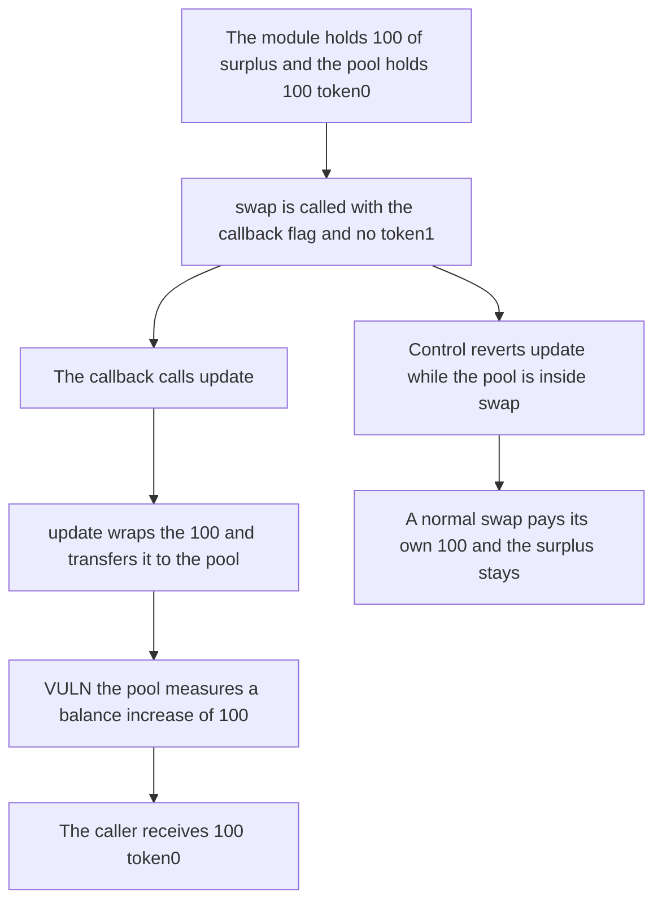

# Valantis surplus is spent as the caller's swap payment

> **Vulnerability classes:** vuln/reentrancy/callback-payment · vuln/defi/surplus-theft

<!-- non-defihacklabs -->
<!-- source-auditvault: https://github.com/Auditware/AuditVault/blob/main/findings/56683-vlts3-13-direct-theft-of-surplus-balance-when-unstaking-sthy.md -->
<!-- date: 2025-03 -->

## Key info

| Field | Value |
|---|---|
| **Loss** | The caller receives 100 stHYPE. The 100 of token1 that pays for it comes from the module's surplus, not from the caller |
| **Vulnerable contract** | `Pool.swap` |
| **Attacker EOA** | `0x1111111111111111111111111111111111111111` |
| **Attack contract** | `Exploit` at `0x15452ec016c4dc8c549e7fe6ff4b26324ea8b7a4` |
| **Attack tx** | `Exploit.run()` with value 100, forwarded to the module |
| **Chain / block / date** | Ethereum model · block 0 · 2025-03 |
| **Compiler** | solc 0.8.27, cancun, via IR |
| **Bug class** | `update` transfers surplus token1 into the pool during a swap callback, and the pool counts that balance increase as payment |



## TL;DR

`update` wraps a native surplus and `safeTransfer`s the wrapped token straight to the pool. A swap that sets `isSwapCallback` measures `token.balanceOf(pool)` after the callback and treats any increase as the caller's payment.

The module holds 100. The pool holds 100 token0. The caller has no token1. During the callback, `update` moves the 100 into the pool. The pool records a payment of 100 and sends 100 token0 to the caller.

The fixed `update` reverts while `pool.inSwap()` is true, so the callback cannot spend the surplus. A swap with the callback flag off pulls 100 of the caller's own token1, and the module still holds its 100.

## The vulnerable code

```solidity
uint256 got = token1.balanceOf(address(this)) - pre;
received = got; // @> VULN: token1 sent by update() during the callback counts as the caller's payment
require(got >= amountOut, "unpaid");
```

`update` is the quoted donor:

```solidity
token1.deposit{value: surplus}();
token1.transfer(address(pool), surplus);
```

## Impact

The module's 100 surplus pays for the caller's swap. The caller holds 100 stHYPE and spent none of their own token1.

## How to reproduce

```bash
cd 56683-vlts3-13-direct-theft-of-surplus-balance-when-unstaking-sthy_exp
forge test -vv
```

`test_exploit_surplus_pays_for_the_swap` asserts the attacker holds 100 token0 and the module balance is 0. `test_control_swap_cannot_spend_the_surplus` asserts the callback reverts and a paid swap leaves the 100 surplus in the module.

## Sources

- AuditVault finding: https://github.com/Auditware/AuditVault/blob/main/findings/56683-vlts3-13-direct-theft-of-surplus-balance-when-unstaking-sthy.md
- Hexens report: Valantis, 2025-03-17
