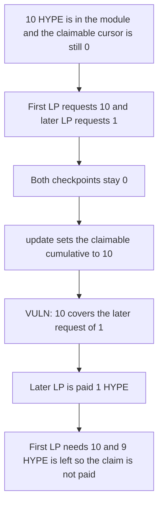

# Later stHYPE withdrawal takes 1 HYPE from an earlier 10 HYPE fill

> **Vulnerability classes:** vuln/logic/incorrect-state-transition · vuln/logic/incorrect-order-of-operations

<!-- non-defihacklabs -->
<!-- source-auditvault: https://github.com/Auditware/AuditVault/blob/main/findings/56685-vlts3-9-withdrawal-queue-priority-bypass-for-feeless-instant.md -->
<!-- date: 2025-03 -->

## Key info

| Field | Value |
|---|---|
| **Loss** | The later LP receives 1 HYPE. The first LP's 10 HYPE claim reverts. 9 HYPE remains in the module |
| **Vulnerable contract** | `stHYPEWithdrawalModule.burnToken0AfterWithdraw` / `claim` |
| **Attacker EOA** | `0x1111111111111111111111111111111111111111` (anyone; claim pays the stored recipient) |
| **Attack contract** | `Exploit` |
| **Attack tx** | `Exploit.run()` |
| **Chain / block / date** | Ethereum model · block 0 · 2025-03 |
| **Compiler** | solc 0.8.27, cancun, via IR |
| **Bug class** | Withdrawal checkpoint is the claimable cursor, not the amount already requested |

## TL;DR

Hexens VLTS3-9 says `burnToken0AfterWithdraw` stores `cumulativeAmountToken1ClaimableLPWithdrawal` on the request. That value changes in `update()`, and only after HYPE arrives. Two requests opened before the update share it. Here the module already holds 10 HYPE from the overseer and `update()` has not run. The first LP requests 10. The later LP requests 1. Both checkpoints are 0. `update()` raises the cursor to 10. The later check is `10 >= 0 + 1`, so the claim sends 1 HYPE. The first check is `10 >= 0 + 10`, but only 9 HYPE is left, so the 10 HYPE claim is not paid. The control stores the cumulative amount requested. The later LP is only claimable at 11, and the first LP is paid 10.

## Background

`stHYPEWithdrawalModule` turns stHYPE burns into HYPE claims. The claim is allowed when `cumulativeAmountToken1ClaimableLPWithdrawal` covers `checkpoint + amount`. The checkpoint written at request time is that same cumulative, not a running total of requests. Until `update()` counts newly received HYPE, every new request copies the old cursor. A smaller later request then fits inside a fill that was redeemed for an earlier, larger request. The report's sequence is a 10 HYPE request, a 10 HYPE redemption, a 1 HYPE request, then `update()`. This run starts from the state after the redemption and before `update()`, which is the state the bypass needs.

## The vulnerable code

```solidity
requests[1] = Request({recipient: LATER, amount: 1 ether, checkpoint: cumulativeClaimable});
laterNeed = requests[1].checkpoint + requests[1].amount;
// @> VULN: shared claimable checkpoint lets the later 1 HYPE request clear on the earlier fill
if (cumulativeClaimable < laterNeed) revert("cannotYetClaim");
```

The first request stored the same `cumulativeClaimable`, which was 0.

## Root cause

Readiness is `cumulativeClaimable >= checkpoint + amount`. `checkpoint` does not increase when a request is opened. It increases when `update()` observes a balance increase. Every request opened in between stores the same number, so the smallest one becomes ready as soon as the cursor moves by that smaller amount, even if an earlier request is still unpaid.

## Preconditions

- The module holds 10 HYPE. `claimable` and `cumulativeClaimable` are still 0, so `update()` has not counted the fill.
- The first request is 10 HYPE. The later request is 1 HYPE. Neither is the contract owner.
- `claim` pays the full request or not at all. It does not pay a partial 9 HYPE.

## Attack walkthrough

1. The first LP's checkpoint is 0. The later LP's checkpoint is 0.
2. `update()` sets `received` to 10 HYPE and `cumulativeClaimable` to 10.
3. The later need is 1. `10 < 1` is false, so the claim is allowed.
4. 1 HYPE is transferred to the later LP. `claimable` is 9.
5. The first need is 10. The time check passes. `9 >= 10` is false, so the first LP is not paid.
6. The module still holds 9 HYPE. The first LP's balance is 0.
7. The control checkpoints are 10 and 11. The later claim reverts. The first LP receives 10 HYPE and the module is empty.

## Diagrams



## Impact

The later LP receives 1 HYPE that was redeemed into a 10 HYPE fill opened for the first LP. The first LP is owed 10 HYPE, is time-ready, and receives nothing, because the claim requires the full 10 and only 9 remains. 9 HYPE sits in the module. The control refuses the later claim and pays the first LP 10 HYPE.

## Remediation

Store a cumulative requested amount on the request, and allow `claim` only when the claimable cumulative has reached that request's own cursor. A later request's cursor must sit strictly after the earlier request's amount.

## How to reproduce

```bash
cd 56685-vlts3-9-withdrawal-queue-priority-bypass-for-feeless-instant_exp
forge test -vv
```

`test_exploit_later_request_takes_fill` deals 10 HYPE to the module and asserts the later LP receives 1 HYPE, the first LP receives 0, and 9 HYPE remains. `test_control_queue_pays_first` asserts the later claim reverts and the first LP receives 10 HYPE. Captured output is `output.txt`.

## Sources

- AuditVault finding: https://github.com/Auditware/AuditVault/blob/main/findings/56685-vlts3-9-withdrawal-queue-priority-bypass-for-feeless-instant.md
- Hexens Valantis report: https://github.com/solodit/solodit_content/blob/main/reports/Hexens/2025-03-17-Valantis.md
