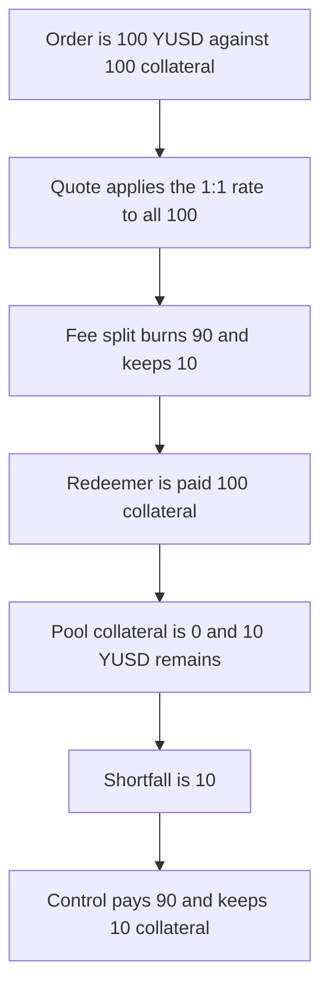

# Aegis YUSD — a redemption pays 100 collateral and burns 90

> **Vulnerability classes:** vuln/logic/fee-calculation · vuln/logic/incorrect-order-of-operations

<!-- non-defihacklabs -->
<!-- source-auditvault: https://github.com/Auditware/AuditVault/blob/main/findings/56707-h-1-insolvency-as-yusd-will-depeg-overtime-as-the-redemption.md -->
<!-- date: 2025-04 -->

## Key info

| | |
|---|---|
| **Protocol** | Aegis YUSD |
| **Finding** | Sherlock H-1, AuditVault 56707 |
| **Vulnerable code** | `AegisMinting.quoteCollateral` / `approveRedeemRequest` |
| **Harm** | The redeemer receives 100 collateral. Fair for the 90 YUSD burned is 90. The pool is short 10. |
| **Chain** | local synthetic |

## TL;DR

`approveRedeemRequest` prices the collateral off the full order amount. With the stored 1000 bps fee, 100 YUSD becomes a 10 YUSD fee and a 90 YUSD burn, but the collateral transfer is still 100. The pool's collateral goes to 0 while 10 YUSD remains outstanding at the insurance fund, with nothing behind it. Pricing the collateral off the burned amount pays 90 and leaves 10 collateral in the pool.

## The vulnerable code

```solidity
function quoteCollateral(uint256 amount) external returns (uint256) {
    // @> VULN: the 1:1 rate is applied to the full yusd amount, not to the amount that will be burned.
    quoted = amount * collateralRate / 10000;
    return quoted;
}
```

`collateralRate` is 10000, so the quote is the order amount itself. That is the report's `_calculateRedeemMinCollateralAmount(..., request.order.yusdAmount)` used before the fee is applied. The fee is then taken from YUSD and only `burnAmount` is burned:

```solidity
collateralAmount = this.quoteCollateral(amount);
(burnAmount, fee) = _calculateInsuranceFundFeeFromAmount(amount, redeemFeeBP);
yusd.transfer(insuranceFund, fee);
collateral.transfer(userWallet, collateralAmount);
yusd.burn(burnAmount);
```

```diff
- collateralAmount = this.quoteCollateral(amount);
+ (burnAmount, fee) = _calculateInsuranceFundFeeFromAmount(amount, redeemFeeBP);
+ collateralAmount = burnAmount * collateralRate / 10000;
```

## Root cause

The collateral leg uses the pre-fee YUSD amount. The burn leg uses the post-fee amount. The fee tokens stay in supply and are still a claim on collateral, but the collateral that should have backed them has already been sent to the redeemer. One redemption is enough to open the gap. No time has to pass for the shortfall to exist. Repeating it is what the report means by the depeg growing.

## Preconditions

The minting contract holds 100 collateral and 100 escrowed YUSD for the order. `redeemFeeBP` is 1000 and `collateralRate` is 10000, both stored at construction. The call is the funds-manager approval from the report. The whole thing is one transaction.

## Attack walkthrough

1. `approveRedeemRequest` quotes collateral as `100 * 10000 / 10000 = 100`.
2. The fee split is `fee = 10`, `burnAmount = 90`.
3. 10 YUSD moves to the insurance fund.
4. 100 collateral moves to the redeemer. The pool balance is 0.
5. 90 YUSD is burned. Supply left is 10.
6. `shortfall = 100 - 90 = 10`.

The redeemer received 100. Fair for the 90 burned is 90. The pool is short 10 against the fee YUSD. The control quotes from `burnAmount` instead, pays 90, and leaves 10 collateral in the pool. Its shortfall is 0.

## Diagrams



## Impact

The redeemer is paid 100 collateral for 90 YUSD burned. The insurance fund holds 10 YUSD that the pool can no longer redeem, because its collateral balance is 0. That is a 10 shortfall on a 100 order at a 10 percent fee. The fixed approval pays 90 and the 10 collateral left over matches the 10 fee YUSD.

## Remediation

Compute the fee first and pass `burnAmount`, not the full order amount, into the collateral quote. The collateral that stays in the pool is then the backing for the fee tokens.

## How to reproduce

```bash
cd 56707-h-1-insolvency-as-yusd-will-depeg-overtime-as-the-redemption_exp
forge test -vv
```

## Sources

- AuditVault finding: https://github.com/Auditware/AuditVault/blob/main/findings/56707-h-1-insolvency-as-yusd-will-depeg-overtime-as-the-redemption.md
- Sherlock issue: https://github.com/sherlock-audit/2025-04-aegis-op-grant-judging/issues/1
- Reduced from `AegisMinting.approveRedeemRequest` as quoted there (`_calculateRedeemMinCollateralAmount` on the full `yusdAmount`, then `_calculateInsuranceFundFeeFromAmount`, then the full collateral transfer and `yusd.burn(burnAmount)`).
