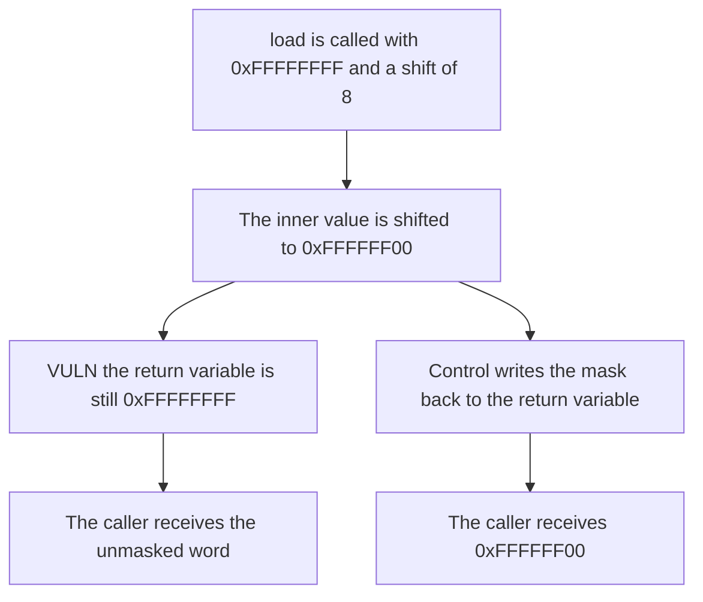

# mloadPotentiallyPaddedValue returns the word it was supposed to mask

> **Vulnerability classes:** vuln/logic/variable-shadow · vuln/data/memory-read

<!-- non-defihacklabs -->
<!-- source-auditvault: https://github.com/Auditware/AuditVault/blob/main/findings/56732-inner-variable-shadowing-causes-incorrect-return-in-mloadpot.md -->
<!-- date: 1970-01 -->

## Key info

| Field | Value |
|---|---|
| **Loss** | A word of 0xFFFFFFFF is returned unchanged. The mask clears it to 0xFFFFFF00, so the low byte 0xFF leaks through |
| **Vulnerable contract** | `Loader.load` |
| **Attacker EOA** | `0x1111111111111111111111111111111111111111` |
| **Attack contract** | `Exploit` at `0x15452ec016c4dc8c549e7fe6ff4b26324ea8b7a4` |
| **Attack tx** | `Exploit.run()` |
| **Chain / block / date** | Ethereum model · block 0 · 1970-01 |
| **Compiler** | solc 0.8.27, cancun, via IR |
| **Bug class** | An inner `let value` shadows the return variable, so the shift-and-mask is discarded |



## TL;DR

`mloadPotentiallyPaddedValue` loads a word and, when the read crosses `memoryBound`, shifts it so the bytes past the bound are zero. The shift is assigned to a new `let value` inside the `if`. That inner variable shadows the return variable, so the function returns the original word.

A word of `0xFFFFFFFF` with a shift of 8 should come back as `0xFFFFFF00`. The function returns `0xFFFFFFFF`. The low byte `0xFF` is the part the mask cleared. The control returns `0xFFFFFF00`.

The finding has no month, so the date marker is 1970-01.

## The vulnerable code

```solidity
value = word;
if (shift > 0) {
    uint256 inner = (value >> shift) << shift;
    masked = inner;
}
returned = value; // @> VULN: the masked inner value is not written back to the return variable
```

## Impact

Callers of the helper see bytes that sit past the memory bound. Here the returned word keeps `0xFF` that the mask had cleared.

## How to reproduce

```bash
cd 56732-inner-variable-shadowing-causes-incorrect-return-in-mloadpot_exp
forge test -vv
```

`test_exploit_returns_the_unmasked_word` asserts the return is `0xFFFFFFFF` and the mask was `0xFFFFFF00`. `test_control_returns_the_masked_word` asserts `0xFFFFFF00`.

## Sources

- AuditVault finding: https://github.com/Auditware/AuditVault/blob/main/findings/56732-inner-variable-shadowing-causes-incorrect-return-in-mloadpot.md
- OpenZeppelin report: zkSync EVM emulator
