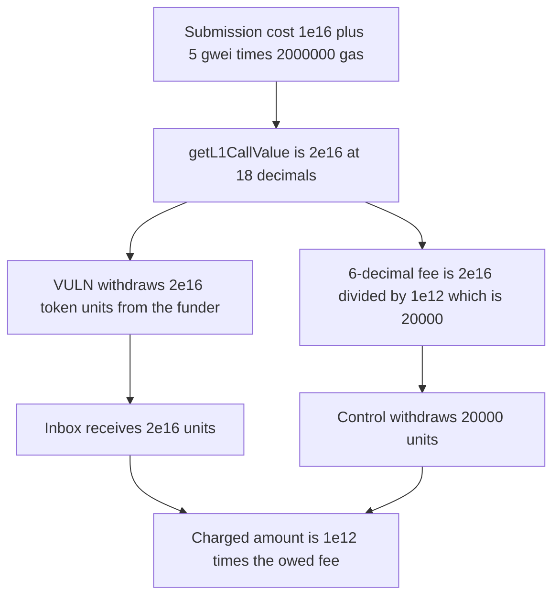

# Across withdraws an 18-decimal gas fee in the custom token's own decimals

> **Vulnerability classes:** vuln/arithmetic/decimal-mismatch · vuln/dos/gas-limit

<!-- non-defihacklabs -->
<!-- source-auditvault: https://github.com/Auditware/AuditVault/blob/main/findings/56752-wrong-scaling-for-amount-of-gas-tokens-openzeppelin-none-acr.md -->
<!-- date: 2024-08 -->

## Key info

| Field | Value |
|---|---|
| **Loss** | The funder is charged 2e16 raw units. The 6-decimal fee is 20000 raw units. The inbox receives 1e12 times the owed fee |
| **Vulnerable contract** | `Arbitrum_CustomGasToken_Adapter._pullCustomGas` |
| **Attacker EOA** | `0x1111111111111111111111111111111111111111` (the relayer) |
| **Attack contract** | `Exploit` |
| **Attack tx** | `Exploit.run()` |
| **Chain / block / date** | Ethereum model · block 0 · 2024-08 |
| **Compiler** | solc 0.8.27, cancun, via IR |
| **Bug class** | `getL1CallValue` is 18-decimal and is withdrawn unscaled |

## TL;DR

OpenZeppelin's Across diff audit says `getL1CallValue` returns `L2_MAX_SUBMISSION_COST + L2_GAS_PRICE * l2GasLimit`, and both terms are 18-decimal. `_pullCustomGas` withdraws that amount from `CUSTOM_GAS_TOKEN_FUNDER` and the inbox pulls it. `L2_GAS_PRICE` is 5 gwei. `relayMessage` uses a 2_000_000 gas limit. With a 0.01e18 submission cost the sum is 2e16. For a 6-decimal gas token the owed amount is `2e16 / 1e12 = 20000` raw units, 0.02 token. The withdraw moves 2e16 raw units, which is 20_000_000_000 tokens. The ratio is 1e12. The control divides before the withdraw and moves 20000 units, leaving the funder with `2e16 - 20000`.

## Background

`Arbitrum_CustomGasToken_Adapter` pays Arbitrum retryable tickets in the orbit chain's custom gas token. `AbsInbox` wants `maxSubmissionCost` and `maxFeePerGas` at 18 decimals. The token amount passed to `createRetryableTicket` is denominated in the token's own decimals. The adapter at commit `f56146a0` (2024-08-28) uses the 18-decimal sum as that token amount. The report's example is USDC, 6 decimals, which is short of 18 by `10^12`.

## The vulnerable code

```solidity
l2GasLimit = RELAY_MESSAGE_L2_GAS_LIMIT;
submissionCost = L2_MAX_SUBMISSION_COST;
gasTerm = L2_GAS_PRICE * l2GasLimit;
requiredL1CallValue = submissionCost + gasTerm;
fair = requiredL1CallValue / SCALE;
// @> VULN: 18-decimal getL1CallValue is withdrawn in the token's own decimals
balanceOf[FUNDER] -= requiredL1CallValue;
balanceOf[INBOX] += requiredL1CallValue;
```

`L2_GAS_PRICE` is `5e9`. `RELAY_MESSAGE_L2_GAS_LIMIT` is `2_000_000`. `SCALE` is `1e12`.

## Root cause

`getL1CallValue` is correct as an 18-decimal fee and wrong as a token amount whenever the custom gas token does not have 18 decimals. The withdraw and the inbox pull both consume it unchanged.

## Preconditions

- Submission cost is 1e16. Gas price is 5 gwei. The message gas limit is 2_000_000.
- The custom gas token has 6 decimals, so the scale factor is 1e12.
- The funder holds 2e16 raw units, exactly the unscaled fee, so the oversized withdraw succeeds.

## Attack walkthrough

1. `relayMessage` sets `l2GasLimit` to 2_000_000.
2. The submission term is 1e16. The gas term is `5e9 * 2_000_000 = 1e16`.
3. `getL1CallValue` is 2e16.
4. The 6-decimal amount is 20000 raw units.
5. The funder balance is reduced by 2e16. The inbox balance increases by 2e16.
6. `2e16 / 20000` is 1e12. The funder is empty.
7. The control withdraws 20000 and the funder keeps `2e16 - 20000`.

## Diagrams



## Impact

The gas-token funder pays 2e16 raw units into the inbox. The fee owed in a 6-decimal token is 20000 raw units, 0.02 token. The charge is larger by `10^12`. At 6 decimals, 2e16 units is 20_000_000_000 tokens. The control moves 20000 units and does not empty the funder.

## Remediation

Scale `getL1CallValue` by `10^(18 - tokenDecimals)` before `CUSTOM_GAS_TOKEN_FUNDER.withdraw` and before the `tokenTotalFeeAmount` passed to `createRetryableTicket`. For a 6-decimal token the divisor is `1e12`.

## How to reproduce

```bash
cd 56752-wrong-scaling-for-amount-of-gas-tokens-openzeppelin-none-acr_exp
forge test -vv
```

`test_exploit_withdraws_unscaled_fee` asserts a 2e16 pull, a fair amount of 20000, a ratio of 1e12, an empty funder, and an inbox balance of 2e16. `test_control_scales_before_withdraw` asserts a 20000 pull and a funder remainder of `2e16 - 20000`. Captured output is `output.txt`.

## Sources

- AuditVault finding: https://github.com/Auditware/AuditVault/blob/main/findings/56752-wrong-scaling-for-amount-of-gas-tokens-openzeppelin-none-acr.md
- Vulnerable adapter: https://github.com/across-protocol/contracts/blob/f56146a01ca9c62e6206a2c23c55dbe01a25a912/contracts/chain-adapters/Arbitrum_CustomGasToken_Adapter.sol
- OpenZeppelin write-up: https://blog.openzeppelin.com/across-protocol-diff-audit
