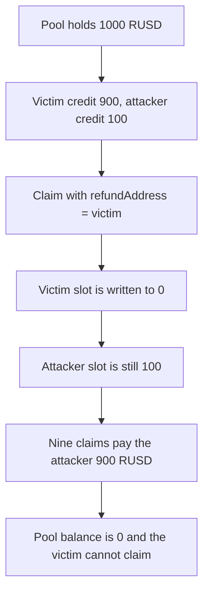

# Across SpokePool: `claimRelayerRefund` clears the wrong refund slot and can be repeated

> **Vulnerability classes:** vuln/logic/state-update · vuln/dos/frozen-funds

> **Reproduction:** cheatcode-free local synthetic. `SpokePool.claimRelayerRefund` is the audited body. Full trace: [output.txt](output.txt). PoC: [test/56784-anyone-can-lock-relayer-refunds-and-contract-can-be-drained_exp.sol](test/56784-anyone-can-lock-relayer-refunds-and-contract-can-be-drained_exp.sol).

<!-- non-defihacklabs -->
<!-- source-auditvault: https://github.com/Auditware/AuditVault/blob/main/findings/56784-anyone-can-lock-relayer-refunds-and-contract-can-be-drained.md -->
<!-- date: 2024-12 -->

**AuditVault taxonomy:** `lang/solidity` · `sector/options` · `severity/high` · OpenZeppelin Across Protocol SVM Solidity, December 2024

## Key info

| | |
|---|---|
| **Protocol** | Across SpokePool |
| **Finding** | OpenZeppelin, AuditVault 56784, high (published as critical in the report) |
| **Vulnerable code** | `SpokePool.claimRelayerRefund` |
| **Harm** | Attacker extracts 900 RUSD. Victim's 900 credit is set to 0. Pool balance ends at 0 |
| **Chain** | local synthetic |

## TL;DR

The function loads `relayerRefund[token][msg.sender]` and then stores 0 at `relayerRefund[token][refundAddress]`. Those keys are different whenever the caller asks to be paid somewhere else. One call with `refundAddress = victim` deletes the victim's 900 RUSD credit. Nine calls with `refundAddress = attacker` pay 100 RUSD each, because the caller's own credit is never cleared. The pool started with 1000 RUSD and ends at 0.

## The vulnerable code

```solidity
function claimRelayerRefund(address l2TokenAddress, address refundAddress) external {
    uint256 refundAmount = relayerRefund[l2TokenAddress][msg.sender];
    require(refundAmount > 0, "no refund");
    // @> VULN: zeroes refundAddress, not msg.sender, so the caller's credit survives
    relayerRefund[l2TokenAddress][refundAddress] = 0;
    IMini(l2TokenAddress).transfer(refundAddress, refundAmount);
}
```

The fixed body stores 0 at `msg.sender`. The same caller can take 100 RUSD once. A second claim reverts with `no refund`. The victim's 900 credit is still there and pays out in full.

## Diagrams


