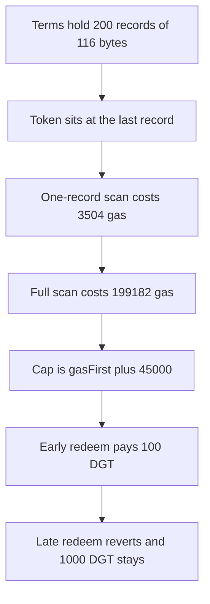

# MetaMask MultiTokenPeriodEnforcer: `getTermsInfo` scans every record and the late token cannot be redeemed

> **Vulnerability classes:** vuln/dos/gas-limit · vuln/dos/frozen-funds

> **Reproduction:** cheatcode-free local synthetic. `getTermsInfo` is the audited loop. Full trace: [output.txt](output.txt). PoC: [test/56801-gettermsinfo-reverts-because-of-block-gas-limit-fixed-consen_exp.sol](test/56801-gettermsinfo-reverts-because-of-block-gas-limit-fixed-consen_exp.sol).

<!-- non-defihacklabs -->
<!-- source-auditvault: https://github.com/Auditware/AuditVault/blob/main/findings/56801-gettermsinfo-reverts-because-of-block-gas-limit-fixed-consen.md -->
<!-- date: 2025-04 -->

**AuditVault taxonomy:** `lang/solidity` · `sector/staking` · `sector/wallet` · `severity/high` · ConsenSys MetaMask Delegation Framework, April 2025

## Key info

| | |
|---|---|
| **Protocol** | MetaMask Delegation Framework |
| **Finding** | ConsenSys Diligence, AuditVault 56801, high |
| **Vulnerable code** | `MultiTokenPeriodEnforcer.getTermsInfo` |
| **Harm** | 1000 DGT stays locked. The same gas cap redeems a one-record list and reverts on record 200 |
| **Chain** | local synthetic |

## TL;DR

`getTermsInfo` walks a packed `bytes` array in steps of 116 bytes until it finds the token. There is no index. A one-record call costs 3504 gas. The same token at record 200 of 200 costs 199182 gas. Inside a gas cap of `gasFirst + 45000` — the gas a heavy `redeemDelegations` would have left — the early redeem pays 100 DGT and the late redeem reverts. 1000 DGT remains on the enforcer.

The fixed function takes `_tokenIndex` and reads one record. Redeeming record 199 moves the 1000 DGT and uses well under 200000 gas.

## The vulnerable code

```solidity
for (uint256 offset_ = 0; offset_ < termsLength_;) {
    // @> VULN: every record is scanned, so a token at the end blows the remaining gas
    address token_ = address(bytes20(_terms[offset_:offset_ + 20]));
    if (token_ == _token) {
        // decode periodAmount, periodDuration, startDate and return
    }
    unchecked { offset_ += 116; }
}
```

## Diagrams


