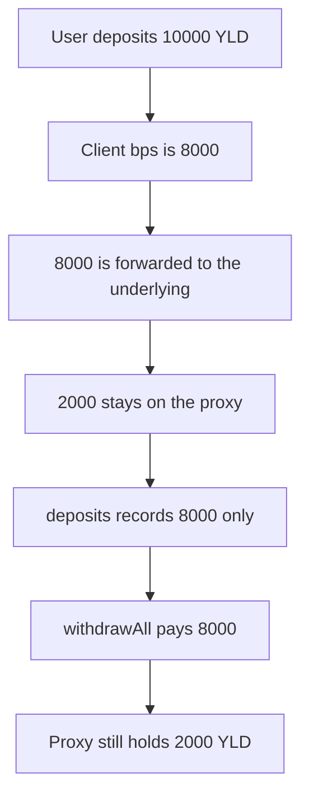

# P2P Yield Proxy: the deposit fee residual stays in the proxy with no withdraw path

> **Vulnerability classes:** vuln/dos/frozen-funds · vuln/logic/state-update

> **Reproduction:** cheatcode-free local synthetic. `_deposit` uses the audited formula. Full trace: [output.txt](output.txt). PoC: [test/56810-locked-residual-token-amounts-on-deposit-mixbytes-none-p2por_exp.sol](test/56810-locked-residual-token-amounts-on-deposit-mixbytes-none-p2por_exp.sol).

<!-- non-defihacklabs -->
<!-- source-auditvault: https://github.com/Auditware/AuditVault/blob/main/findings/56810-locked-residual-token-amounts-on-deposit-mixbytes-none-p2por.md -->
<!-- date: 2025-05 -->

**AuditVault taxonomy:** `lang/solidity` · `sector/staking` · `severity/high` · MixBytes P2P.org Staking Lending Proxy, May 2025

## Key info

| | |
|---|---|
| **Protocol** | P2P.org Staking Lending Proxy |
| **Finding** | MixBytes, AuditVault 56810, high |
| **Vulnerable code** | `P2pYieldProxy._deposit` |
| **Harm** | 2000 of 10000 YLD stays in the proxy after the user withdraws everything the books will pay |
| **Chain** | local synthetic |

## TL;DR

`_deposit` pulls `amount` and forwards `amount * s_clientBasisPointsOfDeposit / 10_000`. With the client share at 8000 bps, a 10000 YLD deposit forwards 8000 and leaves 2000 sitting on the proxy. `deposits[user]` is 8000. `withdrawAll` returns 8000. The 2000 is not tracked and has no transfer. The fixed deposit sends that residual to the treasury, and the proxy balance after withdraw is 0.

## The vulnerable code

```solidity
uint256 amountToDepositAfterFee = amount * s_clientBasisPointsOfDeposit / 10_000;
token.approve(address(underlying), amountToDepositAfterFee);
// @> VULN: amount - amountToDepositAfterFee stays in this proxy with no withdrawal path
underlying.deposit(amountToDepositAfterFee);
deposits[msg.sender] += amountToDepositAfterFee;
```

## Diagrams


