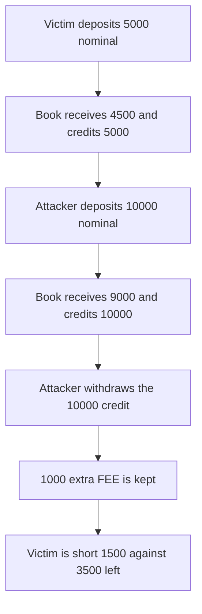

# Hanji LOB: `receiveTokens` credits fee-on-transfer tokens for more than it received

> **Vulnerability classes:** vuln/defi/fee-manipulation · vuln/logic/state-update

> **Reproduction:** cheatcode-free local synthetic. `LOB.receiveTokens` credits the nominal amount. Full trace: [output.txt](output.txt). PoC: [test/56840-incorrect-handling-of-fee-on-transfer-tokens-mixbytes-none-x_exp.sol](test/56840-incorrect-handling-of-fee-on-transfer-tokens-mixbytes-none-x_exp.sol).

<!-- non-defihacklabs -->
<!-- source-auditvault: https://github.com/Auditware/AuditVault/blob/main/findings/56840-incorrect-handling-of-fee-on-transfer-tokens-mixbytes-none-x.md -->
<!-- date: 2025-01 -->

**AuditVault taxonomy:** `lang/solidity` · `sector/dex` · `severity/high` · MixBytes XPress / Hanji OnchainCLOB

## Key info

| | |
|---|---|
| **Protocol** | XPress / Hanji OnchainCLOB |
| **Finding** | MixBytes, AuditVault 56840, high |
| **Vulnerable code** | `LOB.receiveTokens` |
| **Harm** | Attacker withdraws 1000 FEE that the pool never received from them. Victim credit 5000 vs 3500 tokens left |
| **Chain** | local synthetic |

## TL;DR

`receiveTokens` calls `transferFrom` and then adds the requested `amount` to the trader balance. A token that keeps 10% on the way into the book delivers 9000 of a 10000 deposit. The book still owes the attacker 10000. Withdraw pays 10000. The extra 1000 comes out of the victim's deposit. The victim was credited 5000, delivered 4500, and the pool has 3500 left, a 1500 shortfall. The fixed function measures the balance delta and reverts with `fee-on-transfer` when it is not equal to `amount`.

## The vulnerable code

```solidity
function receiveTokens(uint256 amount) external {
    token.transferFrom(msg.sender, address(this), amount);
    // @> VULN: credits `amount` with no check that the balance rose by `amount`
    balances[msg.sender] += amount;
}
```

## Diagrams


