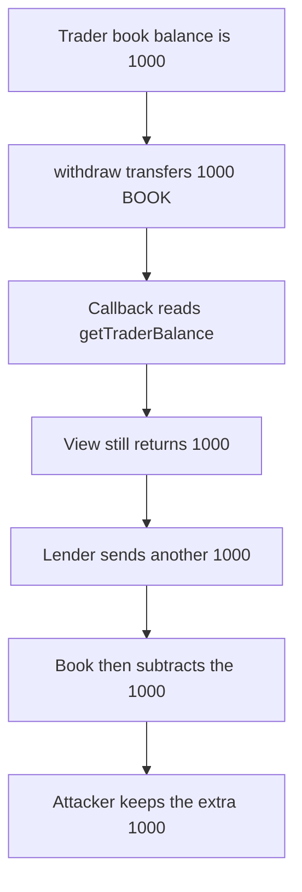

# Hanji LOB: `getTraderBalance` is stale during the withdraw callback

> **Vulnerability classes:** vuln/reentrancy/read-only · vuln/logic/state-update

> **Reproduction:** cheatcode-free local synthetic. The balance write is after the token transfer. Full trace: [output.txt](output.txt). PoC: [test/56842-potential-read-only-reentrancy-mixbytes-none-xpress-markdown_exp.sol](test/56842-potential-read-only-reentrancy-mixbytes-none-xpress-markdown_exp.sol).

<!-- non-defihacklabs -->
<!-- source-auditvault: https://github.com/Auditware/AuditVault/blob/main/findings/56842-potential-read-only-reentrancy-mixbytes-none-xpress-markdown.md -->
<!-- date: 2025-01 -->

**AuditVault taxonomy:** `lang/solidity` · `sector/dex` · `severity/high` · MixBytes XPress / Hanji OnchainCLOB

## Key info

| | |
|---|---|
| **Protocol** | XPress / Hanji OnchainCLOB |
| **Finding** | MixBytes, AuditVault 56842, high |
| **Vulnerable code** | `LOB.withdraw` / `getTraderBalance` |
| **Harm** | Lender pays 1000 BOOK against a view that still shows 1000 after the collateral has already moved |
| **Chain** | local synthetic |

## TL;DR

`withdraw` sends the tokens and only then decreases `balances[trader]`. The token notifies the recipient in between. `getTraderBalance` during that callback still returns 1000. A lender that requires `getTraderBalance >= amount` transfers another 1000. The trader keeps the honest 1000 withdraw and the attacker EOA receives the extra 1000. Updating the balance before `transfer` makes the same callback see 0, so the lender pays nothing and keeps its 1000.

## The vulnerable code

```solidity
function withdraw(uint256 amount) external {
    require(balances[msg.sender] >= amount, "bal");
    token.transfer(msg.sender, amount);
    // @> VULN: storage balance is updated after the token transfer notifies the recipient
    balances[msg.sender] -= amount;
}
```

## Diagrams


