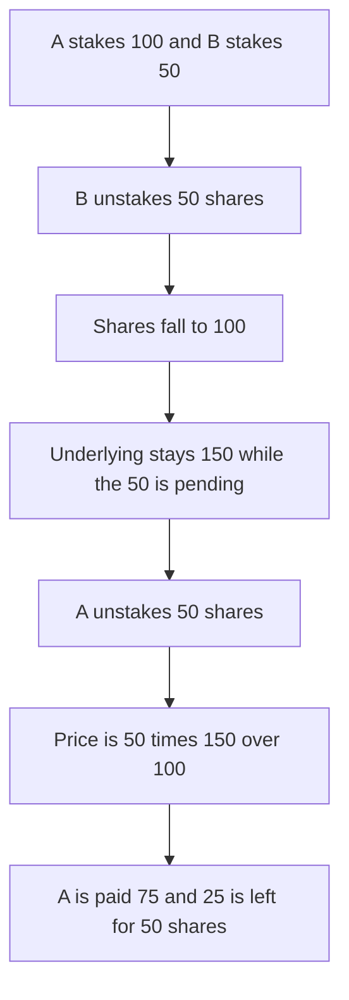

# Cabal: LP unstake burns the shares and still prices them against the pending underlying

> **Vulnerability classes:** vuln/logic/state-update · vuln/logic/reward-calculation

> **Reproduction:** cheatcode-free local synthetic of the Move accounting bug. The report's numbers are used: 50 shares unbond 75 tokens. Full trace: [output.txt](output.txt). PoC: [test/56895-h-01-lp-unstaking-only-burns-the-shares-but-leaves-the-under_exp.sol](test/56895-h-01-lp-unstaking-only-burns-the-shares-but-leaves-the-under_exp.sol).

<!-- non-defihacklabs -->
<!-- source-auditvault: https://github.com/Auditware/AuditVault/blob/main/findings/56895-h-01-lp-unstaking-only-burns-the-shares-but-leaves-the-under.md -->
<!-- date: 2025-04 -->

**AuditVault taxonomy:** `lang/solidity` · `sector/staking` · `severity/high` · Code4rena Cabal liquid staking, April 2025. The original is Move; this is the same share formula.

## Key info

| | |
|---|---|
| **Protocol** | Cabal liquid staking |
| **Finding** | ret2basic, Code4rena, AuditVault 56895, high |
| **Vulnerable code** | `process_lp_unstake` share pricing |
| **Harm** | 50 shares are paid 75 ULP. 25 ULP is taken from the remaining stake. The vault then holds 25 against 50 shares |
| **Chain** | local synthetic |

## TL;DR

Unstake burns the receipt shares immediately. The underlying tokens stay until the delayed undelegation is paid. The next unstake still multiplies by the full underlying balance. After A deposits 100 and B deposits 50, B's exit leaves 100 shares and 150 underlying, with 50 pending. A's exit of 50 shares computes `50 * 150 / 100 = 75`. The batch pays 75. A's remaining 50 shares have 25 ULP behind them. Subtracting `unstaked_pending_amounts` from the balance makes the same exit pay 50, and 50 ULP remains for the leftover shares.

## The vulnerable code

```solidity
uint256 lp_amount = totalUnderlying;
// @> VULN: lp_amount still includes unstaked_pending_amounts whose shares were already burned
unbonding_amount = shares * lp_amount / (totalShares + shares);
```

## Diagrams


