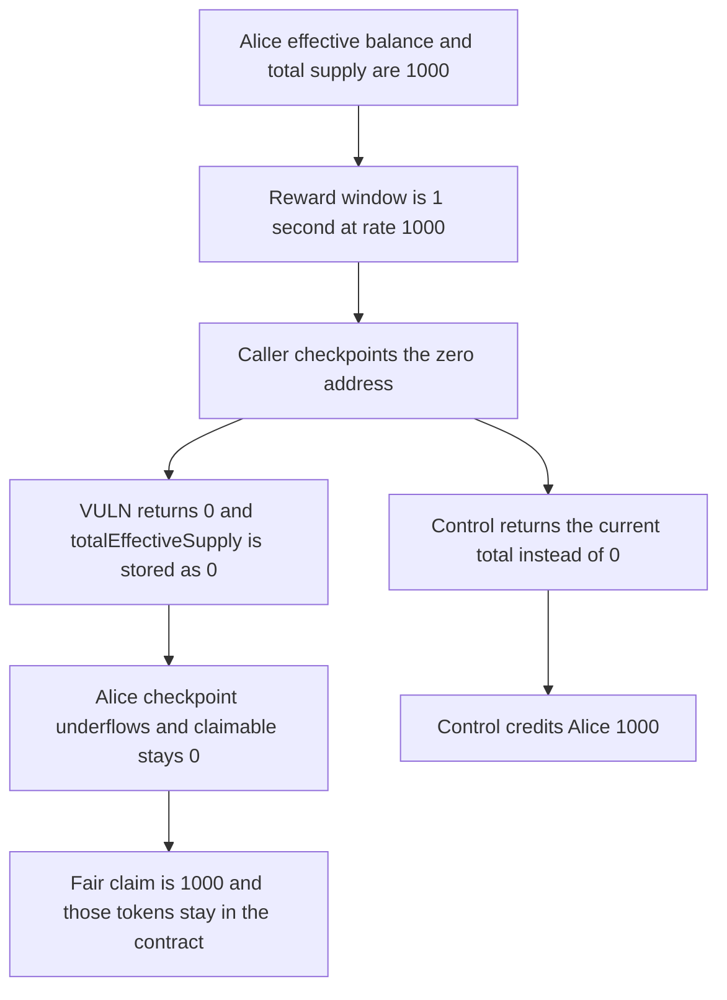

# Resolv Staking: checkpoint of the zero address zeroes totalEffectiveSupply

> **Vulnerability classes:** vuln/arithmetic/underflow · vuln/logic/reward-calculation

<!-- non-defihacklabs -->
<!-- source-auditvault: https://github.com/Auditware/AuditVault/blob/main/findings/56917-checkpoint-resets-totaleffectivesupply-mixbytes-none-resolv.md -->
<!-- date: 2025-08 -->

## Key info

| Field | Value |
|---|---|
| **Loss** | Alice's claimable reward is 0. The fair claim is 1,000. totalEffectiveSupply is 0 while the true effective sum is 1,000 |
| **Vulnerable contract** | `ResolvStaking.updateEffectiveBalance` |
| **Attacker EOA** | `0x1111111111111111111111111111111111111111` |
| **Attack contract** | `Exploit` |
| **Attack tx** | `Exploit.run()` |
| **Chain / block / date** | Ethereum model · block 0 · 2025-08 |
| **Compiler** | solc 0.8.27, cancun, via IR |
| **Bug class** | Zero-address checkpoint stores a zero total effective supply |

## TL;DR

`updateEffectiveBalance` returns 0 when the user is `address(0)`. `updateCheckpoint` is permissionless and forwards that address. `checkpoint` stores the return value as `totalEffectiveSupply`. Alice still has 1,000 of effective balance. The reward index for the one-second window is advanced against the real supply and is not credited to her. Her own checkpoint then computes `0 - 1,000 + 1,000`, which underflows and reverts. Claimable stays 0. The fair claim is 1,000 reward tokens, and those tokens stay in the staking contract. The control returns the current total for the zero address and credits 1,000.

## Background

MixBytes, Resolv Staking, finding 1. `ResolvStakingCheckpoints.updateEffectiveBalance` at the audited commit returns 0 for the zero address. A later user update then subtracts `oldEffectiveBalance` before adding `newEffectiveBalance`, so a zeroed total reverts and withdrawals cannot land. The recommended fixes are to return the current `totalEffectiveSupply` for the zero address, and to add the new balance before subtracting the old one. The client fixed this in resolv-contracts commit `56f2fe95`. This reduction keeps both lines and shows the reward shortfall: rate `1,000e18` per second, `lastUpdate` of 0, and a block timestamp of 1, so the fair accrual is exactly 1,000. No timestamp warp runs inside `run()`.

## The vulnerable code

```solidity
if (user == address(0)) {
    // @> VULN: returns zero for the zero address, and checkpoint stores that as totalEffectiveSupply
    return 0;
}
// ...
// @> VULN: subtracts the old balance before adding the new one, so a zeroed supply underflows
newTotalEffectiveSupply = total - oldEffectiveBalance + newEffectiveBalance;
```

The recommended change, from the report:

```diff
- return 0;
+ return totalEffectiveSupply;
- newTotalEffectiveSupply = total - oldEffectiveBalance + newEffectiveBalance;
+ newTotalEffectiveSupply = total + newEffectiveBalance - oldEffectiveBalance;
```

## Root cause

The zero address is not a staker, but the function treats it as one and returns a fresh total of 0. `checkpoint` assigns that return value straight into `totalEffectiveSupply`. Reward accrual divides by that total, so a later update cannot credit the index that was already moved. The subtraction order then reverts any real staker's checkpoint.

## Preconditions

- Alice's effective balance and `totalEffectiveSupply` are both 1,000.
- `lastUpdate` is 0. The block timestamp is 1. The reward rate is `1,000e18` per second.
- 1,000 reward tokens sit in the staking contract.
- Anyone can call `updateCheckpoint(address(0))`.

## Attack walkthrough

1. Alice is seeded at 1,000 effective stake. The true sum is 1,000.
2. 1,000 reward tokens are minted to the staking contract. That is the fair claim for the one-second window.
3. The caller checkpoints `address(0)`. The function returns 0, and `totalEffectiveSupply` becomes 0.
4. The reward index was updated against the real 1,000 supply and was not written onto Alice.
5. Alice's checkpoint hits `0 - 1,000 + 1,000` and reverts. Her claimable stays 0.
6. The control returns the existing total for the zero address. The same rate and window credit 1,000.

## Diagrams



## Impact

Alice is owed 1,000 reward tokens and is credited 0. The recorded total effective supply is 0. The sum of effective balances is still 1,000, so reward weight and the supply used for that weight are off by 1,000. The 1,000 tokens remain in the staking contract. The control credits the same 1,000.

## Remediation

Return the current `totalEffectiveSupply` when the user is the zero address, and compute `total + newEffectiveBalance - oldEffectiveBalance`. That is the change in resolv-contracts commit `56f2fe95`.

## How to reproduce

```bash
cd 56917-checkpoint-resets-totaleffectivesupply-mixbytes-none-resolv_exp
forge test -vv
```

`test_exploit_supply_zero_rewards_short` asserts a zero recorded supply, a true sum of 1,000, claimable 0, a fair claim of 1,000, and 1,000 tokens left in the contract. `test_control_keeps_supply_and_pays` asserts the fixed path keeps the supply and credits 1,000. Captured output is `output.txt`.

## Sources

- AuditVault finding: https://github.com/Auditware/AuditVault/blob/main/findings/56917-checkpoint-resets-totaleffectivesupply-mixbytes-none-resolv.md
- MixBytes report: https://github.com/mixbytes/audits_public/blob/master/Resolv/Staking/README.md#1-checkpoint-resets-totaleffectivesupply
- Audited file: https://github.com/resolv-im/resolv-contracts/blob/530d997b010b803691abab53835ad70f780ac5db/contracts/staking/libraries/ResolvStakingCheckpoints.sol#L128
- Fix: https://github.com/resolv-im/resolv-contracts/commit/56f2fe95f87a4e1f51221a366efb4fa697fdb2d0
