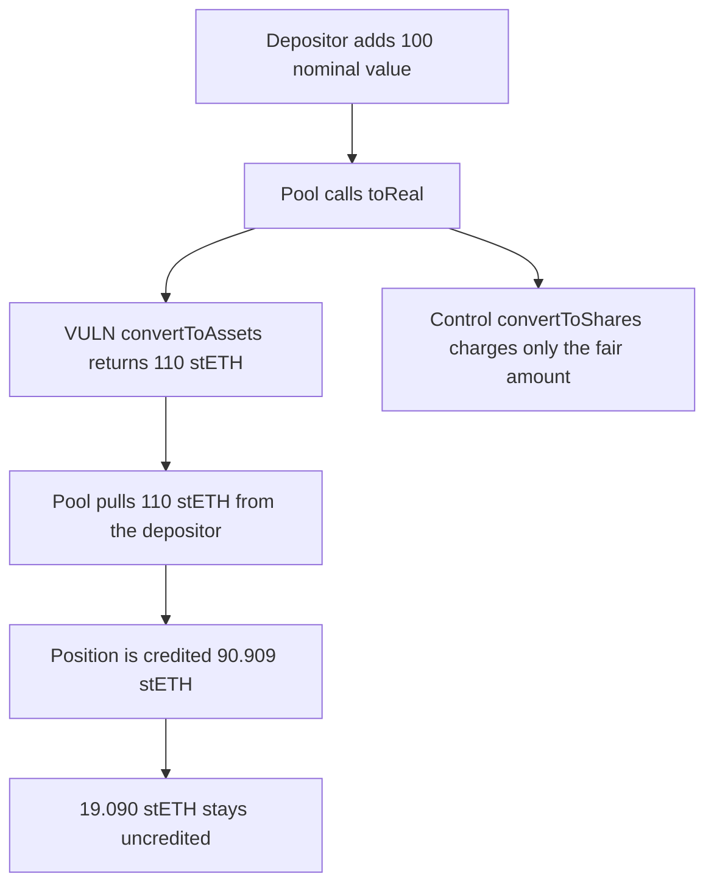

# Burve: ERC4626ViewAdjustor charges 110 stETH for a 100 nominal deposit

> **Vulnerability classes:** `vuln/logic/wrong-condition` · `vuln/logic/price-calculation`

<!-- non-defihacklabs -->
<!-- source-auditvault: https://github.com/Auditware/AuditVault/blob/main/findings/56951-h-2-incorrect-implementation-of-erc4626viewadjustor-sherlock.md -->
<!-- date: 2025-04 -->

## Key info

| Field | Value |
|---|---|
| **Loss** | 19.090909090909090910 stETH overcharged and left uncredited |
| **Vulnerable contract** | `ERC4626ViewAdjustor.toReal` |
| **Attacker EOA** | `0x1111111111111111111111111111111111111111` (the depositor) |
| **Attack contract** | `Exploit` |
| **Attack tx** | `Exploit.run()` |
| **Chain / block / date** | Ethereum model · block 0 · 2025-04 |
| **Compiler** | solc 0.8.27, cancun, via IR |
| **Bug class** | `toReal` calls `convertToAssets` and `toNominal` calls `convertToShares` |

## TL;DR

Burve's adjustor is supposed to turn a nominal value into the real LST amount and back. `toReal` calls `convertToAssets` and `toNominal` calls `convertToShares`. At 1 stETH = 1.1 ETH, a 100 nominal deposit is charged 110 stETH instead of 90.909090909090909090 stETH. The position is credited only the fair amount. The other 19.090909090909090910 stETH sits uncredited. Swapping the two ERC-4626 calls charges the fair amount.

## Background

Sherlock's April 2025 Burve contest, issue 113 (H-2). The report's example is a pool of stETH and WETH where 1 stETH = 1.1 WETH. Alice adds 100 of value and should post 100/1.1 stETH. `toReal` uses `convertToAssets`, so the pool asks for 110 stETH. The team fixed the pair in itos-finance/Burve commit c14995d.

## The vulnerable code

```solidity
function toReal(address token, uint256 nominal, bool) external view returns (uint256) {
    return getVault(token).convertToAssets(nominal); // @> VULN: toReal must be convertToShares
}
```

`toNominal` has the opposite mistake and calls `convertToShares`. The recommended change swaps the two calls.

```diff
- return getVault(token).convertToShares(real);
+ return getVault(token).convertToAssets(real);
- return getVault(token).convertToAssets(nominal);
+ return getVault(token).convertToShares(nominal);
```

## Root cause

Nominal means the underlying value. Real means the vault shares. `convertToAssets` prices shares as assets, so feeding it a nominal amount inflates the share count by the share price. `convertToShares` is the inverse and is what `toReal` needs.

## Preconditions

- The LST vault reports 1.1 assets per share. This run uses 1100 assets per 1000 shares.
- A multi-token pool prices one side with `ERC4626ViewAdjustor.toReal`.
- The depositor can pay the inflated amount. This run funds exactly 110 stETH.

## Attack walkthrough

1. The depositor adds 100 nominal value.
2. The pool calls `toReal`.
3. `convertToAssets(100)` returns 110 stETH.
4. The pool pulls 110 stETH.
5. The position is credited `100 * 1000 / 1100` = 90.909090909090909090 stETH.
6. The uncredited 19.090909090909090910 stETH remains in the surplus holder.

## Diagrams



## Impact

The depositor pays 110 stETH and is credited 90.909090909090909090 stETH. The difference, 19.090909090909090910 stETH, is no longer theirs. Other LPs, or the protocol, hold that surplus. The control adjustor, which calls `convertToShares`, charges only the fair amount.

## Remediation

Swap the bodies. `toNominal` must call `convertToAssets`. `toReal` must call `convertToShares`.

## How to reproduce

```bash
cd 56951-h-2-incorrect-implementation-of-erc4626viewadjustor-sherlock_exp
forge test -vv
```

`test_exploit_depositor_overpays_19_steth` asserts the 110 charge, the fair credit, and the surplus. `test_control_convertToShares_charges_fair` asserts the swapped function. Captured output is `output.txt`.

## Sources

- AuditVault finding: https://github.com/Auditware/AuditVault/blob/main/findings/56951-h-2-incorrect-implementation-of-erc4626viewadjustor-sherlock.md
- Sherlock judging issue 113: https://github.com/sherlock-audit/2025-04-burve-judging/issues/113
- Audited code: https://github.com/sherlock-audit/2025-04-burve/blob/44cba36e2a0c3cd7b6999459bf7746db92f8cc0a/Burve/src/integrations/adjustor/E4626ViewAdjustor.sol#L29-L71
- Fix: https://github.com/itos-finance/Burve/commit/c14995d806cdabc20bfedb094d585ed7b8668c8c
