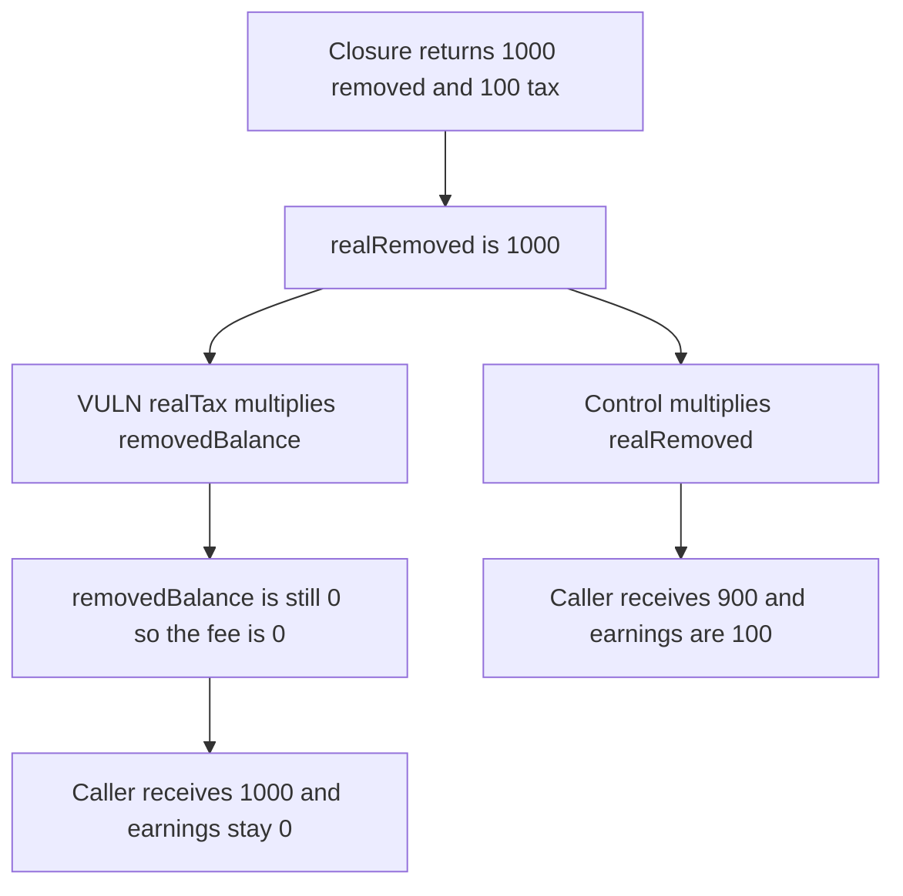

# Burve: removeValueSingle computes the fee from a return variable that is still zero

> **Vulnerability classes:** `vuln/logic/fee-calculation` · `vuln/logic/incorrect-order-of-operations`

<!-- non-defihacklabs -->
<!-- source-auditvault: https://github.com/Auditware/AuditVault/blob/main/findings/56955-h-6-fee-bypass-in-valuefacetremovevaluesingle-sherlock-burve.md -->
<!-- date: 2025-04 -->

**AuditVault taxonomy:** `lang/solidity` · `platform/sherlock` · `has/github` · `has/poc` · `severity/high` · `sector/dex` · genome: `fee-accounting` · `fee-calculation` · `use-reentrancy-guard` · `variant` · `math-is-safe`

## Key info

| Field | Value |
|---|---|
| **Loss** | 100 of protocol fee. The withdrawer is paid 1000 of a 1000 removal and earnings stay 0 |
| **Vulnerable contract** | `ValueFacet.removeValueSingle` |
| **Attacker EOA** | `0x1111111111111111111111111111111111111111` |
| **Attack contract** | `Exploit` |
| **Attack tx** | `Exploit.run()` |
| **Chain / block / date** | Ethereum model · block 0 · 2025-04 |
| **Compiler** | solc 0.8.27, cancun, via IR |
| **Bug class** | `realTax` multiplies the named return `removedBalance` before it is assigned |

## TL;DR

`removeValueSingle` returns `removedBalance`. That local is 0 until the function assigns it. The fee line multiplies `removedBalance` by `nominalTax` and divides by `removedNominal`, so `realTax` is 0. A removal of 1000 with a nominal tax of 100 pays the caller 1000 and adds 0 to earnings. Using `realRemoved` in the numerator keeps 100 and pays 900.

## Background

Sherlock's April 2025 Burve contest, H-6, issue 311, reported by v1c7 and many others. The closure returns `(removedNominal, nominalTax)`. The facet converts nominal units to real tokens, then prorates the fee. The prorate reads the return variable instead of `realRemoved`. The team fixed it in `itos-finance/Burve` commit `ca58c88be97e8f3f7a4617b171377d77fca52cdc` by substituting `realRemoved`.

## The vulnerable code

```solidity
uint256 realRemoved = removedNominal;
// @> VULN: removedBalance is still 0 here, so realTax is always 0
uint256 realTax = FullMath.mulDiv(removedBalance, nominalTax, removedNominal);
closure.addEarnings(vid, realTax);
removedBalance = realRemoved - realTax;
```

The report's fix:

```diff
- uint256 realTax = FullMath.mulDiv(removedBalance, nominalTax, removedNominal);
+ uint256 realTax = FullMath.mulDiv(realRemoved, nominalTax, removedNominal);
```

## Root cause

In Solidity a named return is a zero-initialized local. It is in scope for the whole function, so the compiler accepts the read. The assignment that gives it a meaning happens two lines later.

## Preconditions

- `closure.removeValueSingle` returns removed nominal 1000 and nominal tax 100. The adjustor is 1:1, so real removed is 1000.
- The facet holds 1000 of the token. `minReceive` is 0, so the slippage check does not reject the gross payout.

## Attack walkthrough

1. The fair fee is `1000 * 100 / 1000 = 100`.
2. `removeValueSingle` computes `realTax` from `removedBalance`, which is 0.
3. Earnings stay 0. The caller is transferred 1000.
4. The control multiplies `realRemoved` and pays 900, leaving 100 in the facet and 100 in earnings.

## Diagrams



## Impact

The withdrawer receives 1000 tokens. The protocol's earnings counter stays 0. The intended 10% fee, 100 tokens, is not retained. Every single-token removal on this path skips the fee the same way, which is the impact stated in issue 311.

## Remediation

Pass `realRemoved` as the first argument of `mulDiv`, then set `removedBalance = realRemoved - realTax`.

## How to reproduce

```bash
cd 56955-h-6-fee-bypass-in-valuefacetremovevaluesingle-sherlock-burve_exp
forge test -vv
```

`test_single_removal_pays_1000_and_records_no_fee` asserts a 0 fee and a 1000 payout. `test_control_realRemoved_keeps_100_fee` asserts a 900 payout and 100 of earnings. Captured output is `output.txt`.

## Sources

- AuditVault finding: https://github.com/Auditware/AuditVault/blob/main/findings/56955-h-6-fee-bypass-in-valuefacetremovevaluesingle-sherlock-burve.md
- Sherlock issue 311: https://github.com/sherlock-audit/2025-04-burve-judging/issues/311
- Blamed lines: https://github.com/sherlock-audit/2025-04-burve/blob/main/Burve/src/multi/facets/ValueFacet.sol#L214-L245
- Fix: https://github.com/itos-finance/Burve/commit/ca58c88be97e8f3f7a4617b171377d77fca52cdc
