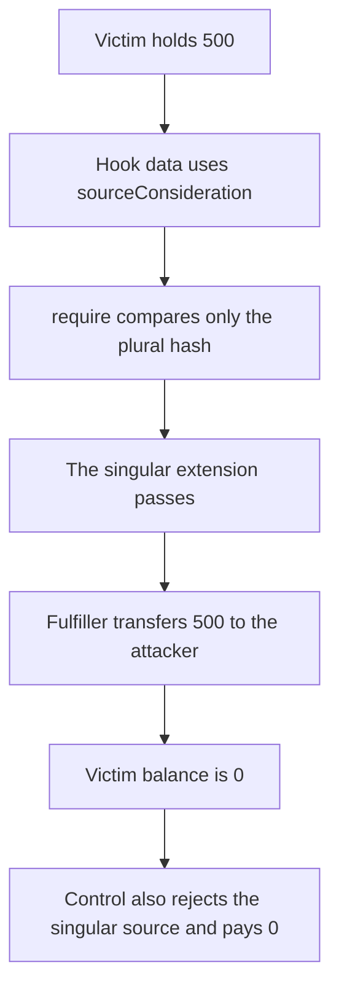

# FloodPlain — a singular sourceConsideration hook drains a fulfiller

> **Vulnerability classes:** vuln/logic/wrong-condition · vuln/logic/missing-check

<!-- non-defihacklabs -->
<!-- source-auditvault: https://github.com/Auditware/AuditVault/blob/main/findings/56966-floodplain-selector-extension-does-not-prevent-ifulfillersou.md -->
<!-- date: 2025-06 -->

## Key info

| | |
|---|---|
| **Protocol** | Bunni / FloodPlain |
| **Finding** | Cyfrin, AuditVault 56966 |
| **Vulnerable code** | `FloodPlain.execute` extension check |
| **Harm** | The attacker fulfills through the hook and takes 500. A check of the singular source pays 0. |
| **Chain** | local synthetic |

## TL;DR

`SELECTOR_EXTENSION` is `bytes28(keccak256("IFulfiller.sourceConsiderations"))`, with a final s. The hook require rejects that value and `permit2`. It does not reject `IFulfiller.sourceConsideration`. A victim fulfiller that trusts FloodPlain as `msg.sender` and accepts the singular extension transfers its inventory to the address in the hook data. Here that is 500 tokens. Also rejecting the singular hash makes the same call revert, and the attacker receives 0.

## The vulnerable code

```solidity
bytes28 public constant SELECTOR_EXTENSION = bytes28(keccak256("IFulfiller.sourceConsiderations"));

lastExtension = extension;
// @> VULN: only the plural sourceConsiderations extension is rejected, so sourceConsideration still runs.
require(extension != SELECTOR_EXTENSION && target != permit2, "MALICIOUS_CALL");
(bool ok,) = target.call(data);
```

The extension word is the 28 bytes after the 4-byte selector, the same `shl(32, calldataload(data.offset))` the report shows. The report's constant is the plural string. The hook data uses the singular string, which is what `IFulfiller.sourceConsideration` checks.

```diff
- require(extension != SELECTOR_EXTENSION && target != permit2, "MALICIOUS_CALL");
+ bytes28 singular = bytes28(keccak256("IFulfiller.sourceConsideration"));
+ require(extension != SELECTOR_EXTENSION && extension != singular && target != permit2, "MALICIOUS_CALL");
```

## Root cause

The guard compares against one magic value, and that value is not the selector extension of the callback the hook is actually able to invoke. A fulfiller that treats "called by FloodPlain, extension equals sourceConsideration" as proof of a real fill will approve or transfer to an attacker-chosen recipient during someone else's pre-hook.

## Preconditions

The victim holds 500 tokens. Its `sourceConsideration` requires `msg.sender` to be FloodPlain and the extension to be the singular hash, and then transfers `amount` to `recipient`. Both of those are under the attacker's control through the hook data. `permit2` is a different address, so the second half of the require does not save it. No signature or permit is required for this reduction: the report's pre-hook runs as an ordinary call from FloodPlain.

## Attack walkthrough

1. Mint 500 to the victim fulfiller.
2. ABI-encode `sourceConsideration(singular, attacker, 500)`.
3. `FloodPlain.execute` loads the extension. It equals the singular hash, not `SELECTOR_EXTENSION`.
4. The require passes.
5. The victim sees `msg.sender == FloodPlain` and the singular extension, and transfers 500 to the attacker.
6. The victim balance is 0. The attacker balance is 500.

The control `execute` also requires `extension != singular`. The same calldata reverts. The attacker balance stays 0 and the victim still holds 500.

## Diagrams



## Impact

The attacker receives the fulfiller's 500 token inventory by fulfilling a hook the extension check was supposed to block. The control, which checks the singular source as well as the plural one, transfers nothing.

## Remediation

Reject both `bytes28(keccak256("IFulfiller.sourceConsideration"))` and `bytes28(keccak256("IFulfiller.sourceConsiderations"))` before the hook call. Fulfillers should also require the extension they expect and should not treat FloodPlain as a sufficient caller on their own.

## How to reproduce

```bash
cd 56966-floodplain-selector-extension-does-not-prevent-ifulfillersou_exp
forge test -vv
```

## Sources

- AuditVault finding: https://github.com/Auditware/AuditVault/blob/main/findings/56966-floodplain-selector-extension-does-not-prevent-ifulfillersou.md
- Cyfrin report: https://github.com/solodit/solodit_content/blob/main/reports/Cyfrin/2025-06-10-cyfrin-bunni-v2.1.md
- Reduced from the `Hooks.execute` require and the `ThirdPartyFulfiller.sourceConsideration` callback quoted in that review.
