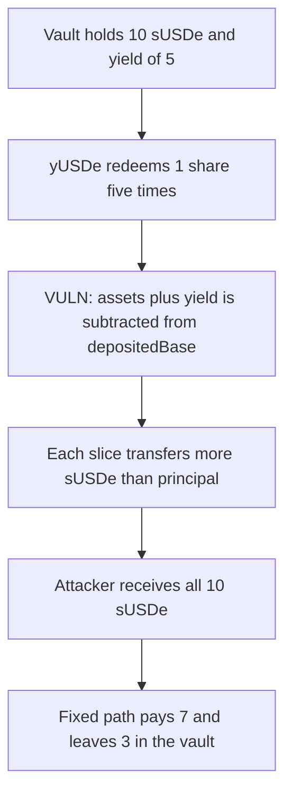

# Strata — a yield-phase redemption takes the vault's entire sUSDe balance

> **Vulnerability classes:** vuln/logic/reward-calculation · vuln/logic/state-update

<!-- non-defihacklabs -->
<!-- source-auditvault: https://github.com/Auditware/AuditVault/blob/main/findings/57015-an-attacker-can-drain-the-entire-protocol-balance-of-susde-d.md -->
<!-- date: 2025-06 -->

## Key info

| | |
|---|---|
| **Protocol** | Strata |
| **Finding** | Cyfrin (Dacian), AuditVault 57015 |
| **Vulnerable code** | `pUSDe` yield-phase `_withdraw` |
| **Harm** | The yUSDe redeemer receives all 10 sUSDe the vault held |
| **Chain** | local synthetic |

## TL;DR

After the yield phase, a yUSDe redemption is supposed to turn yUSDe into pUSDe into sUSDe and to pay the caller's principal plus that caller's sUSDe yield. `previewYield` is added into `assets`, and the same `assets` is both the amount passed to `sUSDe.previewWithdraw` and the amount subtracted from `depositedBase`. The base falls by principal plus yield. The next redemption treats the missing base as more yield. Five 1-share redemptions, after a 5 USDe donation and with one other depositor of 5, transfer all 10 sUSDe to the caller. The vault is left at 0. The fixed path subtracts only principal: the caller receives 7 and the vault keeps 3.

## The vulnerable code

```solidity
if (PreDepositPhase.YieldPhase == currentPhase()) {
    // @> VULN: yield is added into assets, and depositedBase is later decreased by that sum.
    assets += previewYield(caller, shares);
    uint256 sUSDeAssets = susde.previewWithdraw(assets);
    _settle(caller, receiver, owner, assets, sUSDeAssets, shares);
}

// inside _settle
depositedBase -= baseAssets;
susde.transfer(receiver, tokenAssets);
```

`previewYield` is the report's formula: `total_USDe - min(total_USDe, depositedBase)`, times the caller's yUSDe shares over yUSDe's pUSDe balance. `previewWithdraw` rounds up, which is the same direction the report flags.

```diff
- assets += previewYield(caller, shares);
- uint256 sUSDeAssets = susde.previewWithdraw(assets);
- _settle(..., assets, sUSDeAssets, shares);
+ uint256 assetsPlusYield = assets + previewYield(caller, shares);
+ uint256 sUSDeAssets = susde.previewWithdraw(assetsPlusYield);
+ _settle(..., assets, sUSDeAssets, shares);
```

## Root cause

Yield is a claim on sUSDe that sits above `depositedBase`. It has to be included when choosing how much sUSDe to transfer. It must not be included in the number subtracted from `depositedBase`, because that base is the principal still owed to pUSDe depositors. Subtracting it makes the next `previewYield` count principal as yield. Repeating the redemption walks the base to zero and the sUSDe balance out to the yUSDe caller.

## Preconditions

The vault is in the yield phase. sUSDe has yield, here from donating 5 USDe into sUSDe in the same transaction. The report's PoC does the same with `USDe.mint(address(sUSDe), ...)`. No block delay is required. One depositor's pUSDe has been moved into yUSDe. Another depositor's pUSDe has not.

## Attack walkthrough

1. A depositor mints 5 pUSDe. The vault holds 5 sUSDe and `depositedBase` is 5.
2. The attacker mints 5 more. The vault holds 10 sUSDe and `depositedBase` is 10.
3. The attacker moves those 5 pUSDe into yUSDe.
4. The yield phase starts. 5 USDe is donated into sUSDe. `previewRedeem` of the 10 shares is 15, so yield is 5.
5. yUSDe redeems 1 share, five times. Each pass adds `previewYield` into `assets`, transfers `previewWithdraw` of that sum, and subtracts the sum from `depositedBase`.
6. The attacker holds 10 sUSDe. The vault holds 0. `depositedBase` is 0.

The control uses the diff above on the same deposits and the same donation. The caller receives 7 sUSDe. The vault keeps 3. `depositedBase` ends at 5, the other depositor's principal.

## Diagrams



## Impact

The yUSDe caller receives the protocol's entire sUSDe balance, 10 shares, including the sUSDe that backs the other pUSDe depositor. That depositor's claim is 0. The fixed accounting pays the caller 7, which is their principal plus the yield this slice schedule assigns them, and leaves 3 shares in the vault.

## Remediation

Keep the yield inside the amount passed to `previewWithdraw`. Pass only the base assets, without yield, to the `depositedBase` subtraction.

## How to reproduce

```bash
cd 57015-an-attacker-can-drain-the-entire-protocol-balance-of-susde-d_exp
forge test -vv
```

## Sources

- AuditVault finding: https://github.com/Auditware/AuditVault/blob/main/findings/57015-an-attacker-can-drain-the-entire-protocol-balance-of-susde-d.md
- Cyfrin report: https://github.com/solodit/solodit_content/blob/main/reports/Cyfrin/2025-06-11-cyfrin-strata-v2.1.md
- Fix commit cited by the report: https://github.com/Strata-Money/contracts/commit/903d0528eedf784a34a393bd9210adb28451b27c
