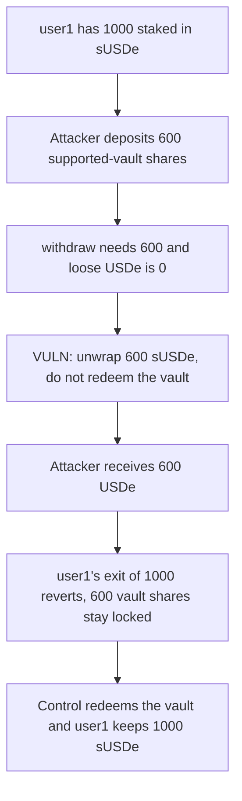

# Strata — a supported-vault withdrawal takes 600 out of sUSDe

> **Vulnerability classes:** vuln/logic/missing-check · vuln/dos/frozen-funds

<!-- non-defihacklabs -->
<!-- source-auditvault: https://github.com/Auditware/AuditVault/blob/main/findings/57016-during-the-yield-phase-when-using-supported-vaults-users-can.md -->
<!-- date: 2025-06 -->

## Key info

| | |
|---|---|
| **Protocol** | Strata pUSDe |
| **Finding** | Cyfrin, AuditVault 57016 |
| **Vulnerable code** | yield-phase `PVault.withdraw` |
| **Harm** | The supported-vault depositor pulls 600 USDe out of sUSDe. The other depositor is 600 short, and the 600 vault shares stay locked. |
| **Chain** | local synthetic |

## TL;DR

During the yield phase, pUSDe has already staked its USDe in sUSDe. A later deposit arrives as shares of a supported ERC-4626 vault, not as USDe. `withdraw` still pays by unwrapping sUSDe and never calls `redeem` on the supported vault. A user who deposited 600 that way withdraws 600 and receives USDe that belonged to the sUSDe depositor. That depositor's exit of 1000 reverts, because only 400 sUSDe is left and the 600 supported-vault shares are still sitting on pUSDe. Redeeming the supported vault first pays the 600 from the caller's own deposit and leaves the 1000 sUSDe in place, so the first depositor can withdraw all 1000.

## The vulnerable code

```solidity
if (loose < assets) {
    uint256 need = assets - loose;
    // @> VULN: yield-phase withdraw unwraps sUSDe and never redeems supported-vault shares.
    pulledFromSusde = need;
    susde.withdraw(need, address(this));
}
usde.transfer(user, assets);
```

The report's fix is a call to `redeemRequiredBaseAssets` when the loose USDe balance cannot cover the withdrawal. The alternative fix, which the protocol shipped, is to stop adding supported vaults during the yield phase. This reduction shows the missing redeem: the same 600 is paid either from sUSDe or from the supported vault.

```diff
- pulledFromSusde = need;
- susde.withdraw(need, address(this));
+ uint256 fromVault = min(need, supported.balanceOf(address(this)));
+ if (fromVault > 0) supported.redeem(fromVault, address(this));
+ need -= fromVault;
+ pulledFromSusde = need;
+ if (need > 0) susde.withdraw(need, address(this));
```

## Root cause

Yield-phase `_withdraw` knows how to turn sUSDe back into USDe and does not know how to turn a supported vault's shares back into USDe. `totalAssets` still counts those shares, so `withdraw` is allowed. The payment comes from the only liquid source the function understands, which is someone else's staked USDe, and the caller's vault shares remain in the contract. A later withdrawal that needs more USDe than the remaining sUSDe reverts.

## Preconditions

The vault is in the yield phase. One depositor has 1000 USDe staked in sUSDe. A second depositor has 600 USDe inside a supported vault and has given those shares to pUSDe. pUSDe holds no loose USDe. No block time passes. This is the supported-vault case from the same Strata review as the sUSDe redemption bug. It is not that bug: nothing here adds `previewYield` into `depositedBase`.

## Attack walkthrough

1. Deposit 1000 USDe for user1 and start the yield phase. pUSDe holds 1000 sUSDe.
2. Credit the attacker with 600 supported-vault shares, backed by 600 USDe, and deposit those shares into pUSDe.
3. The attacker withdraws 600. Loose USDe is 0, so `pulledFromSusde` is set to 600 and sUSDe unwraps 600.
4. The attacker holds 600 USDe. sUSDe left on pUSDe is 400. The supported vault still shows 600 shares owned by pUSDe.
5. user1's withdrawal of 1000 reverts. They are 600 short of the liquid stake they deposited.

The control withdraw redeems 600 from the supported vault and unwraps no sUSDe. The attacker is paid their 600. user1 then withdraws 1000 from the untouched sUSDe position.

## Diagrams



## Impact

The supported-vault depositor extracts 600 USDe from the sUSDe that backs the other depositor. That depositor can no longer withdraw their 1000: 400 sUSDe remains and the 600 of value in the supported vault is not redeemed, so the full exit reverts. They are 600 short. The fixed path pays the 600 from the supported vault, pulls 0 from sUSDe, and user1 withdraws 1000.

## Remediation

In the yield-phase withdraw, redeem supported-vault shares before unwrapping sUSDe, up to the shortfall. Do not pay a supported-vault deposit out of another user's staked USDe.

## How to reproduce

```bash
cd 57016-during-the-yield-phase-when-using-supported-vaults-users-can_exp
forge test -vv
```

## Sources

- AuditVault finding: https://github.com/Auditware/AuditVault/blob/main/findings/57016-during-the-yield-phase-when-using-supported-vaults-users-can.md
- Cyfrin report: https://github.com/solodit/solodit_content/blob/main/reports/Cyfrin/2025-06-11-cyfrin-strata-v2.1.md
- Fix cited by the report: https://github.com/Strata-Money/contracts/commit/076d23e2446ad6780b2c014d66a46e54425a8769
- Reduced from `pUSDeVault._withdraw` in the yield phase, which pays USDe without calling `redeemRequiredBaseAssets` for supported vaults.
