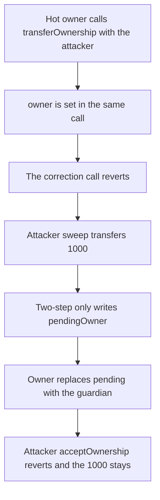

# Reserve — one-step ownership transfer lets the new address sweep 1000

> **Vulnerability classes:** vuln/access-control/missing-check · vuln/dependency/upgradeable-contract

<!-- non-defihacklabs -->
<!-- source-auditvault: https://github.com/Auditware/AuditVault/blob/main/findings/57067-lack-of-a-two-step-process-for-contract-ownership-changes-tr.md -->
<!-- date: 2022-08 -->

## Key info

| | |
|---|---|
| **Protocol** | Reserve |
| **Finding** | Trail of Bits, AuditVault 57067 |
| **Vulnerable code** | `Vault.commitOwner` / `_transferOwnership` |
| **Harm** | The attacker becomes owner in one step and sweeps 1000. Two-step accept fails and pays 0. |
| **Chain** | local synthetic |

## TL;DR

`OwnableUpgradeable._transferOwnership` writes `_owner = newOwner` in the same call. There is no pending owner and no accept. Once the vault's owner names the attacker, that address is owner before anyone can correct the transaction. The previous owner's follow-up `transferOwnership` reverts, and the attacker calls `sweep` and receives the vault's 1000 tokens. A two-step transfer only stores `pendingOwner`. The real owner then points that slot at a guardian. The attacker's `acceptOwnership` reverts, `sweep` reverts, and the 1000 stays in the vault.

## The vulnerable code

```solidity
function _transferOwnership(address newOwner) internal virtual {
    address oldOwner = _owner;
    _owner = newOwner;
    emit OwnershipTransferred(oldOwner, newOwner);
}
```

The reduction keeps that assignment and nothing else:

```solidity
require(msg.sender == address(this), "vault");
// @> VULN: one step. The new address is owner immediately, so the transfer cannot be reversed.
owner = newOwner;
```

```diff
- owner = newOwner;
+ pendingOwner = newOwner;
+ // new owner must call acceptOwnership, and the current owner can replace pendingOwner until then
```

## Root cause

The owner slot and the right to move funds change in one call. A wrong address, or a transaction whose recipient is the attacker, cannot be unwound by the previous owner, because `onlyOwner` now fails for them. Two-step leaves the current owner in place until the pending address calls `acceptOwnership`, and the current owner can replace `pendingOwner` before that call.

## Preconditions

The vault holds 1000 tokens. The current owner is a hot contract that calls `transferOwnership`. The landed call names the attacker. No second block is required: the correction attempt is the next call in the same transaction, and it already fails.

## Attack walkthrough

1. The hot owner calls `transferOwnership(attacker)`.
2. `commitOwner` sets `owner` to the attacker.
3. The hot owner calls `transferOwnership(guardian)` to undo it. `onlyOwner` reverts. The call returns false.
4. The attacker calls `sweep`. `onlyOwner` passes.
5. The vault transfers its 1000 token balance to `owner`, which is the attacker.

The control `transferOwnership` writes `pendingOwner` and does not touch `owner`. The hot owner first nominates the attacker, then replaces the pending address with the guardian. The attacker calls `acceptOwnership` and it reverts, because `msg.sender` is not the pending owner. `sweep` reverts. The attacker balance is 0 and the vault still holds 1000.

## Diagrams



## Impact

The attacker is the vault owner and receives its 1000 tokens. The previous owner cannot reverse the transfer. On the two-step vault the same attacker cannot complete acceptance after the pending address is corrected, and receives 0.

## Remediation

Use a two-step transfer. `transferOwnership` stores a pending owner. `acceptOwnership` requires `msg.sender` to be that address and only then writes `owner`. Until accept, the current owner can point the pending slot elsewhere.

## How to reproduce

```bash
cd 57067-lack-of-a-two-step-process-for-contract-ownership-changes-tr_exp
forge test -vv
```

## Sources

- AuditVault finding: https://github.com/Auditware/AuditVault/blob/main/findings/57067-lack-of-a-two-step-process-for-contract-ownership-changes-tr.md
- Trail of Bits report: https://github.com/trailofbits/publications/blob/master/reviews/2022-08-reserve-protocol-securityreview.pdf
- Reduced from `OwnableUpgradeable._transferOwnership` as quoted in that review (`_owner = newOwner` in one step). Reserve `Main` inherits it.
