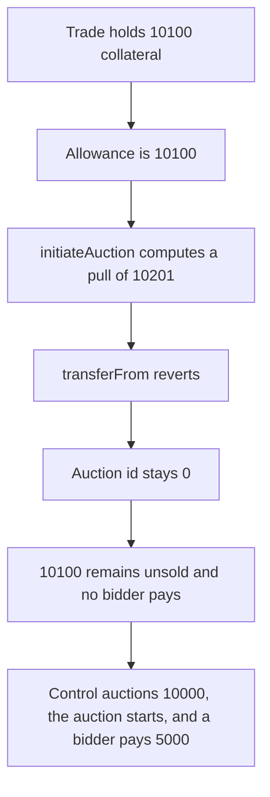

# Reserve — initiateAuction reverts, so 10100 collateral stays unsold

> **Vulnerability classes:** vuln/logic/missing-allowance · vuln/dos/frozen-funds

<!-- non-defihacklabs -->
<!-- source-auditvault: https://github.com/Auditware/AuditVault/blob/main/findings/57069-all-auction-initiation-attempts-may-fail-trailofbits-none-re.md -->
<!-- date: 2022-08 -->

## Key info

| | |
|---|---|
| **Protocol** | Reserve / Gnosis EasyAuction |
| **Finding** | Trail of Bits, AuditVault 57069 |
| **Vulnerable code** | `EasyAuction.initiateAuction` fee pull |
| **Harm** | The auction reverts. 10100 collateral stays in the trade. No bidder pays. The control starts the auction and a bidder pays 5000. |
| **Chain** | local synthetic |

## TL;DR

`GnosisTrade.init` approves EasyAuction for `sellAmount` and then calls `initiateAuction` with that same amount. EasyAuction transfers `sellAmount * (FEE_DENOMINATOR + feeNumerator) / FEE_DENOMINATOR`. With the fee set to 1 percent, 10100 becomes a pull of 10201. `transferFrom` reverts on allowance. The auction id stays 0, bids stay 0, and the 10100 collateral never leaves the trade. Approving the 10100 budget but auctioning `10100 * 100 / 101` (10000) pulls exactly 10100, the auction starts, and a bidder pays 5000.

## The vulnerable code

```solidity
sell.approve(address(gnosis), sellAmount);

uint256 pull = _auctionedSellAmount * (FEE_DENOMINATOR + feeNumerator) / FEE_DENOMINATOR;
// @> VULN: pulls sellAmount plus the fee. The trade only approved sellAmount, so the auction reverts.
pulled = pull;
_auctioningToken.transferFrom(msg.sender, address(this), pull);
```

`FEE_DENOMINATOR` is 100 and `feeNumerator` is 1. The report's formula is the same: `_auctionedSellAmount.mul(FEE_DENOMINATOR.add(feeNumerator)).div(FEE_DENOMINATOR)`. The report's fee cap is 1.5 percent. This reduction uses 1 percent so the integers divide cleanly. The allowance is still short.

```diff
- sell.approve(address(gnosis), sellAmount);
- gnosis.initiateAuction(sell, sellAmount);
+ uint256 actual = sellAmount * FEE_DENOMINATOR / (FEE_DENOMINATOR + feeNumerator);
+ sell.approve(address(gnosis), sellAmount);
+ gnosis.initiateAuction(sell, actual);
```

## Root cause

The allowance and the auctioned amount are the same number, and the auction contract adds a fee on top of the auctioned amount before `transferFrom`. Any non-zero fee makes the pull larger than the allowance. The call reverts, so defaulted collateral is never offered and no bidder can pay.

## Preconditions

The trade holds 10100 collateral. `feeNumerator` is 1. The fee is a stored parameter, not something that has to change during the transaction. `init` catches the revert so the outer call completes with `auctionId == 0`. No time passes and no bidder is reached, because there is no auction to bid on.

## Attack walkthrough

1. Mint 10100 collateral to the trade.
2. `init(10100)` approves EasyAuction for 10100.
3. `initiateAuction` computes `10100 * 101 / 100 = 10201`.
4. `transferFrom` of 10201 reverts. The allowance is 10100.
5. The catch sets `started` to false and leaves `auctionId` at 0.
6. The trade still holds 10100. The auction holds 0. `bids` is 0.

The control approves the same 10100 budget and auctions 10000. The pull is `10000 * 101 / 100 = 10100`, which the allowance covers. The auction id is 1, the collateral sits on the auction, and a bidder pays 5000 of the buy token.

## Diagrams



## Impact

10100 collateral stays in the trade. The auction never opens, so a bidder cannot pay and the collateral is not sold. On the fixed sizing the same 10100 moves into the auction and a bidder pays 5000.

## Remediation

Approve the full budget, and pass `sellAmount * FEE_DENOMINATOR / (FEE_DENOMINATOR + feeNumerator)` as the auctioned amount. The fee-inclusive pull then fits in the allowance.

## How to reproduce

```bash
cd 57069-all-auction-initiation-attempts-may-fail-trailofbits-none-re_exp
forge test -vv
```

## Sources

- AuditVault finding: https://github.com/Auditware/AuditVault/blob/main/findings/57069-all-auction-initiation-attempts-may-fail-trailofbits-none-re.md
- Trail of Bits report: https://github.com/trailofbits/publications/blob/master/reviews/2022-08-reserve-protocol-securityreview.pdf
- Reduced from `GnosisTrade.init` and `EasyAuction.initiateAuction` as quoted in that review. The fee pull is `_auctionedSellAmount * (FEE_DENOMINATOR + feeNumerator) / FEE_DENOMINATOR`.
