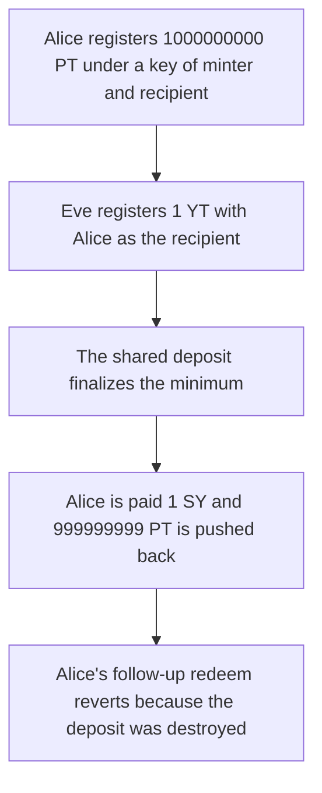

# FIVA YTMinter — a shared redeem deposit lets anyone finish the position

> **Vulnerability classes:** vuln/access-control/missing-auth · vuln/logic/missing-check · vuln/dos/griefing

> **Reproduction:** a self-contained Foundry PoC that compiles and runs offline
> with only `forge-std` — no fork and no RPC. Trace: [output.txt](output.txt).
> PoC: [test/57083-an-attacker-can-prevent-the-redemption-of-yt-and-pt-tokens-f_exp.sol](test/57083-an-attacker-can-prevent-the-redemption-of-yt-and-pt-tokens-f_exp.sol).

<!-- non-defihacklabs -->
<!-- source-auditvault: https://github.com/Auditware/AuditVault/blob/main/findings/57083-an-attacker-can-prevent-the-redemption-of-yt-and-pt-tokens-f.md -->
<!-- date: 2025-05 -->

---

## Key info

| | |
|---|---|
| **Impact** | **HIGH** — Alice's redemption of **1000000000** PT pays **1** SY, and her follow-up redeem reverts |
| **Protocol** | FIVA yield tokenization, `YTMinter` / `RedeemDeposit` |
| **Vulnerable code** | `depositKey` hashes `(minter, recipient)` and omits the jetton sender |
| **Bug class** | Missing sender in the redeem-deposit init state |
| **Finding** | Trail of Bits — Tarun Bansal, May 2025 · id 57083 |
| **Report** | [2025-05 FIVA review (PDF)](https://github.com/trailofbits/publications/blob/master/reviews/2025-05-FIVA-yieldtokenizationprotocol-securityreview.pdf) |
| **Source** | [AuditVault finding](https://github.com/Auditware/AuditVault/blob/main/findings/57083-an-attacker-can-prevent-the-redemption-of-yt-and-pt-tokens-f.md) |
| **Status** | Reproduced as a local Solidity reduction of the FunC init-state bug |
| **Compiler** | solc 0.8.27, cancun, via IR |

---

## TL;DR

A paired PT+YT redemption is stored under a key of `(minter, recipient)` only. Eve names Alice as the recipient and supplies **1** nano YT. The deposit finalizes `min(1000000000, 1) = 1`, mints **1** SY to Alice, and pushes **999999999** PT back. The deposit is then destroyed, so Alice's own `finishRedeem` of the original amount reverts.

Including `msg.sender` in the key gives Eve her own deposit. Alice's two legs then pay **1000000000** SY.

## The vulnerable code

The FunC helper is `calculate_redeem_deposit_state_init(my_address(), recipient_addr, code)`. The sender of the jetton is not an argument. The reduction keeps that hash:

```solidity
function depositKey(address recipient) public view returns (bytes32) {
    // @> VULN: init_state is (minter, recipient). The sender is omitted, so any caller hits this deposit.
    return keccak256(abi.encode(address(this), recipient));
}
```

When both legs are non-zero the deposit redeems the minimum and destroys itself, which is the `register_jetton` handler in `contracts/YT/redeem/deposit.fc`.

## Root cause

The temporary redeem account is addressable by anyone who knows the recipient. The first honest leg opens it. The second leg, from any caller, closes it at `min(pt, yt)`.

## Preconditions

- Alice has registered **1000000000** PT and has not yet sent the YT leg.
- Eve can call `registerJetton` with Alice as the recipient and **1** YT.

## Attack walkthrough

1. Alice's wallet registers **1000000000** PT. The key is `(minter, Alice)`.
2. Eve registers **1** YT with the same recipient. Both balances are non-zero.
3. Finalize mints **1** SY and returns **999999999** PT. The deposit is marked destroyed.
4. Alice calls `finishRedeem` for her YT. It reverts with `redeem closed`.

Control: the key is `(minter, recipient, msg.sender)`. Eve's 1 YT sits on her own deposit. Alice then delivers her own YT and receives **1000000000** SY.

## Diagrams



## Impact

The N-sized redemption does not pay N. Alice receives **1** SY instead of **1000000000**, **999999999** PT is forced back, and the follow-up call reverts. The fixed key pays **1000000000** SY and leaves Eve's 1 YT on a separate deposit.

## Remediation

Put the jetton sender in the redeem-deposit init state, so a deposit is unique to `(minter, recipient, sender)`.

## Sources

- [AuditVault finding 57083](https://github.com/Auditware/AuditVault/blob/main/findings/57083-an-attacker-can-prevent-the-redemption-of-yt-and-pt-tokens-f.md)
- [Trail of Bits, FIVA review, May 2025](https://github.com/trailofbits/publications/blob/master/reviews/2025-05-FIVA-yieldtokenizationprotocol-securityreview.pdf)
- Cited files: `contracts/YT/redeem.fc` and `contracts/YT/redeem/deposit.fc`

### Taxonomy

- `severity/high`
- `vuln/access-control/missing-auth` · `vuln/logic/missing-check` · `vuln/dos/griefing`
