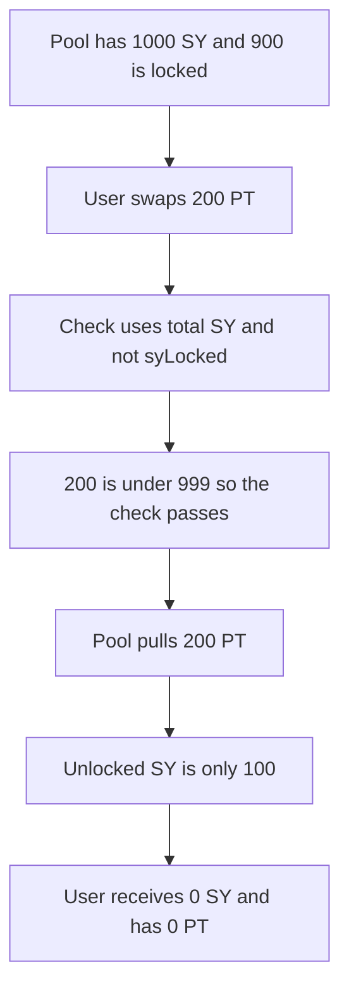

# FIVA AMM: the PT-to-SY balance check ignores locked SY and the user loses the PT

> **Vulnerability classes:** vuln/logic/state-update · vuln/input-validation/missing

> **Reproduction:** cheatcode-free local synthetic of the FunC check. The report's numbers are used: 1000 SY, 900 locked, 200 PT in, 0 SY out. Full trace: [output.txt](output.txt). PoC: [test/57088-an-incorrect-balance-check-for-the-pt-to-sy-swap-can-lead-to_exp.sol](test/57088-an-incorrect-balance-check-for-the-pt-to-sy-swap-can-lead-to_exp.sol).

<!-- non-defihacklabs -->
<!-- source-auditvault: https://github.com/Auditware/AuditVault/blob/main/findings/57088-an-incorrect-balance-check-for-the-pt-to-sy-swap-can-lead-to.md -->
<!-- date: 2025-05 -->

**AuditVault taxonomy:** `lang/solidity` · `sector/dex` · `severity/high` · Trail of Bits FIVA, May 2025. The original check is FunC; this is that comparison.

## Key info

| | |
|---|---|
| **Protocol** | FIVA yield tokenization |
| **Finding** | Trail of Bits, AuditVault 57088, high |
| **Vulnerable code** | `handle_swap_pt_for_sy` |
| **Harm** | User pays 200 PT and receives 0 SY. 900 of 1000 SY is locked. The check never looks at `syLocked` |
| **Chain** | local synthetic |

## TL;DR

Other swaps reject `sy_out > total_supply_sy - sy_locked - MINIMUM_LIQUIDITY`. The PT-to-SY swap drops `sy_locked`. With 1000 SY of which 900 is locked, a 200 PT swap is under the raw total, so it is accepted. The pool takes the 200 PT. It cannot pay 200 SY from the unlocked 100, so the user receives nothing. The fixed check includes `syLocked` and returns before `transferFrom`, and the user still has 200 PT.

On TON the SY payout is a later message, which is why a failed payout does not roll the PT pull back. This reproduction commits the pull and then skips the payout for the same reason: the unlocked balance is not the balance the check used.

## The vulnerable code

```solidity
// @> VULN: compares syOut to totalSupplySy and ignores syLocked
if (syOut < floorOut || syOut > (totalSupplySy - MINIMUM_LIQUIDITY)) {
    return 0;
}
pt.transferFrom(msg.sender, address(this), ptIn);
```

## Diagrams


