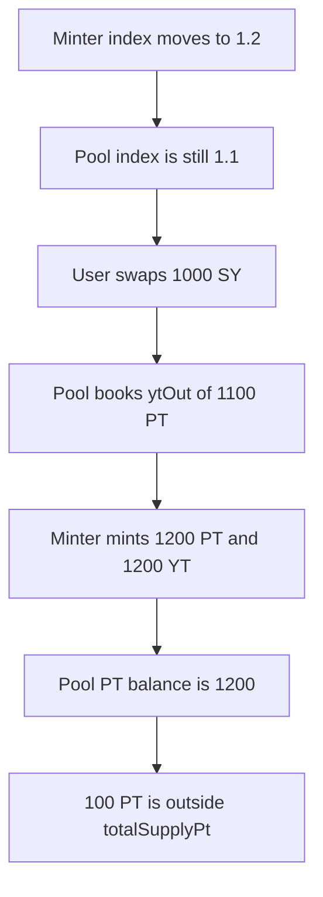

# FIVA: a swap between the minter index update and the pool index update sticks 100 PT

> **Vulnerability classes:** vuln/logic/state-update · vuln/logic/price-calculation

> **Reproduction:** cheatcode-free local synthetic of the FunC index race. No warp: the minter index is 1.2 and the pool index is still 1.1 in the same transaction. Full trace: [output.txt](output.txt). PoC: [test/57093-race-condition-in-yt-swap-and-index-update-can-lead-to-loss_exp.sol](test/57093-race-condition-in-yt-swap-and-index-update-can-lead-to-loss_exp.sol).

<!-- non-defihacklabs -->
<!-- source-auditvault: https://github.com/Auditware/AuditVault/blob/main/findings/57093-race-condition-in-yt-swap-and-index-update-can-lead-to-loss.md -->
<!-- date: 2025-05 -->

**AuditVault taxonomy:** `lang/solidity` · `sector/dex` · `severity/high` · Trail of Bits FIVA, May 2025. The original handlers are FunC; the index split is the same.

## Key info

| | |
|---|---|
| **Protocol** | FIVA yield tokenization |
| **Finding** | Trail of Bits, AuditVault 57093, high |
| **Vulnerable code** | Pool `ytOut = syOut * poolIndex / DIVIDER` against the minter's own index |
| **Harm** | 1000 SY mints 1200 PT onto the pool and the book records 1100. 100 PT is not in `totalSupplyPt` |
| **Chain** | local synthetic |

## TL;DR

The pool and the YT minter each store an index. A swap prices `ytOut` with the pool index and tells the minter to mint from `syOut`. The minter multiplies by its own index. If the minter was updated from 1.1 to 1.2 and the pool was not, a 1000 SY swap books 1100 PT and the minter delivers 1200 PT and 1200 YT. `balanceOf(pool) - totalSupplyPt` is 100. Those 100 PT sit on the pool outside the reserve accounting. Sending the pool index into the mint, which is the report's short-term fix, mints 1100 and the stuck amount is 0.

The window is two messages. This reproduction sets the minter index and leaves the pool index, then swaps, in one transaction. Nothing here depends on `warp`.

## The vulnerable code

```solidity
uint256 syOut = syIn;
// @> VULN: ytOut uses the pool index, which can lag the minter index
ytOut = syOut * poolIndex / DIVIDER;
totalSupplyPt += ytOut;
lastMinted = minter.mint(syOut, msg.sender, address(this));
```

The minter then does `minted = syAmount * index / DIVIDER` with `index` equal to 1.2, not 1.1.

## Diagrams


