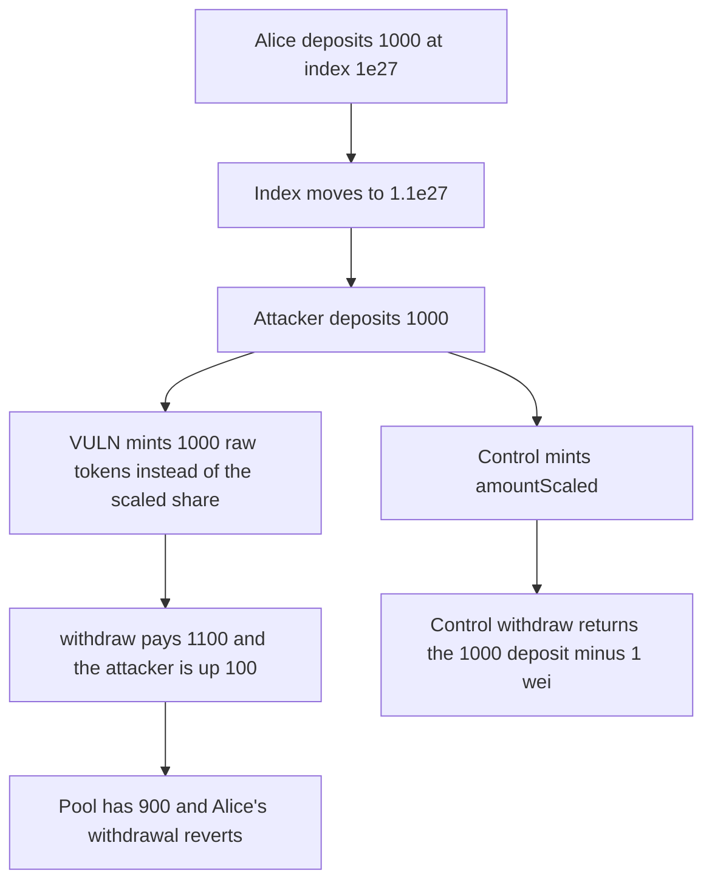

# RAAC: minting the underlying amount lets a 1000 deposit withdraw 1100

> **Vulnerability classes:** vuln/logic/state-update · vuln/logic/price-calculation

<!-- non-defihacklabs -->
<!-- source-auditvault: https://github.com/Auditware/AuditVault/blob/main/findings/57138-wrong-amount-is-minted-to-user-when-they-deposit-into-the-le.md -->
<!-- date: 2025-02 -->

## Key info

| Field | Value |
|---|---|
| **Loss** | Attacker deposits 1000 USD and withdraws 1100. Alice's 1000 is left with 900 in the pool and her withdrawal reverts |
| **Vulnerable contract** | `RToken.mint` |
| **Attacker EOA** | `0x1111111111111111111111111111111111111111` |
| **Attack contract** | `Exploit` |
| **Attack tx** | `Exploit.run()` |
| **Chain / block / date** | Ethereum model · block 0 · 2025-02 |
| **Compiler** | solc 0.8.27, cancun, via IR |
| **Bug class** | `_mint` receives the underlying amount instead of the scaled share |

## TL;DR

`mint` computes `amountScaled = amountToMint.rayDiv(index)` and then calls `_mint` with `amountToMint`. After the liquidity index moves from 1e27 to 1.1e27, a 1000 deposit is stored as 1000 raw tokens. `withdraw` pays `balance.rayMul(index)`, which is 1100. The extra 100 comes out of Alice's 1000. Alice's withdrawal reverts because the pool only has 900 left and her shares are quoted at 1100. Minting `amountScaled` returns the deposit within 1 wei.

## Background

CodeHawks contest `2025-02-raac` (3–24 February 2025). The report is "Wrong amount is minted to user when they deposit into the lending pool" by s4muraii77. The implementation was copied from Aave v3 `ScaledBalanceTokenBase._mintScaled`, which mints `amountScaled`, and the RAAC mint kept the unscaled amount.

## The vulnerable code

```solidity
uint256 amountScaled = amountToMint.rayDiv(index_);
if (amountScaled == 0) revert InvalidAmount();
userIndex[onBehalfOf] = index_.toUint128();
// @> VULN: mints amountToMint (underlying) instead of the scaled share amountScaled
_mint(onBehalfOf, amountToMint.toUint128());
```

Aave's corresponding line is `_mint(onBehalfOf, amountScaled.toUint128())`.

## Root cause

The token balance is later treated as a scaled share and multiplied by the liquidity index. Writing the underlying amount into that balance makes every later index above 1e27 pay more assets than were deposited.

## Preconditions

- Alice has 1000 USD credited at index 1e27, so her share count equals her deposit.
- The index is then 1.1e27 and no matching cash is added.
- The attacker deposits 1000 USD and withdraws in the same transaction.

## Attack walkthrough

1. Alice's 1000 USD is pulled in at index 1e27. She receives 1000 shares.
2. The index becomes 1.1e27.
3. The attacker deposits 1000. `amountScaled` is about 909.09. `_mint` writes 1000.
4. `withdraw` pays `1000 * 1.1 = 1100`. The attacker started the call with 1000 and ends with 1100.
5. The pool holds 900. Alice still has 1000 shares quoted at 1100, so her `withdraw` reverts.
6. The control mints the scaled amount. The same 1000 deposit at index 1.1e27 withdraws `1000 ether - 1`.

## Diagrams



## Impact

The attacker gains 100 USD that Alice deposited. Alice cannot withdraw: the pool's remaining 900 cannot cover the 1100 her shares are quoted at, and the transfer reverts. The control returns the attacker's own deposit.

## Remediation

Mint `amountScaled`, not `amountToMint`, which is the Aave `_mintScaled` line the report cites.

## How to reproduce

```bash
cd 57138-wrong-amount-is-minted-to-user-when-they-deposit-into-the-le_exp
forge test -vv
```

`test_exploit_unscaled_mint_withdraws_1100_for_a_1000_deposit` asserts a 1100 payout and 900 left in the pool. `test_control_scaled_mint_returns_the_deposit` asserts a payout of `1000 ether - 1`. Captured output is `output.txt`.

## Sources

- AuditVault finding: https://github.com/Auditware/AuditVault/blob/main/findings/57138-wrong-amount-is-minted-to-user-when-they-deposit-into-the-le.md
- CodeHawks contest: https://codehawks.cyfrin.io/c/2025-02-raac
- Aave reference: https://github.com/aave/aave-v3-core/blob/782f51917056a53a2c228701058a6c3fb233684a/contracts/protocol/tokenization/base/ScaledBalanceTokenBase.sol#L66-L88
