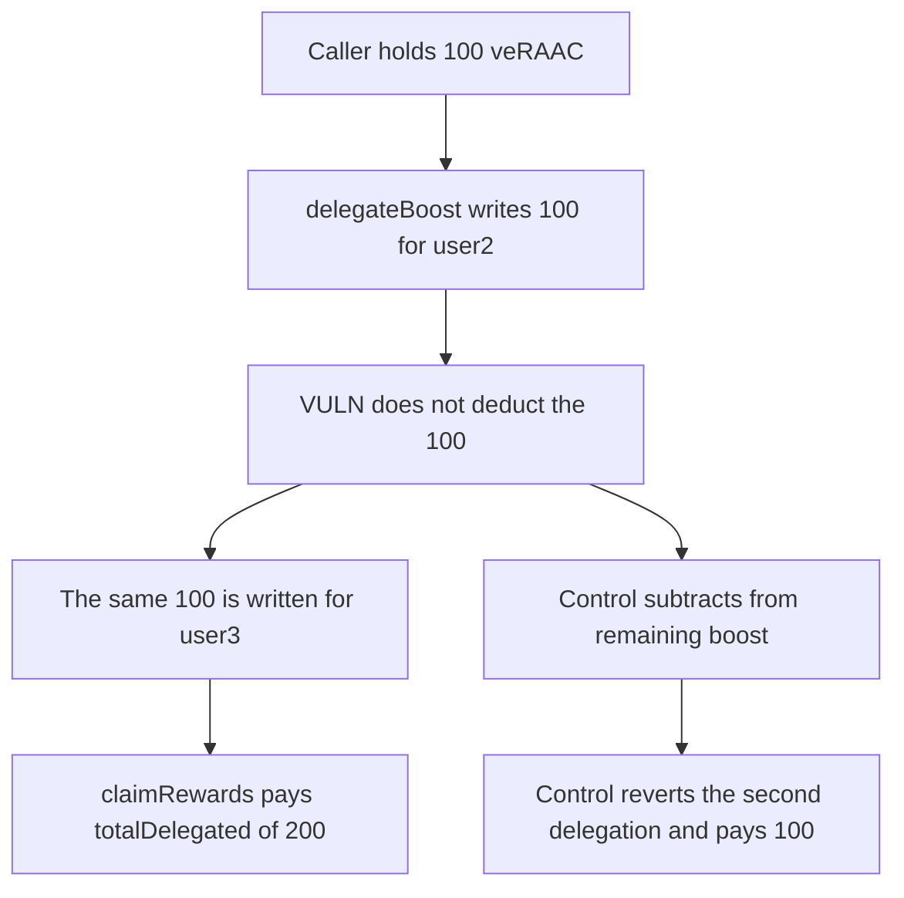

# One 100 veRAAC balance is delegated twice and claims 200 reward tokens

> **Vulnerability classes:** vuln/logic/state-update · vuln/logic/reward-calculation

<!-- non-defihacklabs -->
<!-- source-auditvault: https://github.com/Auditware/AuditVault/blob/main/findings/57145-multiple-delegation-by-double-spending-boosts-and-lack-of-de.md -->
<!-- date: 2025-02 -->

## Key info

| Field | Value |
|---|---|
| **Loss** | 200 reward tokens paid for 100 veRAAC. The second 100 is the same balance delegated again |
| **Vulnerable contract** | `BoostController.delegateBoost` |
| **Attacker EOA** | `0x1111111111111111111111111111111111111111` |
| **Attack contract** | `Exploit` |
| **Attack tx** | `Exploit.run()` |
| **Chain / block / date** | Ethereum model · block 0 · 2025-02 |
| **Compiler** | solc 0.8.27, cancun, via IR |
| **Bug class** | Delegation stored without deducting the caller's remaining boost |

## TL;DR

`delegateBoost` checks `ve.balanceOf(msg.sender) >= amount` and then writes a new `userBoosts[msg.sender][to]` row. It never subtracts `amount` from a remaining balance. The same 100 is delegated to two recipients. `claimRewards` pays `totalDelegated`, which is 200. The fixed controller decrements `remaining` and the second delegation reverts, so the claim pays 100.

## Background

Codehawks / Cyfrin RAAC contest, February 2025, reported by cd_pandora. `BoostController.delegateBoost` in `contracts/core/governance/boost/BoostController.sol` records a delegation and emits `BoostDelegated` without reducing the caller's boost. The report's test delegates 100 ether to user 2 and again to user 3 while the ve balance stays the same.

## The vulnerable code

```solidity
UserBoost storage delegation = userBoosts[msg.sender][to];
if (delegation.amount > 0) revert("BoostAlreadyDelegated");
// @> VULN: amount is stored for `to` and never deducted from the boost that can still be delegated
delegation.amount = amount;
delegation.expiry = block.timestamp + duration;
delegation.delegatedTo = to;
totalDelegated[msg.sender] += amount;
```

`BoostAlreadyDelegated` only blocks a second delegation to the same address. A new recipient is a free extra copy of the same boost.

## Root cause

The ve balance is an upper bound checked on each call, not a balance that is spent. `totalDelegated` therefore grows by `amount` on every new recipient, and `claimRewards` transfers that sum out of the reward pot.

## Preconditions

- The caller holds 100 veRAAC.
- The reward pot holds at least 200 reward tokens.
- Two distinct recipient addresses are used. Duration is 7 days, inside the allowed range.

## Attack walkthrough

1. `delegateBoost(user2, 100 ether, 7 days)` stores a delegation. The ve balance is still 100.
2. `delegateBoost(user3, 100 ether, 7 days)` stores a second row. `totalDelegated` is 200.
3. `claimRewards` transfers 200 reward tokens to the delegator.

## Diagrams



## Impact

The reward pot pays 200 tokens against a 100 token boost. The extra 100 is taken from rewards that belonged to other boost. The caller's ve balance is unchanged, so the same pattern can be repeated for more recipients until the pot is empty. The fixed path pays 100 and leaves the other 100 in the pot.

## Remediation

Keep a `remaining` balance initialized to the ve balance and subtract `amount` inside `delegateBoost`. Reject the call when `remaining` is below `amount`.

## How to reproduce

```bash
cd 57145-multiple-delegation-by-double-spending-boosts-and-lack-of-de_exp
forge test -vv
```

`test_exploit_same_boost_is_delegated_twice_and_paid` asserts both delegations are 100, the ve balance is still 100, and 200 reward tokens are received. `test_control_second_delegation_reverts_and_pays_100` asserts the second delegation reverts and the claim pays 100. Captured output is `output.txt`.

## Sources

- AuditVault finding: https://github.com/Auditware/AuditVault/blob/main/findings/57145-multiple-delegation-by-double-spending-boosts-and-lack-of-de.md
- Blamed function: https://github.com/Cyfrin/2025-02-raac/blob/main/contracts/core/governance/boost/BoostController.sol#L212-L235
