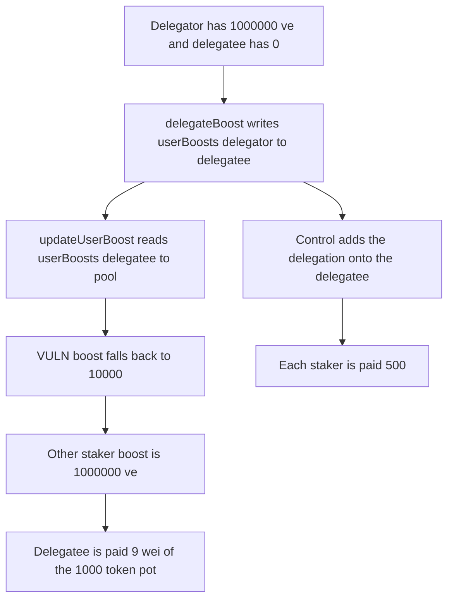

# RAAC: a delegated boost is stored on the delegator, so the delegatee is paid 9 wei of a 1000-token pot

> **Vulnerability classes:** `vuln/logic/reward-calculation` · `vuln/logic/incorrect-state-transition`

<!-- non-defihacklabs -->
<!-- source-auditvault: https://github.com/Auditware/AuditVault/blob/main/findings/57146-delegation-boost-not-usable-by-delegatees-codehawks-regnum-a.md -->
<!-- date: 2025-02 -->

## Key info

| Field | Value |
|---|---|
| **Loss** | Delegatee receives 9 wei. The other staker receives 999.999999999999999991 of a 1000-token pot |
| **Vulnerable contract** | `BoostController.delegateBoost` |
| **Attacker EOA** | `0x1111111111111111111111111111111111111111` (the delegator) |
| **Attack contract** | `Exploit` |
| **Attack tx** | `Exploit.run()` |
| **Chain / block / date** | Ethereum model · block 0 · 2025-02 |
| **Compiler** | solc 0.8.27, cancun, via IR |
| **Bug class** | `userBoosts[delegator][delegatee]` is never the slot `updateUserBoost` reads |

## TL;DR

`userBoosts` is documented as user then pool. `delegateBoost` writes `userBoosts[msg.sender][to]`, with the delegatee address in the pool slot. `updateUserBoost` reads `userBoosts[user][pool]` and `_calculateBoost` uses only that user's ve balance. A delegatee with no ve of their own is stored at `MIN_BOOST` of 10000. Against another staker with 1,000,000 ve, a 1000-token pot pays the delegatee 9 wei and the other staker the rest. Recording the delegation on the delegatee and adding it inside `_calculateBoost` pays each side 500.

## Background

CodeHawks contest "Core Contracts" for Regnum Aurum Acquisition Corp, 3–24 February 2025, `Cyfrin/2025-02-raac` at `89ccb062e2b175374d40d824263a4c0b601bcb7f`. The lead judge grouped the delegation reports as: BoostController's delegation system is broken because it treats the recipient as a pool and never updates pool boost from that record. AuditVault 57146 is that bug: a delegatee cannot use the boost that was delegated to them.

## The vulnerable code

```solidity
uint256 userBalance = ve.balanceOf(msg.sender);
if (userBalance < amount) revert InsufficientVeBalance();
// The slot below is userBoosts[msg.sender][to], not userBoosts[to][pool].
UserBoost storage delegation = userBoosts[msg.sender][to];
if (delegation.amount > 0) revert BoostAlreadyDelegated();
delegation.amount = amount;
delegation.expiry = block.timestamp + duration;
delegation.delegatedTo = to; // @> VULN: this write lands in userBoosts[delegator][delegatee], not the delegatee's pool boost
```

`updateUserBoost` then does:

```solidity
if (!supportedPools[pool]) revert PoolNotSupported();
UserBoost storage userBoost = userBoosts[user][pool];
uint256 newBoost = _calculateBoost(user, 10000);
userBoost.amount = newBoost;
```

`_calculateBoost` returns the 10000 base when `ve.balanceOf(user)` is 0. It never reads the delegation record.

## Root cause

One mapping is used for two keys. Pool boosts are `userBoosts[user][pool]`. Delegations are `userBoosts[delegator][delegatee]`. Settlement only reads the pool key, and the boost math only reads ve balance. The delegated amount is stored and then ignored, so the delegatee's working boost is the minimum.

## Preconditions

- The pool address is in `supportedPools`. `updateUserBoost` would revert otherwise, and nobody would be paid.
- The delegator and the other staker each have 1,000,000 ve. The delegatee has 0 ve.
- The reward pot is 1000 tokens. `MIN_BOOST` is 10000, matching the base amount passed into `_calculateBoost`.

## Attack walkthrough

1. The delegator and the other staker each receive 1,000,000 ve.
2. The delegator calls `delegateBoost` for the full balance and 7 days.
3. The record is readable at `userBoosts[delegator][delegatee]`. `userBoosts[delegatee][pool]` is empty.
4. `settle` updates the delegatee first. Ve balance is 0, so the boost written for the pool is 10000.
5. The other staker is updated from their own 1,000,000 ve.
6. The pot is split by those boosts. The delegatee receives 9 wei. The other staker receives `1000e18 - 9`.
7. The control adds `delegatedIn[delegatee]` and uses it in the boost math. Each side receives 500 tokens.

## Diagrams



## Impact

The delegatee was supposed to share the 1000-token pot with the other staker. They receive 9 wei. The other staker receives 999.999999999999999991 tokens, including the delegatee's missing half of 500. The control pays 500 to each.

## Remediation

Store incoming delegation on the delegatee, and add that amount inside `_calculateBoost` before the minimum-boost fallback. Do not treat the delegatee address as the pool key in `userBoosts`.

## How to reproduce

```bash
cd 57146-delegation-boost-not-usable-by-delegatees-codehawks-regnum-a_exp
forge test -vv
```

`test_exploit_delegatee_receives_dust_and_other_takes_the_pot` asserts the delegatee is under 1 token and the other staker is over 999, and that the two balances sum to 1000. `test_control_delegation_splits_the_pot` asserts 500 and 500. Captured output is `output.txt`.

## Sources

- AuditVault finding: https://github.com/Auditware/AuditVault/blob/main/findings/57146-delegation-boost-not-usable-by-delegatees-codehawks-regnum-a.md
- Contest: https://codehawks.cyfrin.io/c/2025-02-raac
- Judging note on the broken delegation mapping: https://codehawks.cyfrin.io/c/2025-02-raac/s/2879
- BoostController: https://github.com/Cyfrin/2025-02-raac/blob/89ccb062e2b175374d40d824263a4c0b601bcb7f/contracts/core/governance/boost/BoostController.sol
