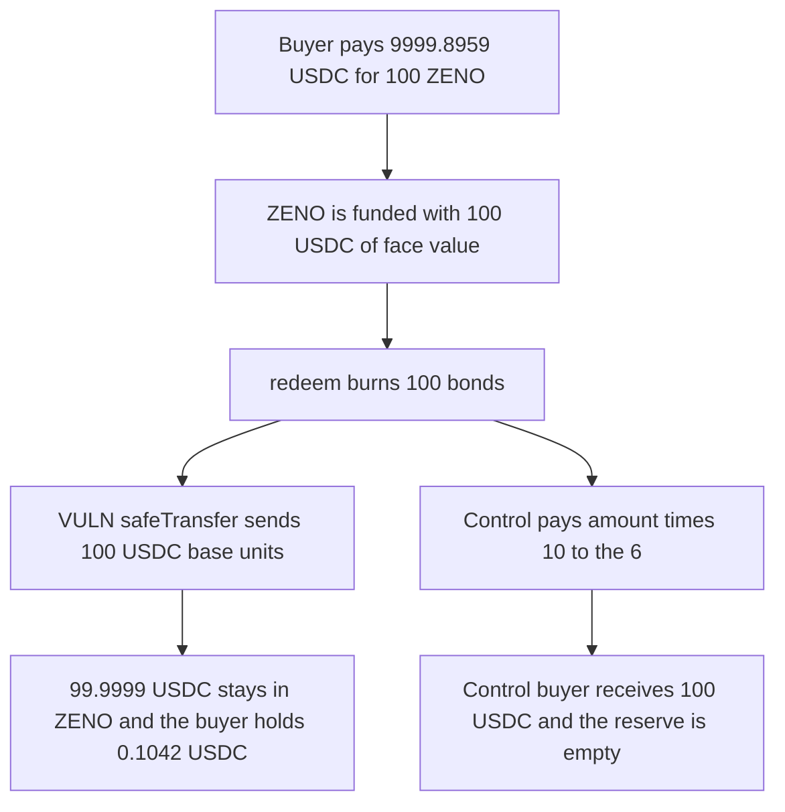

# RAAC: redeeming 100 ZENO pays 0.0001 USDC and leaves 99.9999 USDC in the contract

> **Vulnerability classes:** vuln/arithmetic/decimal-mismatch · vuln/logic/price-calculation

<!-- non-defihacklabs -->
<!-- source-auditvault: https://github.com/Auditware/AuditVault/blob/main/findings/57151-zeno-token-redemption-returns-negligible-usdc-amount-compare.md -->
<!-- date: 2025-02 -->

## Key info

| Field | Value |
|---|---|
| **Loss** | Holder paid 9,999.8959 USDC for 100 bonds and is paid 100 USDC base units. 99.9999 USDC of face value stays in ZENO |
| **Vulnerable contract** | `Zeno.redeem` |
| **Attacker EOA** | `0x1111111111111111111111111111111111111111` |
| **Attack contract** | `Exploit` |
| **Attack tx** | `Exploit.run()` |
| **Chain / block / date** | Ethereum model · block 0 · 2025-02 |
| **Compiler** | solc 0.8.27, cancun, via IR |
| **Bug class** | Whole-bond amount is transferred as 6-decimal USDC units |

## TL;DR

A ZENO balance is a count of bonds. USDC has 6 decimals. `redeem` burns `amount` bonds and `safeTransfer`s that same integer of USDC. Buying 100 bonds costs 9,999.8959 USDC, the number in the CodeHawks test. At maturity the contract holds 100 USDC of face value and pays 100 base units, which is 0.0001 USDC. The buyer is left with 0.1042 USDC. Scaling the payout with `amount * 10**6` pays the 100 USDC and empties the reserve.

## Background

CodeHawks contest `2025-02-raac` (3–24 February 2025). The report is "ZENO Token Redemption Returns Negligible USDC Amount Compared to Purchase Price" by victortheoracle. The recommended fix is `uint256 usdcAmount = amount * (10 ** 6)`.

## The vulnerable code

```solidity
function redeem(uint256 amount) external {
    if (block.timestamp < maturity) revert BondNotRedeemable();
    _burn(msg.sender, amount);
    uint256 usdcBalance = USDC.balanceOf(address(this));
    if (usdcBalance < amount) revert InsufficientBalance();
    // @> VULN: pays `amount` USDC base units instead of amount * 10**6, so 100 ZENO returns 0.0001 USDC
    USDC.safeTransfer(msg.sender, amount);
}
```

The balance check compares the reserve to `amount` (100), not to `amount * 10**6` (100_000_000), so the dust transfer succeeds.

## Root cause

The bond count and the USDC base unit are treated as the same integer. One bond of face value is 1 USDC, which is `10**6` base units, not 1.

## Preconditions

- The auction price is 99.998959 USDC per bond, so 100 bonds cost 9,999.8959 USDC.
- Maturity has passed. The ZENO contract holds 100 USDC, the face reserve.
- The holder calls `redeem(100)`.

## Attack walkthrough

1. `buy(100)` pulls 9,999.8959 USDC to the business account and mints 100 bonds.
2. 100 USDC is minted onto the ZENO contract.
3. `redeem(100)` burns the bonds.
4. `safeTransfer` sends 100 base units. `returned` is 100. The contract still holds 99,999,900 base units.
5. The holder's USDC balance is 104,200, which is 0.1042 USDC.
6. The control pays `amount * 10**6`. The holder receives 100 USDC and the reserve is 0.

## Diagrams



## Impact

The holder does not receive the 1 USDC per bond the redemption is supposed to pay. Of the 100 USDC face reserve, 99.9999 USDC never leaves the contract. Against the 9,999.8959 USDC purchase, the holder is left with 0.1042 USDC. The control pays the full 100 USDC face value.

## Remediation

Set `usdcAmount = amount * (10 ** 6)` and transfer `usdcAmount`, and compare the reserve to `usdcAmount` rather than to `amount`.

## How to reproduce

```bash
cd 57151-zeno-token-redemption-returns-negligible-usdc-amount-compare_exp
forge test -vv
```

`test_exploit_redeem_pays_100_usdc_units_instead_of_100_usdc` asserts a 100-unit payout and 99.9999 USDC retained. `test_control_scaled_redeem_pays_100_usdc` asserts a 100 USDC payout and an empty reserve. Captured output is `output.txt`.

## Sources

- AuditVault finding: https://github.com/Auditware/AuditVault/blob/main/findings/57151-zeno-token-redemption-returns-negligible-usdc-amount-compare.md
- CodeHawks contest: https://codehawks.cyfrin.io/c/2025-02-raac
- Submission: https://codehawks.cyfrin.io/c/2025-02-raac/s/290
