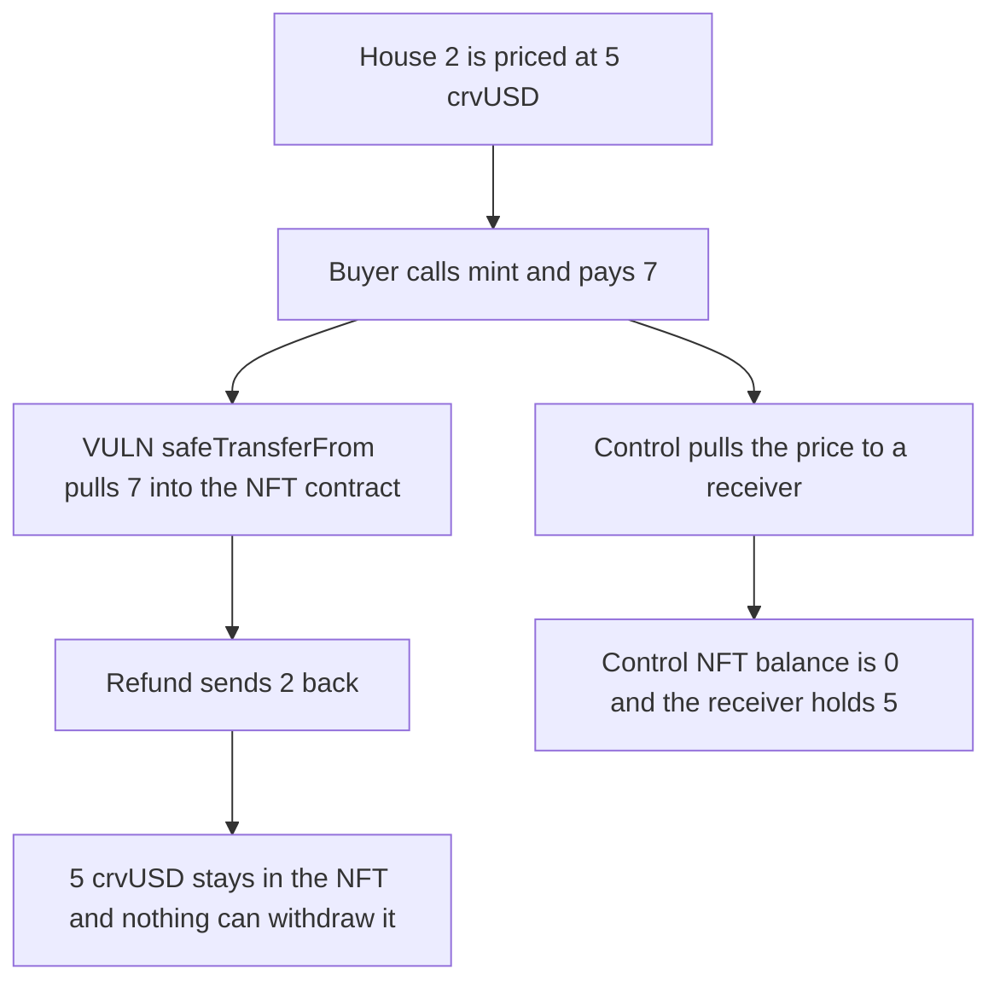

# RAAC: minting an NFT locks the 5 crvUSD price inside the NFT contract

> **Vulnerability classes:** vuln/dos/frozen-funds · vuln/logic/missing-check

<!-- non-defihacklabs -->
<!-- source-auditvault: https://github.com/Auditware/AuditVault/blob/main/findings/57155-raacnft-mint-function-receives-funds-to-addressthis-but-has.md -->
<!-- date: 2025-02 -->

## Key info

| Field | Value |
|---|---|
| **Loss** | 5 crvUSD of the mint price stays in RAACNFT. The buyer is refunded only the 2 crvUSD overpayment |
| **Vulnerable contract** | `RAACNFT.mint` |
| **Attacker EOA** | `0x1111111111111111111111111111111111111111` |
| **Attack contract** | `Exploit` |
| **Attack tx** | `Exploit.run()` |
| **Chain / block / date** | Ethereum model · block 0 · 2025-02 |
| **Compiler** | solc 0.8.27, cancun, via IR |
| **Bug class** | Payment is pulled to `address(this)` and nothing can withdraw it |

## TL;DR

`mint` reads the house price, pulls `_amount` into the NFT contract, mints the token, and refunds only `_amount - price`. The contract has no transfer, approve, or sweep. A buyer who pays 7 crvUSD for a 5 crvUSD house gets 2 back. The 5 price is stuck. Sending the price to a receiver instead leaves the NFT balance at 0 and the receiver holding 5.

## Background

CodeHawks contest `2025-02-raac` (3–24 February 2025). The report is "RAACNFT mint function receives funds to address(this) but has no way of withdrawing them" by newspacexyz. The included test logs `Locked crvUSD balance: 5000000000000000000`.

## The vulnerable code

```solidity
function mint(uint256 _tokenId, uint256 _amount) public {
    uint256 price = raac_hp.tokenToHousePrice(_tokenId);
    if (price == 0) revert RAACNFT__HousePrice();
    if (price > _amount) revert RAACNFT__InsufficientFundsMint();
    // @> VULN: mint price is pulled to address(this) and nothing in the contract can withdraw or forward it
    token.safeTransferFrom(msg.sender, address(this), _amount);
    _safeMint(msg.sender, _tokenId);
    if (_amount > price) {
        uint256 refundAmount = _amount - price;
        token.safeTransfer(msg.sender, refundAmount);
    }
    emit NFTMinted(msg.sender, _tokenId, price);
}
```

`IRAACNFT` exposes `mint`, batch and URI setters, and views. It does not expose a token withdrawal.

## Root cause

The price is taken as custody of the NFT contract, and the only outbound transfer in `mint` is the refund of the overpayment. After that line the price has no path out.

## Preconditions

- House 2 is priced at 5 crvUSD.
- The buyer approves and pays 7 crvUSD.
- No other function on the NFT can move the token.

## Attack walkthrough

1. The oracle sets token 2's price to 5 crvUSD.
2. The buyer approves 7 and calls `mint(2, 7)`.
3. `safeTransferFrom` pulls 7 into the NFT contract.
4. The NFT is minted to the buyer.
5. The refund is `7 - 5 = 2`. The buyer holds 2. The contract holds 5.
6. The control pulls `price` straight to a receiver. The NFT balance is 0, the receiver holds 5, and the buyer still holds the unused 2.

## Diagrams



## Impact

Every mint locks that house's price in the NFT contract. In this run the locked amount is 5 crvUSD. The buyer receives the NFT and only the 2 crvUSD they overpaid. The control forwards the 5 and holds nothing.

## Remediation

`safeTransferFrom` the `price` to a receiver, and stop pulling the surplus into the contract. That is the first diff in the report. An owner `approve` is the alternative if a pull payment is required.

## How to reproduce

```bash
cd 57155-raacnft-mint-function-receives-funds-to-addressthis-but-has_exp
forge test -vv
```

`test_exploit_mint_price_locks_5_crvusd_in_the_nft` asserts 5 locked and 2 refunded. `test_control_price_is_forwarded_and_the_nft_holds_zero` asserts the receiver holds 5 and the NFT holds 0. Captured output is `output.txt`.

## Sources

- AuditVault finding: https://github.com/Auditware/AuditVault/blob/main/findings/57155-raacnft-mint-function-receives-funds-to-addressthis-but-has.md
- CodeHawks contest: https://codehawks.cyfrin.io/c/2025-02-raac
