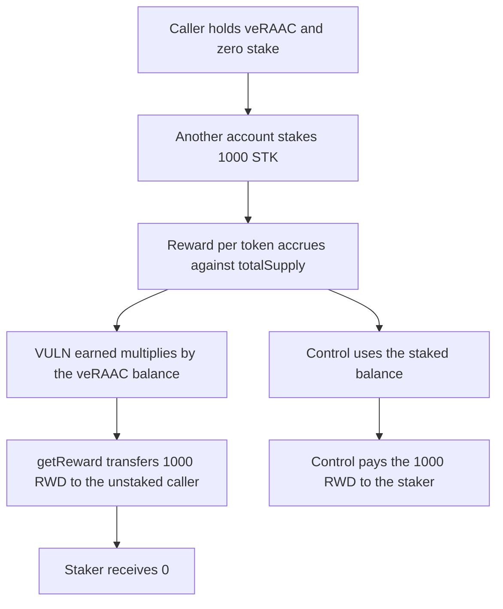

# RAAC BaseGauge: an unstaked veRAAC holder takes 1000 RWD

> **Vulnerability classes:** `vuln/logic/reward-calculation` · `vuln/logic/missing-check`

<!-- non-defihacklabs -->
<!-- source-auditvault: https://github.com/Auditware/AuditVault/blob/main/findings/57156-basegauge-users-can-claim-rewards-without-staking-codehawks.md -->
<!-- date: 2025-02 -->

## Key info

| Field | Value |
|---|---|
| **Loss** | 1000 RWD paid to an account whose staked balance is 0 |
| **Vulnerable contract** | `BaseGauge.earned` |
| **Attacker EOA** | `0x0dc632da5faaae489f4efa12c2f27963d12c0ef9` (the ve holder) |
| **Attack contract** | `Exploit` |
| **Attack tx** | `Exploit.run()` |
| **Chain / block / date** | Ethereum model · block 0 · 2025-02 |
| **Compiler** | solc 0.8.27, cancun, via IR |
| **Bug class** | Reward weight is the veRAAC balance, not the staked balance |

## TL;DR

`earned` multiplies `getUserWeight` by the reward-per-token delta. `getUserWeight` returns the veRAAC balance and does not look at `balances[account]`. A second account stakes 1000 STK, which is what makes rewards accrue. The caller holds 1000 veRAAC and 0 STK, previews 1000 RWD, and `getReward` transfers all of it. The staker receives 0. The control returns 0 when stake is 0 and pays the 1000 RWD to the staker.

## Background

CodeHawks contest 2025-02-raac, Core Contracts, reported by 0xswahili. The gauge is supposed to pay accounts that staked. The published `earned` body uses `getUserWeight`, and that weight is derived from `veToken.balanceOf`. The recommended fix returns 0 when `_balances[account]` is 0 and otherwise multiplies by the staked balance.

## The vulnerable code

```solidity
function earned(address account) public view virtual returns (uint256) {
    // @> VULN: weight is the veRAAC balance, so an account with zero stake is still paid
    return (getUserWeight(account) * (getRewardPerToken() - userStates[account].rewardPerTokenPaid) / 1e18)
        + userStates[account].rewards;
}
```

`getRewardPerToken` divides by `totalSupply`, the sum of staked balances. With `rewardRate` of 1000 RWD, one second, and 1000 STK staked, the per-token delta is 1e18. A ve balance of 1000 ether then earns 1000 RWD.

## Root cause

The paid weight and the balance that accrues the index are different variables. Stake creates the index. veRAAC collects it. `getReward` does not require a positive stake before it transfers.

## Preconditions

- Someone has staked, so `totalSupply` is not zero and `rewardPerToken` moves.
- The caller holds veRAAC and has never staked.
- The gauge holds the reward tokens it is about to pay.

## Attack walkthrough

1. The caller starts with 1000 veRAAC and a stake of 0.
2. A staker deposits 1000 STK. `totalSupply` becomes 1000 STK.
3. `earned` for the caller returns 1000 RWD.
4. `getReward` transfers 1000 RWD to the caller. The gauge balance is 0.
5. The staker's reward balance is still 0, and their 1000 STK is still staked.
6. The control pays 0 to a zero-stake ve holder and 1000 RWD to the staker.

## Diagrams



## Impact

The account that supplied the stake loses the reward that accrued against it. Any veRAAC holder can repeat the claim whenever `totalSupply` is non-zero. In this run the whole 1000 RWD moves in one call.

## Remediation

Return 0 from `earned` when the staked balance is 0, and multiply by `balances[account]` instead of `getUserWeight(account)`.

## How to reproduce

```bash
cd 57156-basegauge-users-can-claim-rewards-without-staking-codehawks_exp
forge test -vv
```

`test_exploit_unstaked_ve_holder_takes_rewards` asserts the caller receives 1000 RWD with a stake of 0. `test_control_zero_stake_earns_zero_and_staker_is_paid` asserts the non-staker receives 0 and the staker receives 1000 RWD. Captured output is `output.txt`.

## Sources

- AuditVault finding: https://github.com/Auditware/AuditVault/blob/main/findings/57156-basegauge-users-can-claim-rewards-without-staking-codehawks.md
- CodeHawks submission: https://codehawks.cyfrin.io/c/2025-02-raac/s/3134
