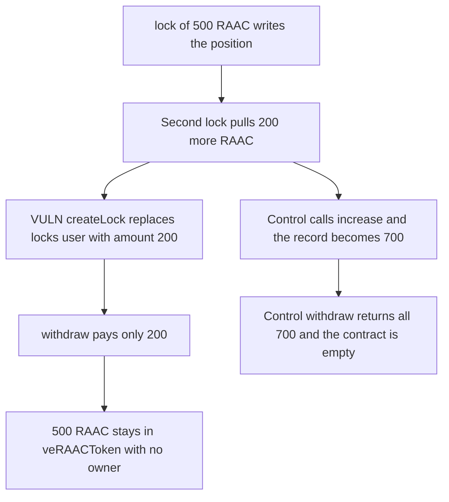

# veRAACToken: a second lock() overwrites the position and strands 500 RAAC

> **Vulnerability classes:** vuln/logic/missing-check · vuln/dos/frozen-funds

<!-- non-defihacklabs -->
<!-- source-auditvault: https://github.com/Auditware/AuditVault/blob/main/findings/57158-users-can-overwrite-existing-locks-in-veraactoken-resulting.md -->
<!-- date: 2025-02 -->

## Key info

| Field | Value |
|---|---|
| **Loss** | 500 RAAC left in veRAACToken with no lock record. withdraw() returns only the second deposit of 200 RAAC |
| **Vulnerable contract** | `LockManager.createLock` |
| **Attacker EOA** | `0x1111111111111111111111111111111111111111` (the locker) |
| **Attack contract** | `Exploit` |
| **Attack tx** | `Exploit.run()` |
| **Chain / block / date** | Ethereum model · block 0 · 2025-02 |
| **Compiler** | solc 0.8.27, cancun, via IR |
| **Bug class** | createLock replaces `locks[user]` and never returns the tokens already held |

## TL;DR

`veRAACToken.lock()` pulls RAAC and calls `LockManager.createLock`, which assigns `locks[user]` with no read of an existing position. A second `lock(200)` replaces a `lock(500)`. `withdraw()` pays the recorded 200. The first 500 stays in the contract, `totalLocked` still counts it, and no account can claim it. `increase()` adds to the existing amount and the same user withdraws all 700.

## Background

Codehawks' February 2025 RAAC contest, reported by newspacexyz. Users lock RAAC for veRAAC voting power. The intended way to add tokens is `increase()`. `lock()` is supposed to create a position, and the report shows Alice locking 500 then 200 and receiving only 200 back after maturity. The synthetic uses duration 0 so the mature withdraw happens in the same transaction. The lost amount does not depend on the duration.

## The vulnerable code

```solidity
end = block.timestamp + duration;
// @> VULN: createLock overwrites locks[user] and never returns the RAAC already locked
locks[user] = Lock({amount: amount, end: end, exists: true});
totalLocked += amount;
```

The recommended check refuses a second active lock and tells the user to call `increase()` or `extend()`.

## Root cause

`createLock` is an unconditional write. The previous `amount` is not subtracted from `totalLocked` and is not returned. After the overwrite the contract's RAAC balance is the sum of both deposits, and the user's record is only the latest one.

## Preconditions

- The locker holds 1000 RAAC and has approved veRAACToken.
- The first call is `lock(500)`, the second is `lock(200)`.
- Duration is 0, so `end == block.timestamp` and `withdraw()` is allowed in this transaction.

## Attack walkthrough

1. `lock(500)` pulls 500 RAAC and writes a lock of 500. `totalLocked` becomes 500.
2. `lock(200)` pulls another 200 and replaces the record with amount 200. The contract now holds 700.
3. `withdraw()` reads the record, clears it, and transfers 200.
4. The locker holds 500 RAAC (300 never locked, plus the 200 returned). veRAACToken still holds 500, and `totalLocked` is 500 with no live lock.
5. The control calls `increase(200)` instead. The record becomes 700 and `withdraw()` returns all of it.

## Diagrams



## Impact

The locker permanently loses 500 RAAC. The tokens sit in veRAACToken, `totalLocked` still includes them, and `withdraw()` will not pay them because the lock record was cleared after paying 200. The control path returns the full 700.

## Remediation

Reject `lock()` when `locks[user].exists` and the lock has not ended. Additions go through `increase()`, which adds to `amount` instead of replacing it.

## How to reproduce

```bash
cd 57158-users-can-overwrite-existing-locks-in-veraactoken-resulting_exp
forge test -vv
```

`test_exploit_second_lock_strands_500_raac` asserts a 500 RAAC balance on veRAACToken and a 200 RAAC refund. `test_control_increase_withdraws_700_raac` asserts the user receives 1000 back and the contract is empty. Captured output is `output.txt`.

## Sources

- AuditVault finding: https://github.com/Auditware/AuditVault/blob/main/findings/57158-users-can-overwrite-existing-locks-in-veraactoken-resulting.md
- Contest tree: https://github.com/Cyfrin/2025-02-raac
