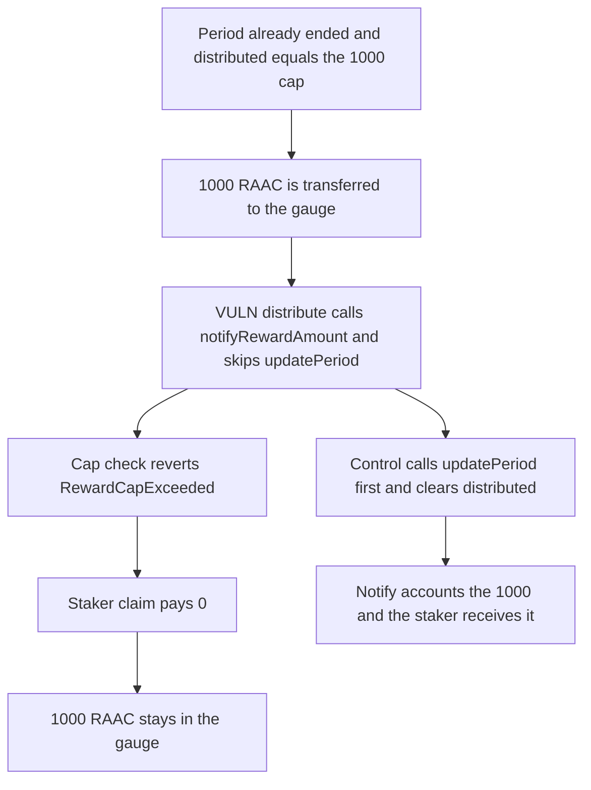

# RAAC gauge: distribute() never calls updatePeriod, so 1000 RAAC stays unclaimable

> **Vulnerability classes:** vuln/logic/state-update · vuln/dos/frozen-funds

<!-- non-defihacklabs -->
<!-- source-auditvault: https://github.com/Auditware/AuditVault/blob/main/findings/57160-gauge-period-cannot-be-updated-codehawks-regnum-aurum-acquis.md -->
<!-- date: 2025-02 -->

## Key info

| Field | Value |
|---|---|
| **Loss** | 1000 RAAC stuck in the gauge. The staker's claim returns 0 |
| **Vulnerable contract** | `GaugeController.distribute` |
| **Attacker EOA** | `0x1111111111111111111111111111111111111111` (the controller caller) |
| **Attack contract** | `Exploit` |
| **Attack tx** | `Exploit.run()` |
| **Chain / block / date** | Ethereum model · block 0 · 2025-02 |
| **Compiler** | solc 0.8.27, cancun, via IR |
| **Bug class** | `notifyRewardAmount` runs without `updatePeriod`, so an expired period still fills the emission cap |

## TL;DR

`BaseGauge.updatePeriod` is `onlyController`, and `GaugeController` never calls it. `notifyRewardAmount` still rejects `distributed + amount` above the emission cap. The stored period has already ended (`periodFinish` is 1 and `distributed` equals the 1000 cap). The next 1000 RAAC is sent to the gauge, `distribute` reverts with `RewardCapExceeded`, and the staker's claim pays 0. Calling `updatePeriod` first clears `distributed` because `block.timestamp` is past `periodFinish`, and the same 1000 is then paid to the staker.

## Background

Codehawks' February 2025 RAAC contest, reported by 0xb0k0. `BaseGauge.updatePeriod` rolls the period and the emission cap. The report's test funds the gauge, notifies one emission, warps past the period, and shows the next `notifyRewardAmount` reverting with `RewardCapExceeded`. This run starts from that expired state so the failure is visible in one transaction, without `vm.warp`.

## The vulnerable code

```solidity
function distribute(uint256 amount) external {
    // @> VULN: GaugeController never calls updatePeriod, so an expired period still consumes the emission cap
    gauge.notifyRewardAmount(amount);
}
```

The cap check that reverts:

```solidity
if (distributed + amount > emissionCap) revert RewardCapExceeded();
```

## Root cause

The period roll is a separate `onlyController` function, and the only controller entry point that notifies rewards does not call it. After one period of emissions, `distributed` stays at the cap forever. Further notifies revert. Tokens already transferred to the gauge are not accounted, so `claim` pays nothing.

## Preconditions

- `emissionCap` and `distributed` are 1000 RAAC. `periodFinish` is 1, which is before the block timestamp.
- A staker has a non-zero stake.
- The next 1000 RAAC is transferred to the gauge, then `distribute(1000)` is called.

## Attack walkthrough

1. 1000 RAAC is minted and transferred to the gauge.
2. `distribute(1000)` calls `notifyRewardAmount` and does not call `updatePeriod`.
3. `distributed + 1000` is 2000, above the cap. The notify reverts.
4. `claim` computes `accounted - paid`. `accounted` is still 0, so the staker receives 0.
5. The gauge balance is 1000. The control calls `updatePeriod`, which sees the expired period and sets `distributed` to 0, then notifies and the staker receives 1000.

## Diagrams



## Impact

The staker is owed a period of rewards and receives 0. The 1000 RAAC sits in the gauge with `accounted == 0`, so no claim can move it. Every later notify of a full emission reverts the same way. The control empties the gauge into the staker.

## Remediation

Call `gauge.updatePeriod()` from the controller before `notifyRewardAmount`. `updatePeriod` already resets `distributed` when `block.timestamp >= periodFinish`.

## How to reproduce

```bash
cd 57160-gauge-period-cannot-be-updated-codehawks-regnum-aurum-acquis_exp
forge test -vv
```

`test_exploit_expired_period_sticks_1000_rewards` asserts the notify reverts, the claim is 0, and the gauge holds 1000. `test_control_update_period_pays_staker_1000` asserts the staker receives 1000 and the gauge is empty. Captured output is `output.txt`.

## Sources

- AuditVault finding: https://github.com/Auditware/AuditVault/blob/main/findings/57160-gauge-period-cannot-be-updated-codehawks-regnum-aurum-acquis.md
- `BaseGauge.updatePeriod`: https://github.com/Cyfrin/2025-02-raac/blob/89ccb062e2b175374d40d824263a4c0b601bcb7f/contracts/core/governance/gauges/BaseGauge.sol#L452
