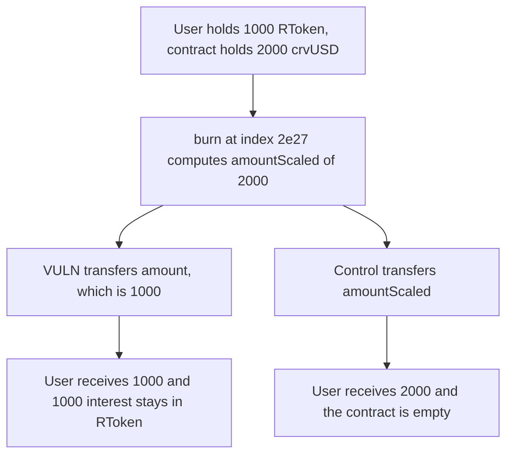

# RAAC RToken burn pays 1000 principal and leaves 1000 of interest in the contract

> **Vulnerability classes:** vuln/logic/reward-calculation · vuln/logic/missing-check

<!-- non-defihacklabs -->
<!-- source-auditvault: https://github.com/Auditware/AuditVault/blob/main/findings/57190-rtoken-is-not-interest-bearing-due-to-broken-liquidity-index.md -->
<!-- date: 2025-02 -->

## Key info

| Field | Value |
|---|---|
| **Loss** | 1000 crvUSD of interest not paid. `amountScaled` is 2000. The user receives 1000 and 1000 stays in RToken |
| **Vulnerable contract** | `RToken.burn` |
| **Attacker EOA** | `0x1111111111111111111111111111111111111111` |
| **Attack contract** | `Exploit` at `0x15452ec016c4dc8c549e7fe6ff4b26324ea8b7a4` |
| **Attack tx** | `Exploit.run()` |
| **Chain / block / date** | Ethereum model · block 0 · 2025-02 |
| **Compiler** | solc 0.8.27, cancun, via IR |
| **Bug class** | `burn` computes `amount.rayMul(index)` and then transfers `amount` |

## TL;DR

At liquidity index `2e27`, burning 1000 RToken should pay `rayMul(1000e18, 2e27) = 2000e18` of the underlying. `burn` stores that scaled value and then burns and transfers the unscaled 1000. The depositor gets their principal back. The 1000 of interest that the contract holds is not sent. `RTokenFixed` transfers `amountScaled` and the contract ends empty.

## Background

Codehawks contest on RAAC core contracts, 3 to 24 February 2025, reported by vs_ and others. `RToken.burn` is the exit from the lending pool. The function calculates `amountScaled = amount.rayMul(index)` and never passes it to `_burn` or to the underlying transfer. The Codehawks PoC withdrew a deposit after time passed and got exactly the deposited amount back.

## The vulnerable code

```solidity
uint256 amountScaled = rayMul(amount, index);
amountScaledSeen = amountScaled;
userIndex[from] = index;
_burn(from, amount);
if (receiverOfUnderlying != address(this)) {
    // @> VULN: the underlying paid is `amount`, not `amountScaled`, so accrued interest is not transferred
    asset.transfer(receiverOfUnderlying, amount);
}
```

`rayMul` is `(a * b + RAY / 2) / RAY` with `RAY = 1e27`. For 1000 ether and index `2e27` the result is exactly 2000 ether. The transfer uses `amount`, which was capped to the RToken balance of 1000 ether.

`RTokenFixed.burn` transfers `amountScaled`. The user receives 2000 and the contract balance is 0.

## Root cause

The interest-bearing conversion is computed and then discarded. Both the burn amount and the underlying payout use the pre-index figure. A depositor cannot receive the index growth that the pool has already accounted as assets.

## Preconditions

- The user holds 1000 RToken, minted 1:1 with the original deposit.
- The contract holds 2000 crvUSD, the principal plus interest at index 2.
- `burn` is invoked with `amount = 1000 ether` and `index = 2e27`. The lending pool is the intended caller. The shortfall is in `burn`, not in who may call it.

## Attack walkthrough

1. `burn` is called for 1000 RToken at index `2e27`.
2. `amountScaled` is 2000 and is stored in `amountScaledSeen`.
3. `_burn` destroys 1000 RToken.
4. `asset.transfer` sends 1000 crvUSD to the user.
5. The contract still holds 1000 crvUSD.
6. The fixed burn sends 2000 and leaves a 0 balance.

## Diagrams



## Impact

The depositor is paid 1000 of the 2000 the index says they are owed. 1000 crvUSD of accrued interest remains in the RToken contract and is not withdrawable through `burn`. The fixed transfer pays the full 2000.

## Remediation

Pass `amountScaled` to the underlying transfer, and burn the scaled RToken amount the interest model expects. Drop the unused `amountScaled` local only if the transfer uses it. `RTokenFixed` pays `amountScaled`.

## How to reproduce

```bash
cd 57190-rtoken-is-not-interest-bearing-due-to-broken-liquidity-index_exp
forge test -vv
```

`test_exploit_burn_pays_principal_and_strands_interest` asserts scaled 2000, paid 1000, and 1000 left in the contract. `test_control_burn_pays_the_scaled_amount` asserts the user receives 2000 and the contract is empty. Captured output is `output.txt`.

## Sources

- AuditVault finding: https://github.com/Auditware/AuditVault/blob/main/findings/57190-rtoken-is-not-interest-bearing-due-to-broken-liquidity-index.md
- Codehawks contest: https://codehawks.cyfrin.io/c/2025-02-raac
